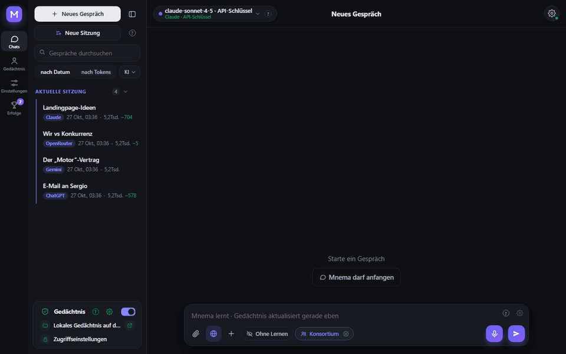
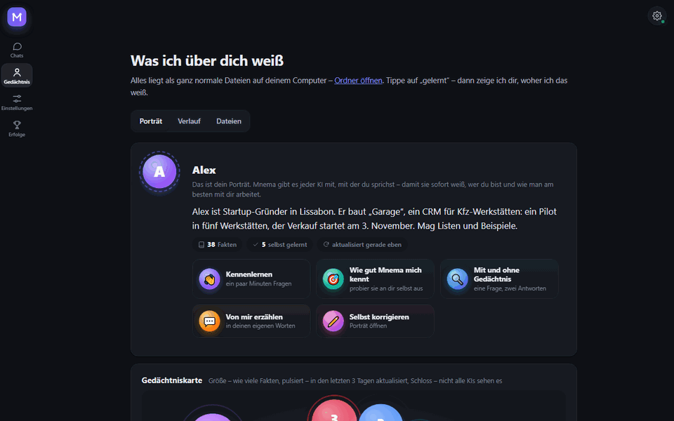
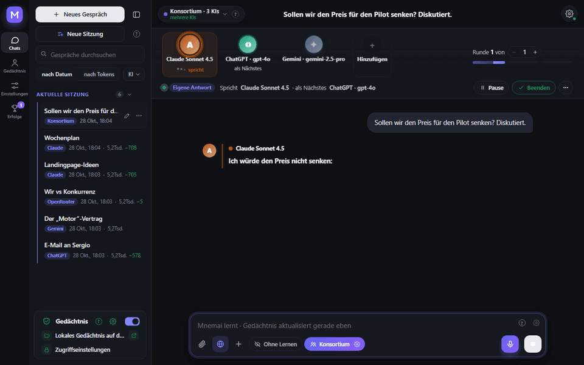
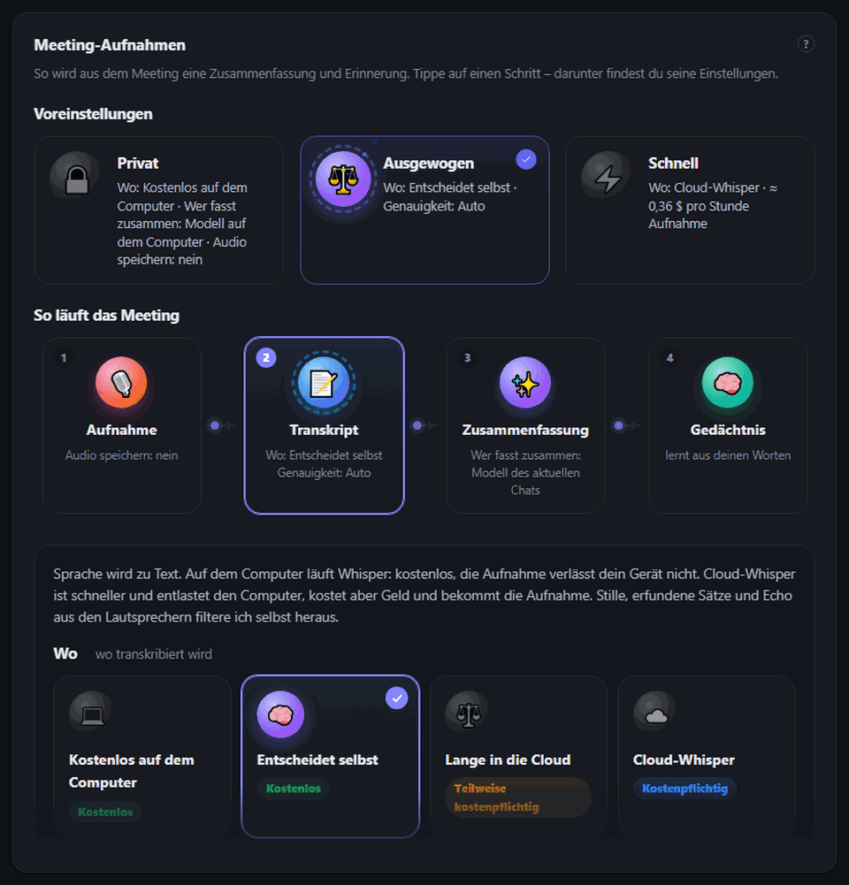
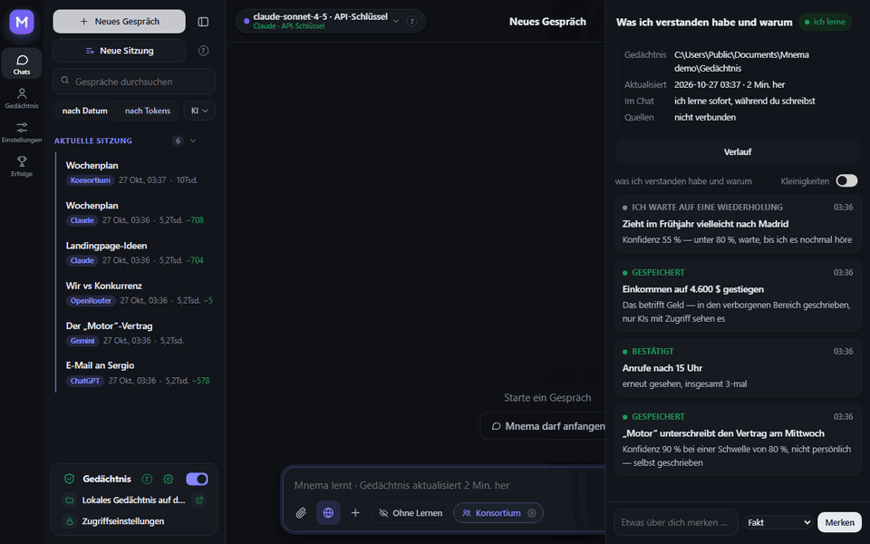
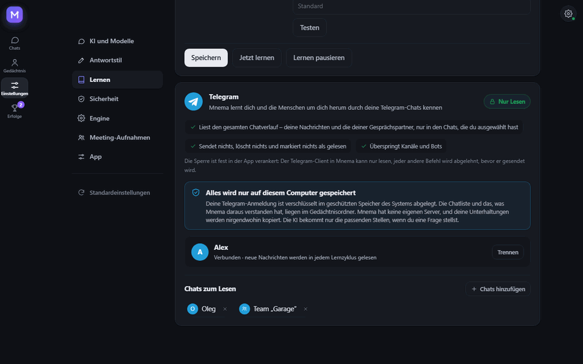
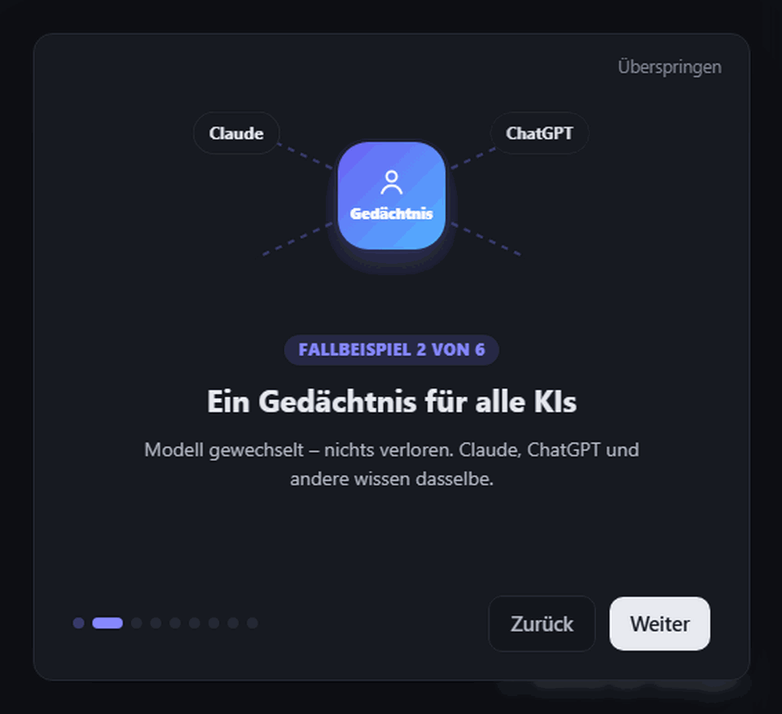
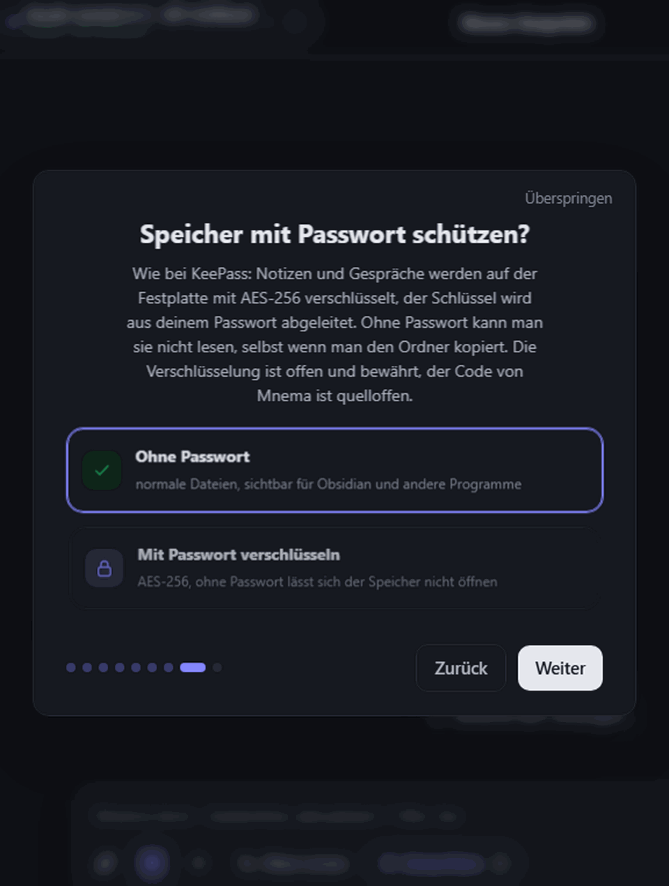
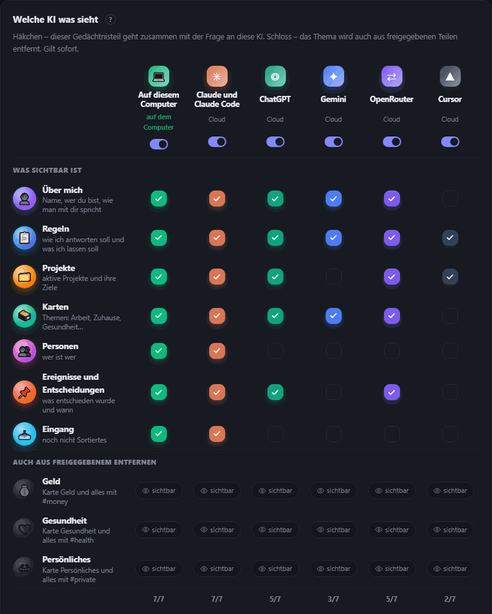

<div align="center">


# Mnemai


<a href="https://github.com/Pumpetee/Mnemai/releases/latest"></a> <a href="https://github.com/Pumpetee/Mnemai/actions/workflows/tests.yml"></a> <a href="LICENSE"></a> <a href="https://github.com/Pumpetee/Mnemai/commits/main"></a>

     

<a href="docs/guide/de.md"></a>

<a href="https://github.com/Pumpetee/Mnemai"></a><br><sub>Scannen, um das Repository zu öffnen · github.com/Pumpetee/Mnemai</sub>

</div>

## Sprachen

Mnemai spricht neun Sprachen. Oberfläche, Hilfe und die Antworten der KI richten sich nach der Sprache, die du auswählst – auch wenn du in einer anderen schreibst. Diese README und die Mnemai-Anleitung gibt es in jeder davon.

<table>
<tr><td align="center" width="10%"><br><b>English</b><br><sub><a href="README.md">README</a> · <a href="docs/guide/en.md">Guide</a></sub></td><td align="center" width="10%"><br><b>Русский</b><br><sub><a href="README.ru.md">README</a> · <a href="docs/guide/ru.md">Справочник</a></sub></td><td align="center" width="10%"><br><b>中文</b><br><sub><a href="README.zh.md">README</a> · <a href="docs/guide/zh.md">指南</a></sub></td><td align="center" width="10%"><br><b>Español</b><br><sub><a href="README.es.md">README</a> · <a href="docs/guide/es.md">Guía</a></sub></td><td align="center" width="10%"><br><b>हिन्दी</b><br><sub><a href="README.hi.md">README</a> · <a href="docs/guide/hi.md">गाइड</a></sub></td></tr>
<tr><td align="center" width="10%"><br><b>Português</b><br><sub><a href="README.pt.md">README</a> · <a href="docs/guide/pt.md">Guia</a></sub></td><td align="center" width="10%"><br><b>Français</b><br><sub><a href="README.fr.md">README</a> · <a href="docs/guide/fr.md">Guide</a></sub></td><td align="center" width="10%"><br><b>✓ Deutsch</b><br><sub><a href="README.de.md">README</a> · <a href="docs/guide/de.md">Handbuch</a></sub></td><td align="center" width="10%"><br><b>日本語</b><br><sub><a href="README.ja.md">README</a> · <a href="docs/guide/ja.md">ガイド</a></sub></td></tr>
</table>

<div align="center">

Mnemai merkt sich, wer du bist, woran du arbeitest, was du entschieden hast und wie du Antworten magst – und jede KI, mit der du sprichst, bekommt diesen Kontext. Das Gedächtnis ist ein Ordner mit einfachen Markdown-Dateien auf deinem Rechner. Keine Cloud, kein Konto.

<a href="../../releases/latest/download/Mnemai-Setup.exe"></a> <a href="../../releases/latest/download/Mnemai-macos-arm64.dmg"></a> <a href="../../releases/latest/download/Mnemai-x86_64.AppImage"></a>

<sub><a href="../../releases">alle Dateien</a> · macOS Intel: <a href="../../releases/latest/download/Mnemai-macos-x64.dmg">x64.dmg</a></sub>



<sub>Du fragst «Was ist diese Woche wichtig?» – der Plan kommt als Tabelle, mit dem vereinbarten Preis und deiner Regel für Meetings. Du musstest sie nie erneut eintippen.</sub>

</div>

## ✨ Was Mnemai kann

<table>
<tr>
<td width="33%" valign="top"><h3>🧠 Kennt dich</h3>Ein Porträt, das jede KI zuerst liest, eine lebendige Gedächtniskarte, einfache Dateien, die dir gehören.</td>
<td width="33%" valign="top"><h3>🗣️ Konsortium</h3>Claude, ChatGPT und Gemini diskutieren und einigen sich auf eine Antwort.</td>
<td width="33%" valign="top"><h3>🎙️ Meetings</h3>Aus einem Anruf werden ein Transkript, eine Zusammenfassung und Aufgaben mit Verantwortlichen.</td>
</tr>
<tr>
<td width="33%" valign="top"><h3>🔐 Privat</h3>Ein Passwort auf dem Gedächtnis wie bei KeePass. Geheimnisse erreichen nie die Cloud.</td>
<td width="33%" valign="top"><h3>💻 Offline</h3>13 kostenlose Modelle laufen auf deinem Rechner, ganz ohne Schlüssel.</td>
<td width="33%" valign="top"><h3>📉 Weniger Tokens</h3>Nur das Wichtige geht ans Modell: 4,8× weniger Tokens bei einem langen Vertrag.</td>
</tr>
</table>

## 🧠 Es kennt dich

<p align="center"></p>

- **Ein Porträt, das jede KI zuerst liest:** wer du bist, was du aufbaust, wie du gern arbeitest. Mnemai schreibt es beim Lernen fort, du kannst es von Hand korrigieren.
- **Eine Gedächtniskarte:** Jedes Thema ist eine Blase, ein Pulsieren heißt, dass es sich kürzlich geändert hat, ein Schloss bedeutet, dass manche KIs es nicht sehen.
- **Alte Fakten gelten nicht als neu:** Jeder Fakt trägt sein Datum, und bei einem Status, der älter als einen Monat ist, fragt Mnemai noch einmal nach.
- **Mehr als ein Ordner:** Verbinde einen Obsidian-Vault oder einen Team-Ordner – nur lesend, das Programm selbst verhindert dort jedes Schreiben.

## 🗣️ Konsortium: mehrere KIs, eine Antwort

<p align="center"></p>

- **Rat, Debatte, Brainstorming, Red Team, Roast** – wähle das Format und die Anzahl der Runden.
- **Greif jederzeit ein:** «Stopp» unterbricht die aktuelle KI und behält, was sie gesagt hat.
- **Streite mit verschiedenen KIs** unter jeder Antwort: Ihr Autor verteidigt sie, die anderen suchen, wo sie falsch ist.

## 🎙️ Meetings: vom Anruf zu Aufgaben

<p align="center"></p>

- **Zwei Spuren:** dein Mikrofon und der Ton des Computers, damit das Transkript weiß, wer gesprochen hat.
- **Whisper kostenlos auf deinem Rechner** oder das Cloud-Whisper (≈ 0,36 $ pro Stunde) – Stille, erfundene Sätze und Echo werden herausgeschnitten.
- **Die Zusammenfassung:** was entschieden wurde, die Aufgaben und wer sie übernimmt, von jedem Modell deiner Wahl, auch einem lokalen.
- **Voreinstellungen:** Privat, Ausgewogen und Schnell legen den ganzen Ablauf auf einmal fest.

## 🌱 Es lernt von selbst

<p align="center"></p>

- **Sicher heißt gespeichert:** Ein Fakt, dessen es sich sicher ist (80 % oder mehr), wird sofort geschrieben, ein zweifelhafter wartet, bis er noch einmal auftaucht.
- **Persönliches kommt getrennt:** Geld, Gesundheit und Privates landen in markierten Karten, die du vor jeder KI verbergen kannst.
- **Nichts bleibt vor dir verborgen:** Der Feed «Was ich verstanden habe und warum» zeigt jede Entscheidung mit ihrer Begründung.

## ✈️ Liest Telegram, schreibt dort nie

<p align="center"></p>

- **Du wählst die Chats:** Mnemai lernt nur aus diesen etwas über dich und die Menschen um dich herum.
- **Nur lesend, by Design:** Der Telegram-Client in Mnemai kann ausschließlich lesen; jeder andere Befehl wird abgelehnt, bevor er gesendet wird.
- **Bleibt auf deinem Rechner:** Die Anmeldung wird im Speicher des Systems verschlüsselt abgelegt, und Mnemai hat keine eigenen Server.

## 📉 Spart Tokens

<p align="center"></p>

- **Nur das Wichtige geht raus:** Gedächtnis, Dokumente und Webseiten werden auf deinem Rechner gelesen, und das Modell bekommt die relevanten Teile.
- **Gemessen:** Bei einer Frage zu einem Vertrag mit 153.000 Zeichen brauchte der ganze Text 29.643 Eingabe-Tokens; Mnemai schickte 6.159, und nur die Antwort mit Mnemai war richtig.
- **Jedes Mal sichtbar:** Unter jeder Antwort siehst du, wie viele Tokens gespart wurden.

## 🔐 Privat von Grund auf

<table><tr><td width="50%" valign="top" align="center"><br><sub>Erster Start: ein Passwort auf dem Gedächtnis, wie bei KeePass</sub></td><td width="50%" valign="top" align="center"><br><sub>Wer was sieht: ein Häkchen pro Gedächtnisteil, ein Schloss pro Thema</sub></td></tr></table>

- **Ein Passwort auf dem Gedächtnis:** AES-256, der Schlüssel entsteht aus deinem Passwort, quelloffene Kryptografie. Ohne es sind die Notizen nicht lesbar, selbst wenn sie von der Festplatte kopiert werden. Auch eine synchronisierte Kopie bleibt verschlüsselt.
- **Geheimnisse bleiben bei dir:** Kartennummern, Passwörter, Schlüssel und Telefonnummern werden zu Platzhaltern, bevor irgendetwas an ein Cloud-Modell geht.
- **Jede KI hat ihren eigenen Zugriff:** Geld, Gesundheit und private Themen verbirgst du mit einem Klick vor jeder von ihnen.

## 🤖 Funktioniert mit

<div align="center">
<table><tr><td valign="middle" width="150"><b>Cloud-KI</b><br><sub>per Schlüssel oder Abo</sub></td><td align="center" width="92"><br><sub><b>Claude</b></sub></td><td align="center" width="92"><br><sub><b>ChatGPT</b></sub></td><td align="center" width="92"><br><sub><b>Gemini</b></sub></td><td align="center" width="92"><br><sub><b>DeepSeek</b></sub></td><td align="center" width="92"><br><sub><b>YandexGPT</b></sub></td><td align="center" width="92"><br><sub><b>OpenRouter</b></sub></td></tr><tr><td valign="middle" width="150"><b>Auf deinem Rechner</b><br><sub>kostenlos, offline</sub></td><td align="center" width="92"><br><sub><b>Integriert</b></sub></td><td align="center" width="92"><br><sub><b>Ollama</b></sub></td><td align="center" width="92"><br><sub><b>Strata</b></sub></td><td></td><td></td><td></td></tr><tr><td valign="middle" width="150"><b>In deinen Tools</b><br><sub>über MCP</sub></td><td align="center" width="92"><br><sub><b>Claude Code</b></sub></td><td align="center" width="92"><br><sub><b>Cursor</b></sub></td><td></td><td></td><td></td><td></td></tr><tr><td valign="middle" width="150"><b>Systeme</b><br><sub>eine App</sub></td><td align="center" width="92"><br><sub><b>Windows</b></sub></td><td align="center" width="92"><br><sub><b>macOS</b></sub></td><td align="center" width="92"><br><sub><b>Linux</b></sub></td><td></td><td></td><td></td></tr></table>
</div>

## ⚡ Und mehr

- **Arbeitet mit deinen Dateien.** Liest Scans, schreibt Notizen, erstellt PDF, Word und Excel, fügt PDFs zusammen und teilt sie. Jede Schreibaktion lässt sich unter Gedächtnis → Verlauf rückgängig machen.
- **Neun Sprachen.** Oberfläche und KI-Antworten richten sich nach der Sprache, die du auswählst – auch wenn du in einer anderen schreibst.

<details>
<summary><b>Installation</b></summary>

Lade die Datei für dein System herunter (alle Versionen mit ihrer Nummer findest du unter [Releases](../../releases)):

| System | Datei | Vorgehen |
|---|---|---|
| Windows 10 und 11 | [`Mnemai-Setup.exe`](../../releases/latest/download/Mnemai-Setup.exe) | Ausführen. Es sind keine Administratorrechte nötig. Eine portable `.zip` gibt es ebenfalls. |
| macOS 11 und neuer | Apple Silicon: [`Mnemai-macos-arm64.dmg`](../../releases/latest/download/Mnemai-macos-arm64.dmg), Intel: [`Mnemai-macos-x64.dmg`](../../releases/latest/download/Mnemai-macos-x64.dmg) | Öffnen und Mnemai in den Ordner „Programme“ ziehen. |
| Linux x86-64 (Ubuntu 22.04 und neuer, Fedora, Debian …) | [`Mnemai-x86_64.AppImage`](../../releases/latest/download/Mnemai-x86_64.AppImage) | `chmod +x Mnemai-*.AppImage` und ausführen. Dasselbe Programm als Ordner: `.tar.gz`, darin `Mnemai` ausführen. |

Die Pakete sind noch nicht codesigniert, daher warnt jedes System einmalig:

- **Windows** SmartScreen meldet „Der Computer wurde durch Windows geschützt“. Klicke auf **Weitere Informationen → Trotzdem ausführen**.
- **macOS** meldet, dass der Entwickler nicht überprüft werden kann. Klicke in „Programme“ mit der rechten Maustaste auf Mnemai → **Öffnen**, oder öffne Systemeinstellungen → Datenschutz & Sicherheit → **Trotzdem öffnen**.
- **Linux** Das AppImage benötigt FUSE 2: `sudo apt install libfuse2` (unter Ubuntu 24.04: `libfuse2t64`). Oder verwende die `.tar.gz`.

Um eine Datei zu überprüfen, vergleiche ihren sha256-Wert mit der daneben liegenden `.sha256`-Datei: `certutil -hashfile <file> SHA256` unter Windows, `shasum -a 256 <file>` unter macOS, `sha256sum <file>` unter Linux.

</details>

<details>
<summary><b>Aus dem Quellcode bauen</b></summary>

Windows:

```powershell
python -m venv .venv
.venv\Scripts\pip install -r requirements-dev.txt
.venv\Scripts\python tools\fetch_vendor.py      # llama.cpp, Xray, WebView2 from their official releases, verified
.venv\Scripts\python -m mnema.desktop           # run the program
.venv\Scripts\python tools\package.py           # dist\Mnemai-Setup-<version>.exe and the portable zip
```

macOS und Linux:

```bash
python3 -m venv .venv
.venv/bin/pip install -r requirements-dev.txt
.venv/bin/python tools/fetch_vendor.py           # llama.cpp and Xray for this system, verified by sha256
.venv/bin/python -m mnema.desktop                # run the program
.venv/bin/python tools/package.py                # macOS: dist/Mnemai-<version>-macos-arm64.dmg
                                                 # Linux: dist/Mnemai-<version>-x86_64.AppImage and .tar.gz
```

Jeder Push wird unter Windows, macOS und Linux getestet; die drei Pakete werden gebaut, einmal mit ihrem Fenster gestartet und als Dateien des Laufs aufbewahrt (`.github/workflows`).

Der Kern benötigt nur die Python-Standardbibliothek. Er umfasst den Vault, die Zugriffsregeln, das Journal, den MCP-Server und die Kommandozeile:

```bash
python -m mnema init ~/mnema --default
python -m mnema serve                    # http://127.0.0.1:7461
python -m mnema install claude-code      # shows the plan; add --apply

</details>

<details>
<summary><b>Wie es aufgebaut ist</b></summary>

Siehe [docs/ARCHITECTURE.md](docs/ARCHITECTURE.md). Kurz gesagt:

| Teil | Wo |
|---|---|
| Tresor (Vault): Ordner, Fakten, Abschnitte mit versteckten Tags | `mnema/vault.py`, `mnema/memory.py` |
| Zugriffsregeln pro KI | `mnema/clients.py` |
| Journal und Rückgängig-Funktion | `mnema/journal.py` |
| MCP-Server, Kommandozeile | `mnema/mcp_server.py`, `mnema/cli.py` |
| Lokale API und das Fenster | `mnema/api*.py`, `mnema/desktop.py` |
| Oberfläche | `mnema/ui/index.html`, `mnema/ui/css/app.css`, `mnema/ui/js/NN-*.js` (der Reihe nach geladen) |
| Chat mit jedem Modell, Konsortium, Aktionen mit Dateien | `mnema/chat/` |
| Lernen: Quellen, Gehirne, Entscheidungen | `mnema/learn/` |
| Was den Computer verlässt | `mnema/outgoing.py` |
| Was sich zwischen Windows, macOS und Linux unterscheidet | `mnema/osapi.py` |
| Verschlüsselung des Gedächtnisses per Passwort | `mnema/crypt.py` |
| Text aus Scans und Bildern | `mnema/ocr.py` |
| Wissensbasis, aus der der Assistent antwortet | `mnema/knowledge/mnema.md` |

</details>

<details>
<summary><b>Sicherheit</b></summary>

Die lokale API lauscht ausschließlich auf 127.0.0.1, prüft den Host-Header und erfordert ein Token. Seiten per Link und VPN-Abonnements werden nur aus dem Internet geöffnet, niemals von diesem Computer oder aus dem lokalen Netzwerk. Schlüssel und Passwörter liegen im Geheimnisspeicher des Systems (DPAPI unter Windows, die Keychain unter macOS, der Secret Service unter Linux, sofern vorhanden), niemals im Memory-Ordner. Das Gedächtnis selbst kann mit einem Passwort verschlüsselt werden (AES-256-GCM, der Schlüssel durch scrypt geschützt); die Synchronisierung eines verschlüsselten Gedächtnisses sendet nur verschlüsselte Dateien. Jede Anfrage an ein Cloud-Modell wird protokolliert, einschließlich dessen, was gesendet und was verborgen wurde. Sicherheitslücken bitte vertraulich an den Autor melden.

</details>

## Lizenz

AGPL-3.0. Kostenlos für den persönlichen Gebrauch und für Open-Source-Projekte. Eine kommerzielle Lizenz und die Team-Edition sind beim Autor erhältlich.

© 2026 Anton Sannikov

<div align="center">


<sub>Wenn Mnemai sich etwas Nützliches für dich merkt, hilft ein ⭐ anderen, es zu finden.</sub>
</div>
