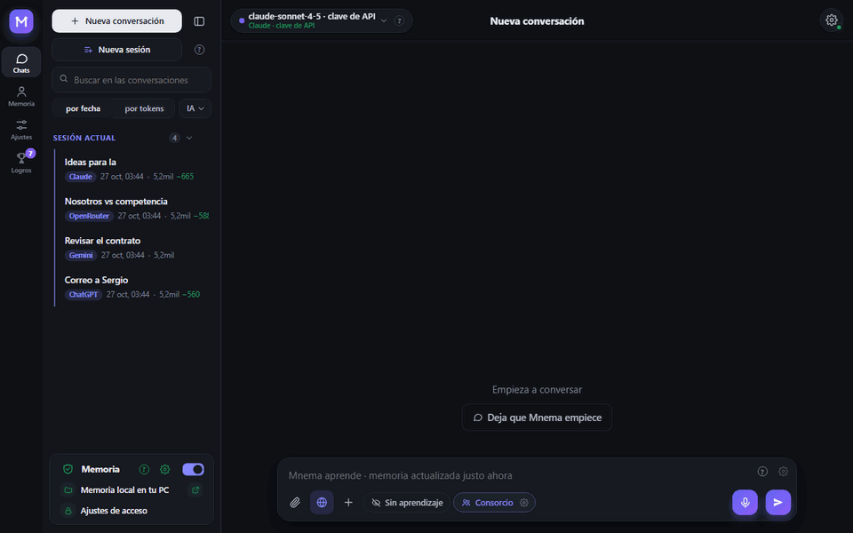
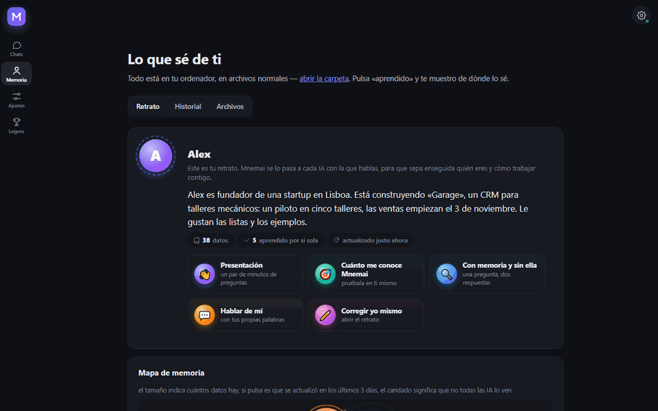
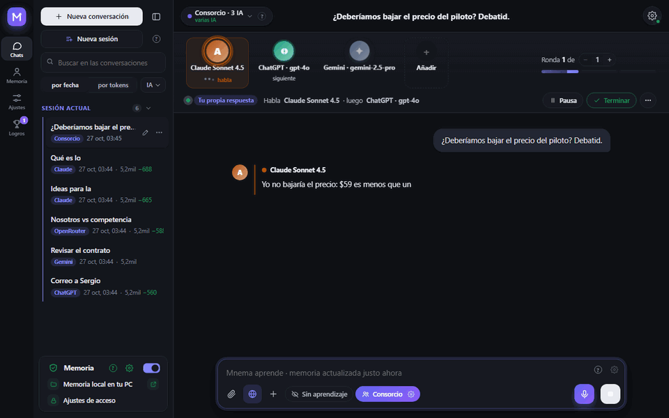
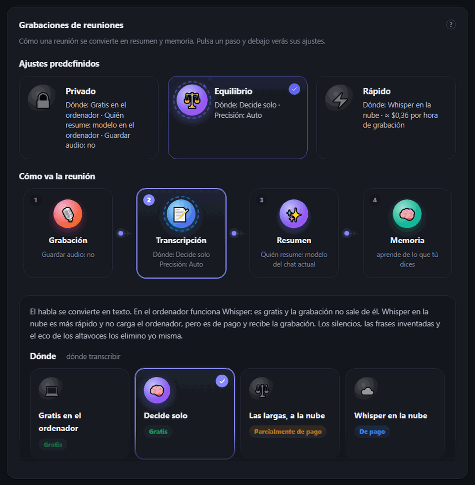
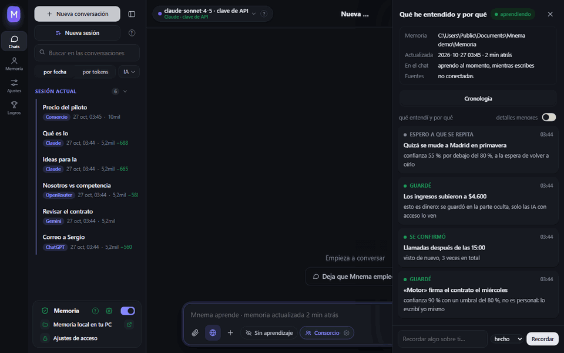
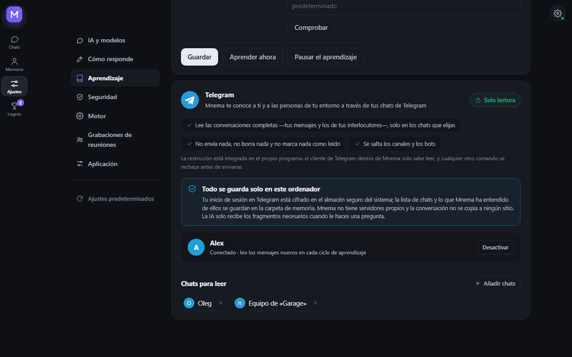
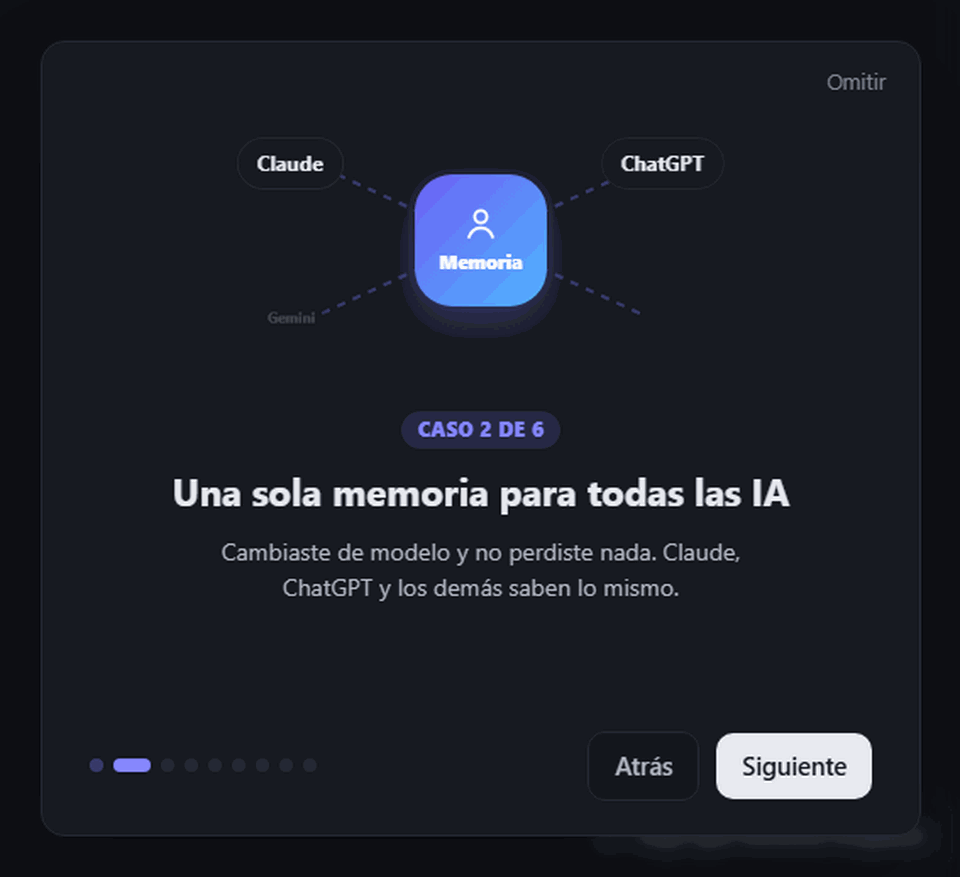
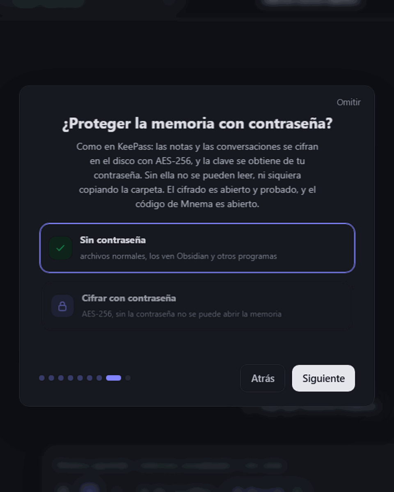
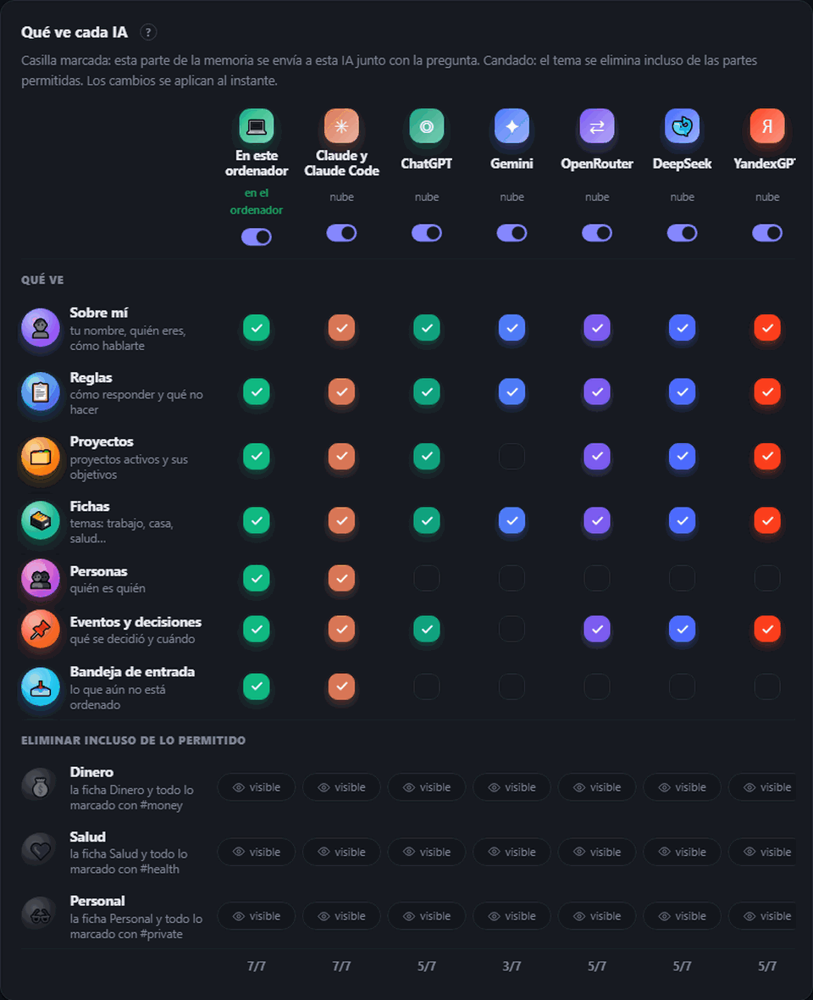

<div align="center">


# Mnema


<a href="https://github.com/Pumpetee/Mnema/releases/latest"></a> <a href="https://github.com/Pumpetee/Mnema/actions/workflows/tests.yml"></a> <a href="LICENSE"></a> <a href="https://github.com/Pumpetee/Mnema/commits/main"></a>

     

<a href="docs/guide/es.md"></a>

<a href="https://github.com/Pumpetee/Mnema"></a><br><sub>Escanea para abrir el repositorio · github.com/Pumpetee/Mnema</sub>

</div>

## Idiomas

Mnema habla nueve idiomas. La interfaz, la ayuda y las respuestas de la IA siguen el idioma que elijas, incluso cuando escribes en otro. Este README y la guía de Mnema existen en cada uno de ellos.

<table>
<tr><td align="center" width="10%"><br><b>English</b><br><sub><a href="README.md">README</a> · <a href="docs/guide/en.md">Guide</a></sub></td><td align="center" width="10%"><br><b>Русский</b><br><sub><a href="README.ru.md">README</a> · <a href="docs/guide/ru.md">Справочник</a></sub></td><td align="center" width="10%"><br><b>中文</b><br><sub><a href="README.zh.md">README</a> · <a href="docs/guide/zh.md">指南</a></sub></td><td align="center" width="10%"><br><b>✓ Español</b><br><sub><a href="README.es.md">README</a> · <a href="docs/guide/es.md">Guía</a></sub></td><td align="center" width="10%"><br><b>हिन्दी</b><br><sub><a href="README.hi.md">README</a> · <a href="docs/guide/hi.md">गाइड</a></sub></td></tr>
<tr><td align="center" width="10%"><br><b>Português</b><br><sub><a href="README.pt.md">README</a> · <a href="docs/guide/pt.md">Guia</a></sub></td><td align="center" width="10%"><br><b>Français</b><br><sub><a href="README.fr.md">README</a> · <a href="docs/guide/fr.md">Guide</a></sub></td><td align="center" width="10%"><br><b>Deutsch</b><br><sub><a href="README.de.md">README</a> · <a href="docs/guide/de.md">Handbuch</a></sub></td><td align="center" width="10%"><br><b>日本語</b><br><sub><a href="README.ja.md">README</a> · <a href="docs/guide/ja.md">ガイド</a></sub></td></tr>
</table>

<div align="center">

Mnema recuerda quién eres, en qué trabajas, qué has decidido y cómo te gusta que te respondan, y cada IA con la que hablas recibe ese contexto. La memoria es una carpeta de archivos Markdown sencillos en tu ordenador. Sin nube, sin cuenta.

<a href="../../releases/latest/download/Mnema-Setup.exe"></a> <a href="../../releases/latest/download/Mnema-macos-arm64.dmg"></a> <a href="../../releases/latest/download/Mnema-x86_64.AppImage"></a>

<sub><a href="../../releases">todos los archivos</a> · macOS Intel: <a href="../../releases/latest/download/Mnema-macos-x64.dmg">x64.dmg</a></sub>



<sub>Preguntas «¿qué es lo importante esta semana?» y el plan llega en una tabla, con el precio acordado y tu regla sobre las reuniones. Nunca tuviste que volver a escribirlos.</sub>

</div>

## ✨ Qué hace

<table>
<tr>
<td width="33%" valign="top"><h3>🧠 Te conoce</h3>Un retrato que toda IA lee primero, un mapa vivo de la memoria y archivos sencillos que son tuyos.</td>
<td width="33%" valign="top"><h3>🗣️ Consorcio</h3>Claude, ChatGPT y Gemini debaten y se ponen de acuerdo en una sola respuesta.</td>
<td width="33%" valign="top"><h3>🎙️ Reuniones</h3>Una llamada se convierte en transcripción, resumen y tareas con responsables.</td>
</tr>
<tr>
<td width="33%" valign="top"><h3>🔐 Privado</h3>Una contraseña para la memoria, como en KeePass. Los secretos nunca llegan a la nube.</td>
<td width="33%" valign="top"><h3>💻 Sin conexión</h3>13 modelos gratuitos funcionan en tu ordenador, sin claves.</td>
<td width="33%" valign="top"><h3>📉 Menos tokens</h3>Al modelo solo llega lo importante: 4,8× menos tokens en un contrato largo.</td>
</tr>
</table>

## 🧠 Te conoce

<p align="center"></p>

- **Un retrato que toda IA lee primero:** quién eres, qué estás construyendo, cómo te gusta trabajar. Mnema lo escribe a medida que aprende y tú puedes corregirlo a mano.
- **Un mapa de memoria:** cada tema es una burbuja, un pulso indica que cambió hace poco y un candado significa que algunas IA no lo ven.
- **Los datos viejos no pasan por nuevos:** cada dato lleva su fecha, y Mnema vuelve a preguntar por un estado con más de un mes.
- **Más de una carpeta:** conecta un vault de Obsidian o una carpeta de equipo, en solo lectura: el propio programa bloquea la escritura ahí.

## 🗣️ Consorcio: varias IA, una respuesta

<p align="center"></p>

- **Consejo, debate, lluvia de ideas, red team, roast:** elige el formato y el número de rondas.
- **Intervén cuando quieras:** «Stop» corta la IA actual y conserva lo que dijo.
- **Discute con otras IA** debajo de cualquier respuesta: su autora la defiende y las demás buscan dónde falla.

## 🎙️ Reuniones: de una llamada a tareas

<p align="center"></p>

- **Dos pistas:** tu micrófono y el sonido del ordenador, para que la transcripción sepa quién habló.
- **Whisper en tu ordenador, gratis**, o Whisper en la nube (≈ 0,36 $ la hora): se eliminan silencios, frases inventadas y eco.
- **El resumen:** qué se decidió, las tareas y quién se encarga de cada una, con el modelo que elijas, incluso uno local.
- **Preajustes:** Privado, Equilibrado y Rápido configuran todo el proceso de una vez.

## 🌱 Aprende solo

<p align="center"></p>

- **Seguro significa guardado:** un dato del que está seguro (80 % o más) se escribe al instante; uno dudoso espera a oírlo otra vez.
- **Lo personal va aparte:** dinero, salud y asuntos privados acaban en tarjetas etiquetadas que puedes ocultar a cualquier IA.
- **Nada se te oculta:** el feed «Qué entendí y por qué» muestra cada decisión con su motivo.

## ✈️ Lee Telegram, nunca escribe

<p align="center"></p>

- **Tú eliges los chats:** Mnema aprende sobre ti y las personas de tu entorno solo a partir de ellos.
- **Solo lectura, por diseño:** el cliente de Telegram dentro de Mnema solo puede leer; cualquier otro comando se rechaza antes de enviarse.
- **Se queda en tu ordenador:** la sesión se cifra en el almacén del sistema y Mnema no tiene servidores propios.

## 📉 Ahorra tokens

<p align="center"></p>

- **Solo sale lo importante:** la memoria, los documentos y las páginas web se leen en tu ordenador y el modelo recibe las partes relevantes.
- **Medido:** en una pregunta sobre un contrato de 153 000 caracteres, el texto completo costó 29 643 tokens de entrada; Mnema envió 6159, y solo la respuesta de Mnema fue correcta.
- **Visible cada vez:** debajo de cada respuesta ves cuántos tokens se ahorraron.

## 🔐 Privado por diseño

<table><tr><td width="50%" valign="top" align="center"><br><sub>Primer inicio: una contraseña para la memoria, como en KeePass</sub></td><td width="50%" valign="top" align="center"><br><sub>Quién ve qué: una marca por parte de la memoria, un candado por tema</sub></td></tr></table>

- **Una contraseña para la memoria:** AES-256, la clave se deriva de tu contraseña, criptografía de código abierto. Sin ella las notas no se pueden leer, ni siquiera copiándolas del disco. Una copia sincronizada también permanece cifrada.
- **Los secretos se quedan contigo:** números de tarjeta, contraseñas, claves y teléfonos se convierten en etiquetas antes de que nada llegue a un modelo en la nube.
- **Cada IA tiene su propio acceso:** el dinero, la salud y los temas privados se ocultan a cualquiera de ellas con un clic.

## 🤖 Funciona con

<div align="center">
<table><tr><td valign="middle" width="150"><b>IA en la nube</b><br><sub>con clave o suscripción</sub></td><td align="center" width="92"><br><sub><b>Claude</b></sub></td><td align="center" width="92"><br><sub><b>ChatGPT</b></sub></td><td align="center" width="92"><br><sub><b>Gemini</b></sub></td><td align="center" width="92"><br><sub><b>DeepSeek</b></sub></td><td align="center" width="92"><br><sub><b>YandexGPT</b></sub></td><td align="center" width="92"><br><sub><b>OpenRouter</b></sub></td></tr><tr><td valign="middle" width="150"><b>En tu ordenador</b><br><sub>gratis, sin conexión</sub></td><td align="center" width="92"><br><sub><b>Integrado</b></sub></td><td align="center" width="92"><br><sub><b>Ollama</b></sub></td><td align="center" width="92"><br><sub><b>Strata</b></sub></td><td></td><td></td><td></td></tr><tr><td valign="middle" width="150"><b>En tus herramientas</b><br><sub>mediante MCP</sub></td><td align="center" width="92"><br><sub><b>Claude Code</b></sub></td><td align="center" width="92"><br><sub><b>Cursor</b></sub></td><td></td><td></td><td></td><td></td></tr><tr><td valign="middle" width="150"><b>Sistemas</b><br><sub>una sola app</sub></td><td align="center" width="92"><br><sub><b>Windows</b></sub></td><td align="center" width="92"><br><sub><b>macOS</b></sub></td><td align="center" width="92"><br><sub><b>Linux</b></sub></td><td></td><td></td><td></td></tr></table>
</div>

## ⚡ Y más

- **Trabaja con tus archivos.** Lee escaneos, escribe notas, crea PDF, Word y Excel, y une y divide PDF. Cada escritura se puede deshacer en Memoria → Historial.
- **Nueve idiomas.** La interfaz y las respuestas de la IA siguen el idioma que elijas, incluso cuando escribes en otro.

<details>
<summary><b>Instalación</b></summary>

Descarga el archivo para tu sistema (todas las versiones con su número están en [Releases](../../releases)):

| Sistema | Archivo | Cómo |
|---|---|---|
| Windows 10 y 11 | [`Mnema-Setup.exe`](../../releases/latest/download/Mnema-Setup.exe) | Ejecútalo. No se necesitan derechos de administrador. También hay un `.zip` portable. |
| macOS 11 y posterior | Apple Silicon: [`Mnema-macos-arm64.dmg`](../../releases/latest/download/Mnema-macos-arm64.dmg), Intel: [`Mnema-macos-x64.dmg`](../../releases/latest/download/Mnema-macos-x64.dmg) | Ábrelo y arrastra Mnema a Aplicaciones. |
| Linux x86-64 (Ubuntu 22.04 y posterior, Fedora, Debian…) | [`Mnema-x86_64.AppImage`](../../releases/latest/download/Mnema-x86_64.AppImage) | `chmod +x Mnema-*.AppImage` y ejecútalo. El mismo programa como carpeta: `.tar.gz`, ejecuta `Mnema` dentro. |

Los paquetes todavía no están firmados con código, así que cada sistema muestra una advertencia la primera vez:

- **Windows**: SmartScreen dice «Windows protegió su PC». Haz clic en **Más información → Ejecutar de todas formas**.
- **macOS**: dice que no puede comprobar el desarrollador. Haz clic derecho en Mnema en Aplicaciones → **Abrir**, o abre Ajustes del Sistema → Privacidad y seguridad → **Abrir de todos modos**.
- **Linux**: el AppImage necesita FUSE 2: `sudo apt install libfuse2` (en Ubuntu 24.04: `libfuse2t64`). O usa el `.tar.gz`.

Para comprobar un archivo, compara su sha256 con el archivo `.sha256` que está junto a él: `certutil -hashfile <file> SHA256` en Windows, `shasum -a 256 <file>` en macOS, `sha256sum <file>` en Linux.

</details>

<details>
<summary><b>Compilar desde el código fuente</b></summary>

Windows:

```powershell
python -m venv .venv
.venv\Scripts\pip install -r requirements-dev.txt
.venv\Scripts\python tools\fetch_vendor.py      # llama.cpp, Xray, WebView2 from their official releases, verified
.venv\Scripts\python -m mnema.desktop           # run the program
.venv\Scripts\python tools\package.py           # dist\Mnema-Setup-<version>.exe and the portable zip
```

macOS y Linux:

```bash
python3 -m venv .venv
.venv/bin/pip install -r requirements-dev.txt
.venv/bin/python tools/fetch_vendor.py           # llama.cpp and Xray for this system, verified by sha256
.venv/bin/python -m mnema.desktop                # run the program
.venv/bin/python tools/package.py                # macOS: dist/Mnema-<version>-macos-arm64.dmg
                                                 # Linux: dist/Mnema-<version>-x86_64.AppImage and .tar.gz
```

Cada push se prueba en Windows, macOS y Linux; los tres paquetes se compilan, se inician una vez con su ventana y se conservan como archivos de la ejecución (`.github/workflows`).

El núcleo solo necesita la biblioteca estándar de Python. Cubre la bóveda, las reglas de acceso, el diario, el servidor MCP y la línea de comandos:

```bash
python -m mnema init ~/mnema --default
python -m mnema serve                    # http://127.0.0.1:7461
python -m mnema install claude-code      # shows the plan; add --apply

</details>

<details>
<summary><b>Cómo está hecho</b></summary>

Consulta [docs/ARCHITECTURE.md](docs/ARCHITECTURE.md). En resumen:

| Parte | Dónde |
|---|---|
| Bóveda: carpetas, datos, secciones con etiquetas ocultas | `mnema/vault.py`, `mnema/memory.py` |
| Reglas de acceso por IA | `mnema/clients.py` |
| Diario y deshacer | `mnema/journal.py` |
| Servidor MCP, línea de comandos | `mnema/mcp_server.py`, `mnema/cli.py` |
| API local y la ventana | `mnema/api*.py`, `mnema/desktop.py` |
| Interfaz | `mnema/ui/index.html`, `mnema/ui/css/app.css`, `mnema/ui/js/NN-*.js` (cargados en orden) |
| Chat con cualquier modelo, consorcio, acciones con archivos | `mnema/chat/` |
| Aprendizaje: fuentes, cerebros, decisiones | `mnema/learn/` |
| Lo que sale del ordenador | `mnema/outgoing.py` |
| Lo que difiere entre Windows, macOS y Linux | `mnema/osapi.py` |
| Cifrado de la memoria mediante contraseña | `mnema/crypt.py` |
| Texto de escaneos e imágenes | `mnema/ocr.py` |
| Base de conocimiento a partir de la cual responde el asistente | `mnema/knowledge/mnema.md` |

</details>

<details>
<summary><b>Seguridad</b></summary>

La API local solo escucha en 127.0.0.1, comprueba la cabecera Host y exige un token. Las páginas por enlace y las suscripciones VPN solo se abren desde internet, nunca desde este equipo ni desde la red local. Las claves y contraseñas se guardan en el almacén de secretos del sistema (DPAPI en Windows, el Llavero en macOS, el Secret Service en Linux cuando está disponible), nunca en la carpeta de memoria. La propia memoria se puede cifrar con una contraseña (AES-256-GCM, con la clave protegida mediante scrypt); la sincronización de una memoria cifrada envía únicamente archivos cifrados. Cada solicitud a un modelo en la nube queda registrada con lo que se envió y lo que se ocultó. Informa de las vulnerabilidades de forma privada al autor.

</details>

## Licencia

AGPL-3.0. Gratis para uso personal y para proyectos de código abierto. El autor ofrece una licencia comercial y la edición para equipos.

© 2026 Anton Sannikov

<div align="center">


<sub>Si Mnema recuerda algo útil para ti, una ⭐ ayuda a que otros lo encuentren.</sub>
</div>
