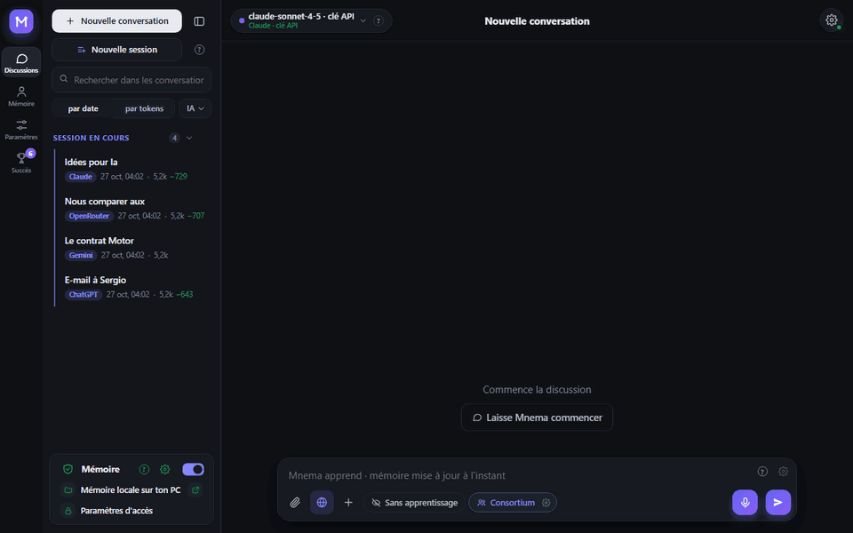
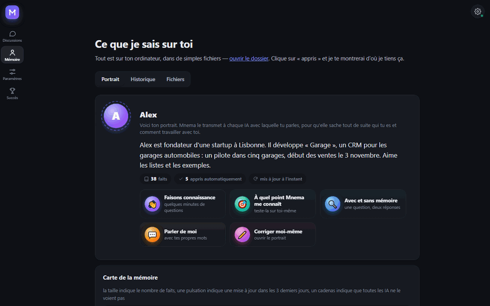
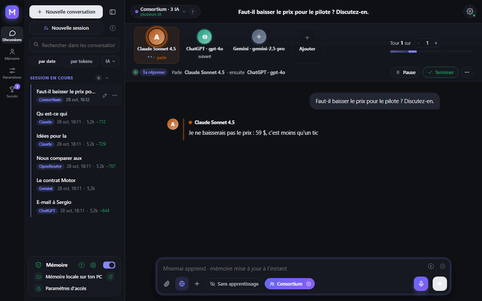
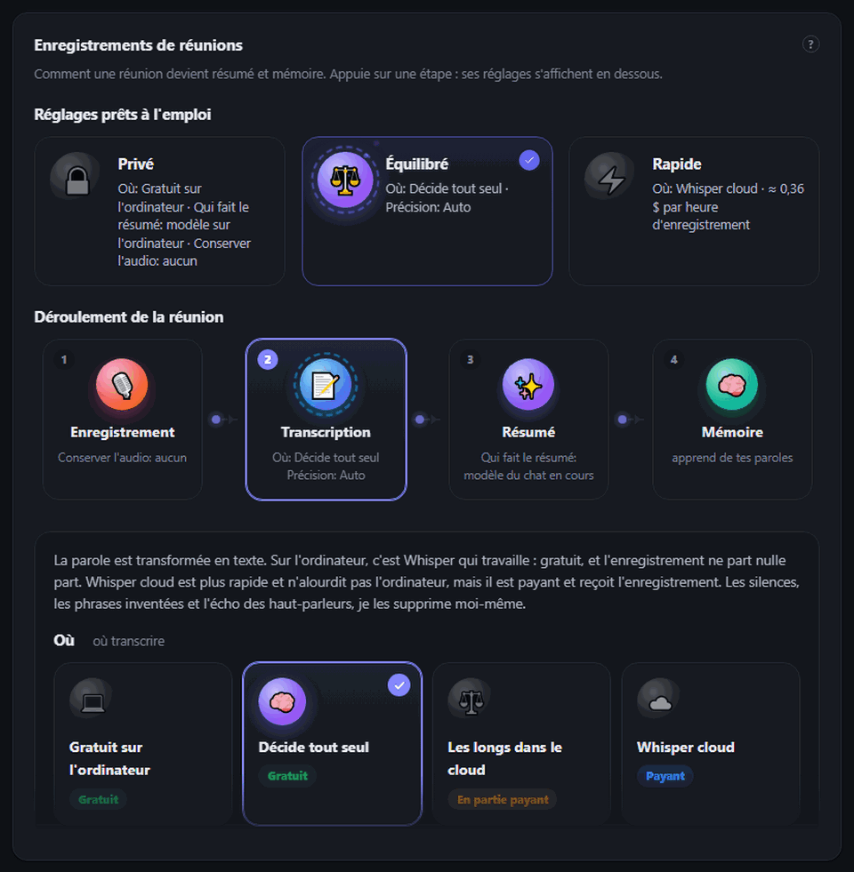
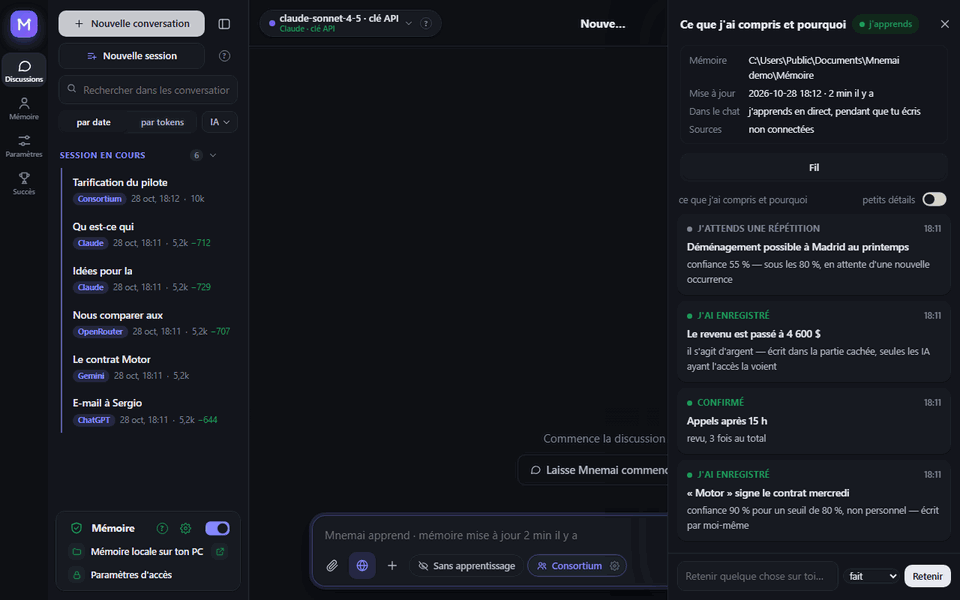
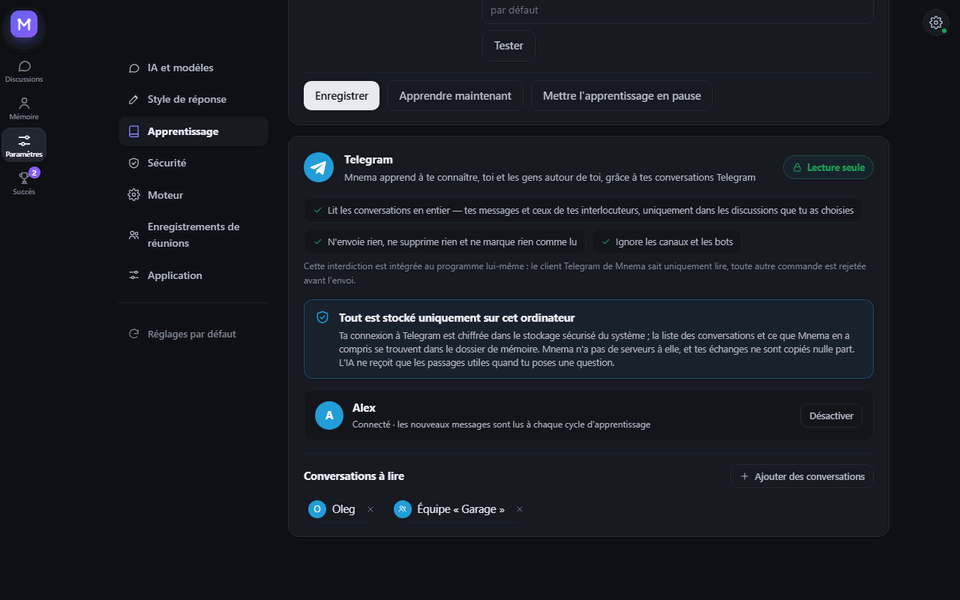
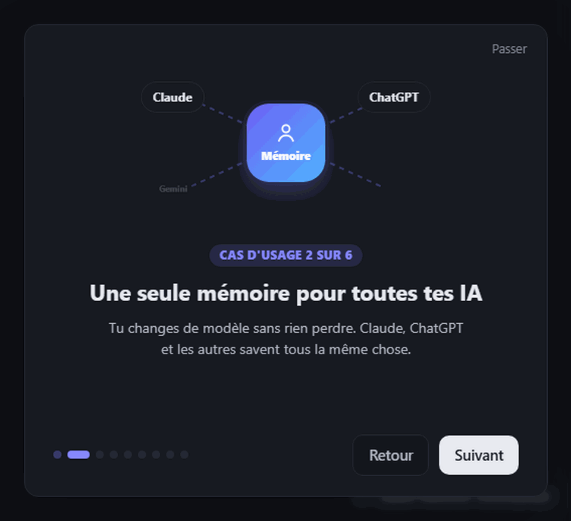
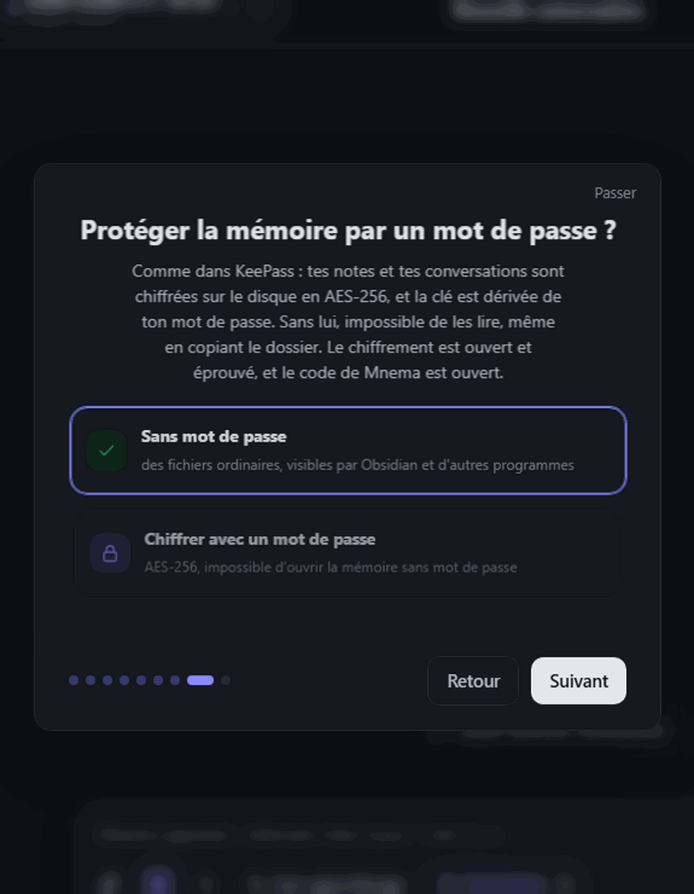
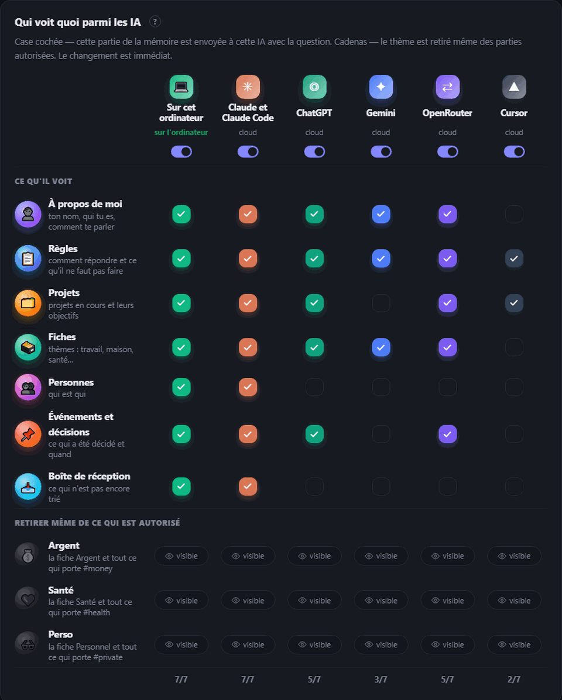

<div align="center">


# Mnema


<a href="https://github.com/Pumpetee/Mnema/releases/latest"></a> <a href="https://github.com/Pumpetee/Mnema/actions/workflows/tests.yml"></a> <a href="LICENSE"></a> <a href="https://github.com/Pumpetee/Mnema/commits/main"></a>

     

<a href="docs/guide/fr.md"></a>

</div>

## Langues

Mnema parle neuf langues. L'interface, l'aide et les réponses de l'IA suivent celle que tu choisis, même quand tu écris dans une autre. Ce README et le guide Mnema existent dans chacune d'elles.

<table>
<tr><td align="center" width="10%"><br><b>English</b><br><sub><a href="README.md">README</a> · <a href="docs/guide/en.md">Guide</a></sub></td><td align="center" width="10%"><br><b>Русский</b><br><sub><a href="README.ru.md">README</a> · <a href="docs/guide/ru.md">Справочник</a></sub></td><td align="center" width="10%"><br><b>中文</b><br><sub><a href="README.zh.md">README</a> · <a href="docs/guide/zh.md">指南</a></sub></td><td align="center" width="10%"><br><b>Español</b><br><sub><a href="README.es.md">README</a> · <a href="docs/guide/es.md">Guía</a></sub></td><td align="center" width="10%"><br><b>हिन्दी</b><br><sub><a href="README.hi.md">README</a> · <a href="docs/guide/hi.md">गाइड</a></sub></td></tr>
<tr><td align="center" width="10%"><br><b>Português</b><br><sub><a href="README.pt.md">README</a> · <a href="docs/guide/pt.md">Guia</a></sub></td><td align="center" width="10%"><br><b>✓ Français</b><br><sub><a href="README.fr.md">README</a> · <a href="docs/guide/fr.md">Guide</a></sub></td><td align="center" width="10%"><br><b>Deutsch</b><br><sub><a href="README.de.md">README</a> · <a href="docs/guide/de.md">Handbuch</a></sub></td><td align="center" width="10%"><br><b>日本語</b><br><sub><a href="README.ja.md">README</a> · <a href="docs/guide/ja.md">ガイド</a></sub></td></tr>
</table>

<div align="center">

Mnema se souvient de qui tu es, de ce sur quoi tu travailles, de ce que tu as décidé et de la façon dont tu aimes les réponses — et chaque IA à laquelle tu parles reçoit ce contexte. La mémoire est un dossier de simples fichiers Markdown sur ton ordinateur. Pas de cloud, pas de compte.

<a href="../../releases/latest/download/Mnema-Setup.exe"></a> <a href="../../releases/latest/download/Mnema-macos-arm64.dmg"></a> <a href="../../releases/latest/download/Mnema-x86_64.AppImage"></a>

<sub><a href="../../releases">tous les fichiers</a> · macOS Intel: <a href="../../releases/latest/download/Mnema-macos-x64.dmg">x64.dmg</a></sub>



<sub>Tu demandes «qu'est-ce qui compte cette semaine ?» — le plan arrive sous forme de tableau, avec le prix convenu et ta règle sur les réunions. Tu n'as jamais eu à les retaper.</sub>

</div>

## ✨ Ce qu'il fait

<table>
<tr>
<td width="33%" valign="top"><h3>🧠 Te connaît</h3>Un portrait que chaque IA lit en premier, une carte vivante de la mémoire, de simples fichiers qui t'appartiennent.</td>
<td width="33%" valign="top"><h3>🗣️ Consortium</h3>Claude, ChatGPT et Gemini débattent et s'accordent sur une seule réponse.</td>
<td width="33%" valign="top"><h3>🎙️ Réunions</h3>Un appel devient une transcription, un résumé et des tâches avec leurs responsables.</td>
</tr>
<tr>
<td width="33%" valign="top"><h3>🔐 Privé</h3>Un mot de passe sur la mémoire, comme KeePass. Les secrets n'atteignent jamais le cloud.</td>
<td width="33%" valign="top"><h3>💻 Hors ligne</h3>13 modèles gratuits tournent sur ton ordinateur, sans aucune clé.</td>
<td width="33%" valign="top"><h3>📉 Moins de tokens</h3>Seul l'essentiel part vers le modèle : 4,8× moins de tokens sur un long contrat.</td>
</tr>
</table>

## 🧠 Il te connaît

<p align="center"></p>

- **Un portrait que chaque IA lit en premier :** qui tu es, ce que tu construis, comment tu aimes travailler. Mnema l'écrit au fil de ce qu'il apprend, tu peux le corriger à la main.
- **Une carte de la mémoire :** chaque sujet est une bulle, une pulsation signale un changement récent, un cadenas indique que certaines IA ne le voient pas.
- **Les vieux faits ne passent pas pour des nouveaux :** chaque fait porte sa date, et Mnema redemande un statut vieux de plus d'un mois.
- **Plus d'un dossier :** connecte un coffre Obsidian ou un dossier d'équipe — en lecture seule, le programme lui-même y bloque l'écriture.

## 🗣️ Consortium : plusieurs IA, une réponse

<p align="center"></p>

- **Conseil, débat, brainstorming, red team, roast** — choisis le format et le nombre de tours.
- **Interviens à tout moment :** «Stop» coupe l'IA en cours et garde ce qu'elle a dit.
- **Débats avec d'autres IA** sous n'importe quelle réponse : son auteur la défend, les autres cherchent où elle se trompe.

## 🎙️ Réunions : d'un appel aux tâches

<p align="center"></p>

- **Deux pistes :** ton micro et le son de l'ordinateur, pour que la transcription sache qui a parlé.
- **Whisper gratuit sur ton ordinateur**, ou Whisper dans le cloud (≈ 0,36 $ de l'heure) — les silences, les phrases inventées et l'écho sont supprimés.
- **Le résumé :** ce qui a été décidé, les tâches et leurs responsables, par le modèle de ton choix, y compris un modèle local.
- **Préréglages :** Privé, Équilibré, Rapide configurent tout le déroulé d'un coup.

## 🌱 Il apprend tout seul

<p align="center"></p>

- **Sûr signifie enregistré :** un fait dont il est sûr (80 % ou plus) est écrit tout de suite, un fait douteux attend d'être entendu à nouveau.
- **Le personnel est mis à part :** argent, santé et vie privée atterrissent dans des fiches étiquetées que tu peux cacher à n'importe quelle IA.
- **Rien ne t'est caché :** le fil «Ce que j'ai compris et pourquoi» montre chaque décision avec sa raison.

## ✈️ Lit Telegram, n'y écrit jamais

<p align="center"></p>

- **Tu choisis les discussions :** Mnema n'apprend sur toi et sur ton entourage qu'à partir de celles-ci.
- **Lecture seule, par conception :** le client Telegram intégré à Mnema ne peut que lire ; toute autre commande est refusée avant d'être envoyée.
- **Reste sur ton ordinateur :** la connexion est chiffrée dans le coffre du système, et Mnema n'a pas de serveurs à lui.

## 📉 Économise des tokens

<p align="center"></p>

- **Seul l'essentiel part :** la mémoire, les documents et les pages web sont lus sur ton ordinateur, et le modèle reçoit les parties pertinentes.
- **Mesuré :** sur une question à propos d'un contrat de 153 000 caractères, le texte entier a pris 29 643 tokens d'entrée ; Mnema en a envoyé 6 159, et seule la réponse de Mnema était juste.
- **Visible à chaque fois :** sous chaque réponse, tu vois combien de tokens ont été économisés.

## 🔐 Privé par conception

<table><tr><td width="50%" valign="top" align="center"><br><sub>Premier lancement : un mot de passe sur la mémoire, comme KeePass</sub></td><td width="50%" valign="top" align="center"><br><sub>Qui voit quoi : une coche par partie de la mémoire, un cadenas par sujet</sub></td></tr></table>

- **Un mot de passe sur la mémoire :** AES-256, la clé est dérivée de ton mot de passe, cryptographie open source. Sans lui, les notes sont illisibles, même copiées depuis le disque. Une copie synchronisée reste elle aussi chiffrée.
- **Les secrets restent chez toi :** numéros de carte, mots de passe, clés et téléphones deviennent des étiquettes avant que quoi que ce soit parte vers un modèle cloud.
- **Chaque IA a son propre accès :** l'argent, la santé et les sujets privés sont cachés à n'importe laquelle d'entre elles en un clic.

## 🤖 Fonctionne avec

<div align="center">
<table><tr><td valign="middle" width="150"><b>IA cloud</b><br><sub>par clé ou abonnement</sub></td><td align="center" width="92"><br><sub><b>Claude</b></sub></td><td align="center" width="92"><br><sub><b>ChatGPT</b></sub></td><td align="center" width="92"><br><sub><b>Gemini</b></sub></td><td align="center" width="92"><br><sub><b>DeepSeek</b></sub></td><td align="center" width="92"><br><sub><b>YandexGPT</b></sub></td><td align="center" width="92"><br><sub><b>OpenRouter</b></sub></td></tr><tr><td valign="middle" width="150"><b>Sur ton ordinateur</b><br><sub>gratuit, hors ligne</sub></td><td align="center" width="92"><br><sub><b>Intégré</b></sub></td><td align="center" width="92"><br><sub><b>Ollama</b></sub></td><td align="center" width="92"><br><sub><b>Strata</b></sub></td><td></td><td></td><td></td></tr><tr><td valign="middle" width="150"><b>Dans tes outils</b><br><sub>via MCP</sub></td><td align="center" width="92"><br><sub><b>Claude Code</b></sub></td><td align="center" width="92"><br><sub><b>Cursor</b></sub></td><td></td><td></td><td></td><td></td></tr><tr><td valign="middle" width="150"><b>Systèmes</b><br><sub>une seule appli</sub></td><td align="center" width="92"><br><sub><b>Windows</b></sub></td><td align="center" width="92"><br><sub><b>macOS</b></sub></td><td align="center" width="92"><br><sub><b>Linux</b></sub></td><td></td><td></td><td></td></tr></table>
</div>

## ⚡ Et encore plus

- **Fonctionne avec tes fichiers.** Lit les scans, écrit des notes, crée des PDF, Word et Excel, fusionne et découpe des PDF. Chaque écriture peut être annulée dans Mémoire → Historique.
- **Neuf langues.** L'interface et les réponses de l'IA suivent celle que tu choisis, même quand tu écris dans une autre.

<details>
<summary><b>Installation</b></summary>

Téléchargez le fichier correspondant à votre système (toutes les versions, avec leur numéro, se trouvent dans [Releases](../../releases)) :

| Système | Fichier | Procédure |
|---|---|---|
| Windows 10 et 11 | [`Mnema-Setup.exe`](../../releases/latest/download/Mnema-Setup.exe) | Lancez-le. Aucun droit d'administrateur n'est nécessaire. Un `.zip` portable est également disponible. |
| macOS 11 et versions ultérieures | Apple Silicon : [`Mnema-macos-arm64.dmg`](../../releases/latest/download/Mnema-macos-arm64.dmg), Intel : [`Mnema-macos-x64.dmg`](../../releases/latest/download/Mnema-macos-x64.dmg) | Ouvrez-le et faites glisser Mnema dans Applications. |
| Linux x86-64 (Ubuntu 22.04 et versions ultérieures, Fedora, Debian…) | [`Mnema-x86_64.AppImage`](../../releases/latest/download/Mnema-x86_64.AppImage) | Exécutez `chmod +x Mnema-*.AppImage`, puis lancez-le. Le même programme sous forme de dossier : `.tar.gz`, lancez `Mnema` à l'intérieur. |

Les paquets ne sont pas encore signés, donc chaque système affiche un avertissement une seule fois :

- **Windows** : SmartScreen affiche « Windows a protégé votre PC ». Cliquez sur **Informations complémentaires → Exécuter quand même**.
- **macOS** indique qu'il ne peut pas vérifier le développeur. Faites un clic droit sur Mnema dans Applications → **Ouvrir**, ou ouvrez Réglages Système → Confidentialité et sécurité → **Ouvrir quand même**.
- **Linux** : l'AppImage nécessite FUSE 2 : `sudo apt install libfuse2` (sur Ubuntu 24.04 : `libfuse2t64`). Ou utilisez le `.tar.gz`.

Pour vérifier un fichier, comparez son sha256 avec le fichier `.sha256` qui se trouve à côté : `certutil -hashfile <file> SHA256` sous Windows, `shasum -a 256 <file>` sous macOS, `sha256sum <file>` sous Linux.

</details>

<details>
<summary><b>Compiler depuis les sources</b></summary>

Windows :

```powershell
python -m venv .venv
.venv\Scripts\pip install -r requirements-dev.txt
.venv\Scripts\python tools\fetch_vendor.py      # llama.cpp, Xray, WebView2 depuis leurs versions officielles, vérifiés
.venv\Scripts\python -m mnema.desktop           # lancer le programme
.venv\Scripts\python tools\package.py           # dist\Mnema-Setup-<version>.exe et le zip portable
```

macOS et Linux :

```bash
python3 -m venv .venv
.venv/bin/pip install -r requirements-dev.txt
.venv/bin/python tools/fetch_vendor.py           # llama.cpp et Xray pour ce système, vérifiés par sha256
.venv/bin/python -m mnema.desktop                # lancer le programme
.venv/bin/python tools/package.py                # macOS : dist/Mnema-<version>-macos-arm64.dmg
                                                 # Linux : dist/Mnema-<version>-x86_64.AppImage et .tar.gz
```

Chaque push est testé sur Windows, macOS et Linux ; les trois paquets sont construits, démarrés une fois avec leur fenêtre et conservés sous forme de fichiers de l'exécution (`.github/workflows`).

Le cœur n'a besoin que de la bibliothèque standard de Python. Il couvre le coffre (vault), les règles d'accès, le journal, le serveur MCP et la ligne de commande :

```bash
python -m mnema init ~/mnema --default
python -m mnema serve                    # http://127.0.0.1:7461
python -m mnema install claude-code      # affiche le plan ; ajouter --apply

</details>

<details>
<summary><b>Comment il est construit</b></summary>

Voir [docs/ARCHITECTURE.md](docs/ARCHITECTURE.md). En bref :

| Partie | Emplacement |
|---|---|
| Coffre : dossiers, faits, sections avec balises cachées | `mnema/vault.py`, `mnema/memory.py` |
| Règles d'accès par IA | `mnema/clients.py` |
| Journal et annulation | `mnema/journal.py` |
| Serveur MCP, ligne de commande | `mnema/mcp_server.py`, `mnema/cli.py` |
| API locale et la fenêtre | `mnema/api*.py`, `mnema/desktop.py` |
| Interface | `mnema/ui/index.html`, `mnema/ui/css/app.css`, `mnema/ui/js/NN-*.js` (chargés dans l'ordre) |
| Discussion avec n'importe quel modèle, consortium, actions sur les fichiers | `mnema/chat/` |
| Apprentissage : sources, cerveaux, décisions | `mnema/learn/` |
| Ce qui quitte l'ordinateur | `mnema/outgoing.py` |
| Ce qui diffère entre Windows, macOS et Linux | `mnema/osapi.py` |
| Chiffrement de la mémoire par mot de passe | `mnema/crypt.py` |
| Texte issu de scans et d'images | `mnema/ocr.py` |
| Base de connaissances à partir de laquelle l'assistant répond | `mnema/knowledge/mnema.md` |

</details>

<details>
<summary><b>Sécurité</b></summary>

L'API locale écoute uniquement sur 127.0.0.1, vérifie l'en-tête Host et exige un jeton. Les pages par lien et les abonnements VPN ne sont ouverts que depuis Internet, jamais depuis cet ordinateur ni depuis le réseau local. Les clés et les mots de passe sont conservés dans le magasin de secrets du système (DPAPI sous Windows, le Trousseau sous macOS, le Secret Service sous Linux lorsqu'il y en a un), jamais dans le dossier de mémoire. La mémoire elle-même peut être chiffrée avec un mot de passe (AES-256-GCM, clé protégée par scrypt) ; la synchronisation d'une mémoire chiffrée n'envoie que des fichiers chiffrés. Chaque requête vers un modèle cloud est journalisée, avec ce qui a été envoyé et ce qui a été masqué. Signalez les vulnérabilités en privé à l'auteur.

</details>

## Licence

AGPL-3.0. Gratuit pour un usage personnel et pour les projets open source. Une licence commerciale et l'édition équipe sont disponibles auprès de l'auteur.

© 2026 Anton Sannikov

<div align="center">


<sub>Si Mnema retient quelque chose d'utile pour toi, une ⭐ aide les autres à le trouver.</sub>
</div>
