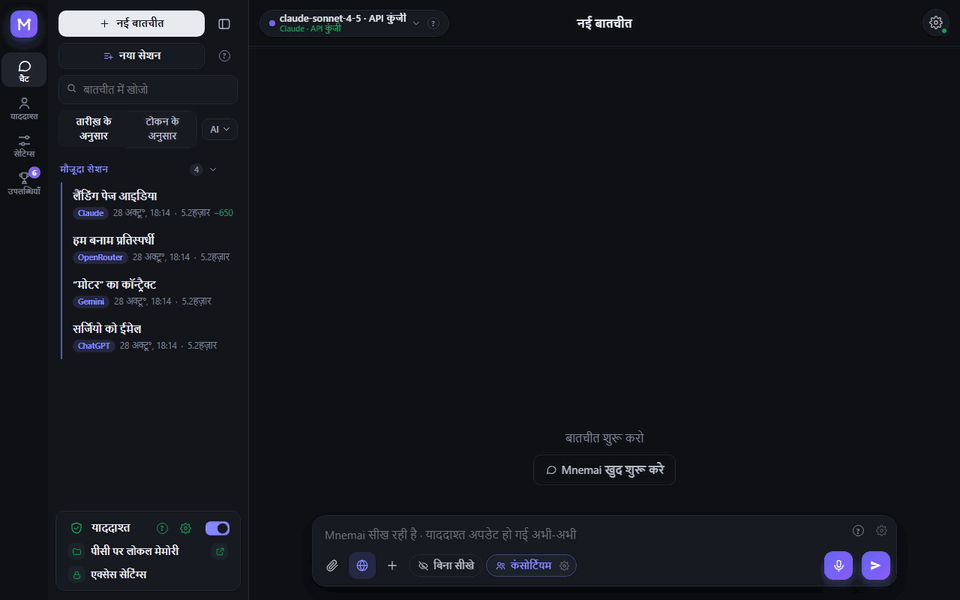
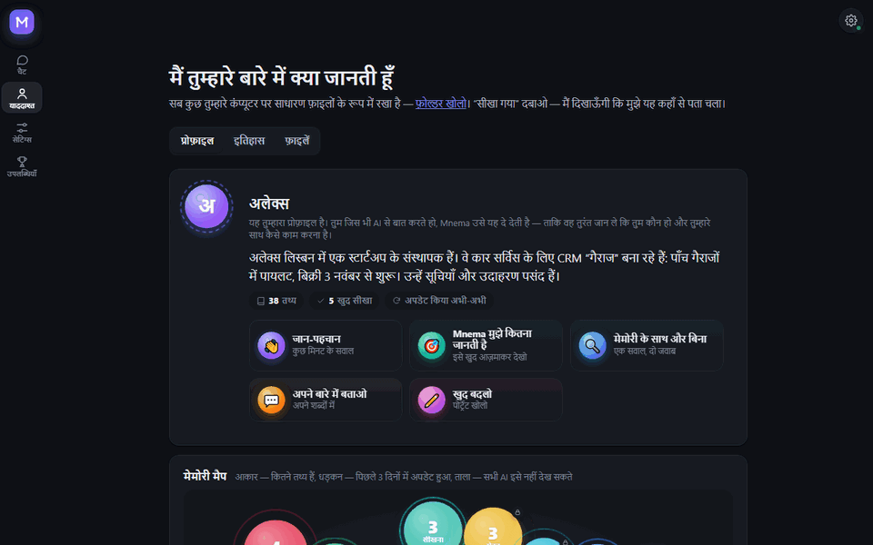
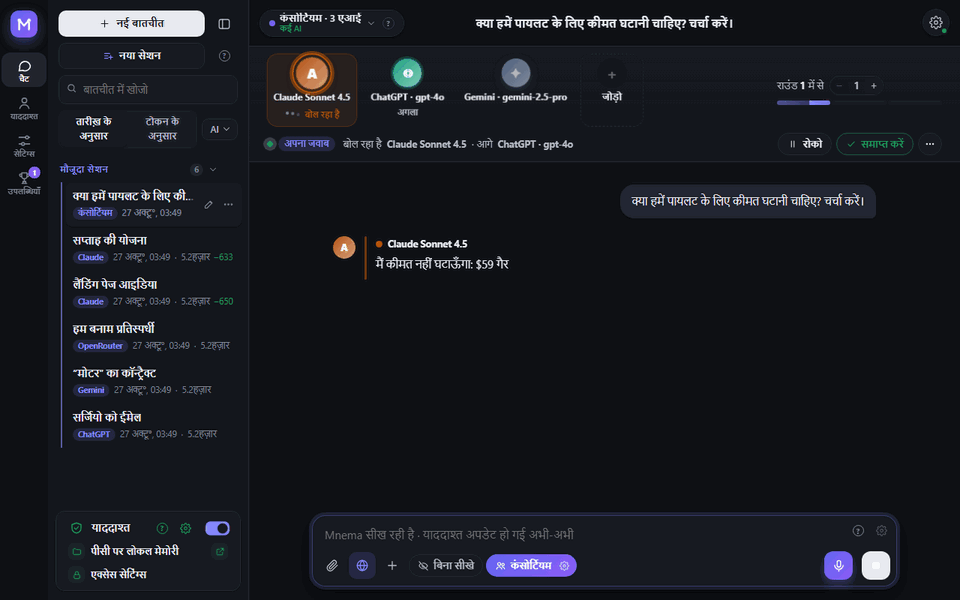
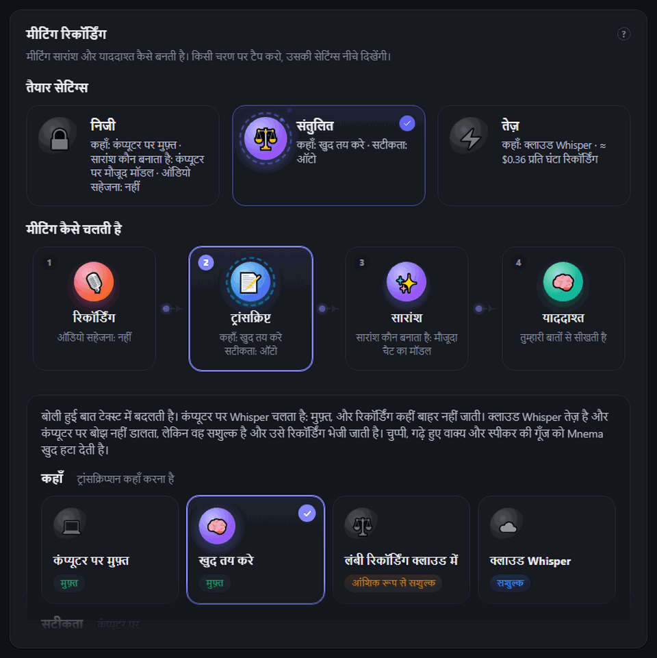
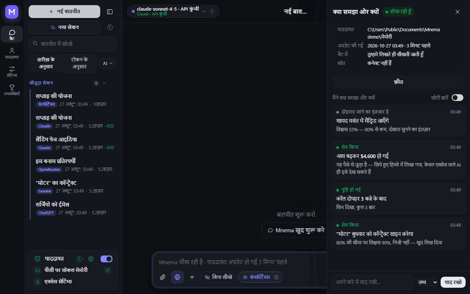
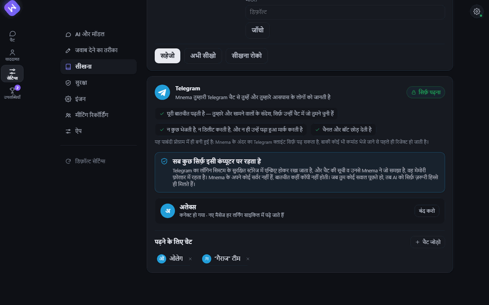
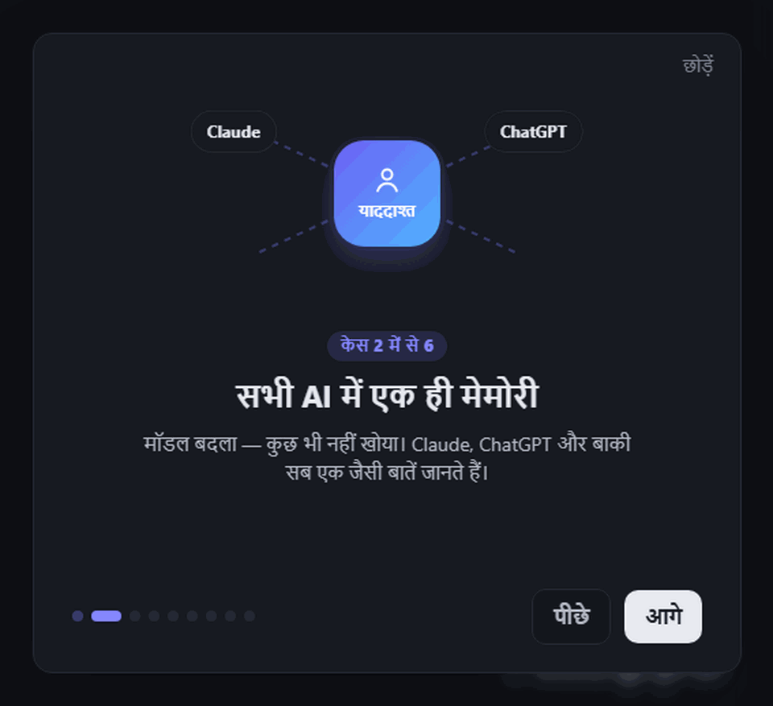
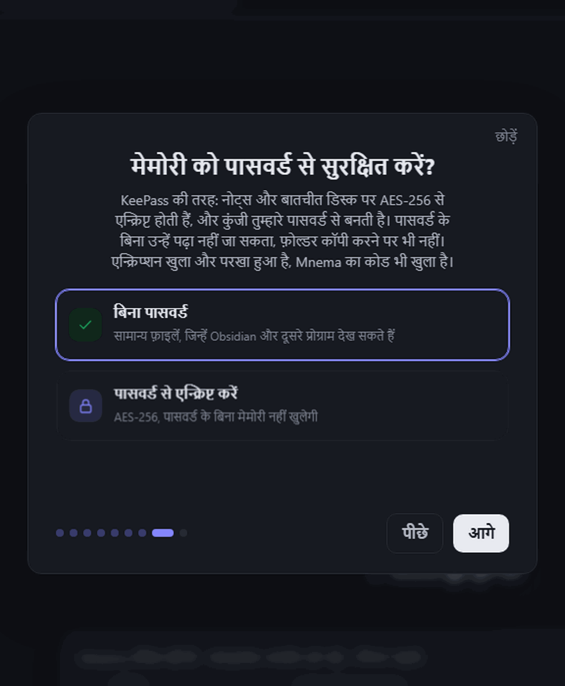
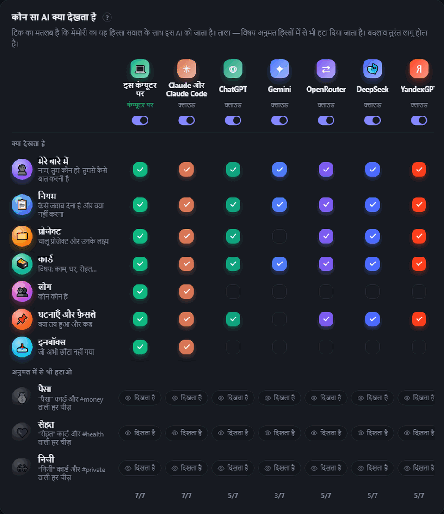

<div align="center">


# Mnema


<a href="https://github.com/Pumpetee/Mnema/releases/latest"></a> <a href="https://github.com/Pumpetee/Mnema/actions/workflows/tests.yml"></a> <a href="LICENSE"></a> <a href="https://github.com/Pumpetee/Mnema/commits/main"></a>

     

<a href="docs/guide/hi.md"></a>

</div>

## भाषाएँ

Mnema नौ भाषाएँ बोलता है। इंटरफ़ेस, मदद और AI के जवाब उसी भाषा में आते हैं जो तुम चुनते हो, भले ही तुम किसी और भाषा में लिखो। यह README और Mnema गाइड हर भाषा में उपलब्ध हैं।

<table>
<tr><td align="center" width="10%"><br><b>English</b><br><sub><a href="README.md">README</a> · <a href="docs/guide/en.md">Guide</a></sub></td><td align="center" width="10%"><br><b>Русский</b><br><sub><a href="README.ru.md">README</a> · <a href="docs/guide/ru.md">Справочник</a></sub></td><td align="center" width="10%"><br><b>中文</b><br><sub><a href="README.zh.md">README</a> · <a href="docs/guide/zh.md">指南</a></sub></td><td align="center" width="10%"><br><b>Español</b><br><sub><a href="README.es.md">README</a> · <a href="docs/guide/es.md">Guía</a></sub></td><td align="center" width="10%"><br><b>✓ हिन्दी</b><br><sub><a href="README.hi.md">README</a> · <a href="docs/guide/hi.md">गाइड</a></sub></td></tr>
<tr><td align="center" width="10%"><br><b>Português</b><br><sub><a href="README.pt.md">README</a> · <a href="docs/guide/pt.md">Guia</a></sub></td><td align="center" width="10%"><br><b>Français</b><br><sub><a href="README.fr.md">README</a> · <a href="docs/guide/fr.md">Guide</a></sub></td><td align="center" width="10%"><br><b>Deutsch</b><br><sub><a href="README.de.md">README</a> · <a href="docs/guide/de.md">Handbuch</a></sub></td><td align="center" width="10%"><br><b>日本語</b><br><sub><a href="README.ja.md">README</a> · <a href="docs/guide/ja.md">ガイド</a></sub></td></tr>
</table>

<div align="center">

Mnema याद रखता है कि तुम कौन हो, किस पर काम कर रहे हो, तुमने क्या तय किया और तुम्हें जवाब कैसे पसंद हैं — और तुम जिस भी AI से बात करते हो, उसे यह संदर्भ मिल जाता है। याददाश्त तुम्हारे कंप्यूटर पर सादी Markdown फ़ाइलों का एक फ़ोल्डर है। न क्लाउड, न अकाउंट।

<a href="../../releases/latest/download/Mnema-Setup.exe"></a> <a href="../../releases/latest/download/Mnema-macos-arm64.dmg"></a> <a href="../../releases/latest/download/Mnema-x86_64.AppImage"></a>

<sub><a href="../../releases">सभी फ़ाइलें</a> · macOS Intel: <a href="../../releases/latest/download/Mnema-macos-x64.dmg">x64.dmg</a></sub>



<sub>तुम पूछते हो «इस हफ़्ते क्या ज़रूरी है?» — योजना एक टेबल में आती है, तय कीमत और मीटिंग वाले तुम्हारे नियम के साथ। तुम्हें इन्हें दोबारा टाइप नहीं करना पड़ा।</sub>

</div>

## ✨ यह क्या करता है

<table>
<tr>
<td width="33%" valign="top"><h3>🧠 तुम्हें जानता है</h3>एक प्रोफ़ाइल जिसे हर AI सबसे पहले पढ़ता है, जीता-जागता मेमोरी मैप, और सादी फ़ाइलें जो तुम्हारी अपनी हैं।</td>
<td width="33%" valign="top"><h3>🗣️ कंसोर्शियम</h3>Claude, ChatGPT और Gemini बहस करते हैं और एक जवाब पर सहमत होते हैं।</td>
<td width="33%" valign="top"><h3>🎙️ मीटिंग</h3>कॉल से ट्रांसक्रिप्ट, सारांश और ज़िम्मेदार लोगों के साथ टास्क बन जाते हैं।</td>
</tr>
<tr>
<td width="33%" valign="top"><h3>🔐 निजी</h3>याददाश्त पर KeePass जैसा पासवर्ड। राज़ कभी क्लाउड तक नहीं पहुँचते।</td>
<td width="33%" valign="top"><h3>💻 ऑफ़लाइन</h3>13 मुफ़्त मॉडल तुम्हारे कंप्यूटर पर चलते हैं, बिना किसी कुंजी के।</td>
<td width="33%" valign="top"><h3>📉 कम टोकन</h3>मॉडल तक सिर्फ़ ज़रूरी हिस्सा जाता है: लंबे कॉन्ट्रैक्ट पर 4.8× कम टोकन।</td>
</tr>
</table>

## 🧠 यह तुम्हें जानता है

<p align="center"></p>

- **एक प्रोफ़ाइल जिसे हर AI सबसे पहले पढ़ता है:** तुम कौन हो, क्या बना रहे हो, कैसे काम करना पसंद करते हो। Mnema इसे सीखते-सीखते लिखता है, और तुम इसे हाथ से ठीक कर सकते हो।
- **मेमोरी मैप:** हर विषय एक बुलबुला है, धड़कन का मतलब है कि वह हाल ही में बदला है, और ताला बताता है कि कुछ AI उसे नहीं देखते।
- **पुरानी बातें नई बनकर नहीं चलतीं:** हर तथ्य के साथ उसकी तारीख होती है, और एक महीने से पुरानी स्थिति के बारे में Mnema दोबारा पूछता है।
- **एक से ज़्यादा फ़ोल्डर:** अपना Obsidian वॉल्ट या टीम का फ़ोल्डर जोड़ो — सिर्फ़ पढ़ने के लिए, प्रोग्राम खुद वहाँ लिखने से रोकता है।

## 🗣️ कंसोर्शियम: कई AI, एक जवाब

<p align="center"></p>

- **काउंसिल, डिबेट, ब्रेनस्टॉर्म, रेड टीम, रोस्ट** — फ़ॉर्मेट और राउंड की संख्या चुनो।
- **कभी भी बीच में आओ:** «रुको» मौजूदा AI को रोक देता है और जो वह कह चुका है उसे रख लेता है।
- **अलग-अलग AI से बहस करो** किसी भी जवाब के नीचे: उसका लेखक उसका बचाव करता है, बाकी ढूँढते हैं कि वह कहाँ ग़लत है।

## 🎙️ मीटिंग: कॉल से टास्क तक

<p align="center"></p>

- **दो ट्रैक:** तुम्हारा माइक्रोफ़ोन और कंप्यूटर की आवाज़, ताकि ट्रांसक्रिप्ट को पता रहे कि किसने क्या कहा।
- **तुम्हारे कंप्यूटर पर मुफ़्त Whisper**, या क्लाउड वाला Whisper (≈ $0.36 प्रति घंटा) — चुप्पी, गढ़े हुए वाक्य और गूँज हटा दी जाती हैं।
- **सारांश:** क्या तय हुआ, कौन-से टास्क हैं और किसके हैं, तुम्हारे चुने किसी भी मॉडल से, लोकल मॉडल भी चलेगा।
- **प्रीसेट:** निजी, संतुलित, तेज़ पूरा तरीका एक बार में सेट कर देते हैं।

## 🌱 यह खुद सीखता है

<p align="center"></p>

- **पक्का है तो सेव है:** जिस तथ्य पर उसे यक़ीन है (80% या ज़्यादा), वह तुरंत लिख दिया जाता है, और संदिग्ध तथ्य दोबारा सुने जाने का इंतज़ार करता है।
- **निजी बातें अलग रहती हैं:** पैसे, सेहत और निजी मामले टैग वाले कार्ड में जाते हैं, जिन्हें तुम किसी भी AI से छिपा सकते हो।
- **तुमसे कुछ छिपा नहीं है:** «मैंने क्या समझा और क्यों» फ़ीड हर फ़ैसले को उसकी वजह के साथ दिखाती है।

## ✈️ Telegram पढ़ता है, वहाँ कभी लिखता नहीं

<p align="center"></p>

- **चैट तुम चुनते हो:** Mnema तुम्हारे और तुम्हारे आसपास के लोगों के बारे में सिर्फ़ उन्हीं चैट से सीखता है।
- **डिज़ाइन से ही सिर्फ़ पढ़ना:** Mnema के अंदर का Telegram क्लाइंट सिर्फ़ पढ़ सकता है; कोई भी दूसरा कमांड भेजे जाने से पहले ही ठुकरा दिया जाता है।
- **तुम्हारे कंप्यूटर पर ही रहता है:** लॉगिन सिस्टम के स्टोर में एन्क्रिप्ट होकर रहता है, और Mnema के अपने कोई सर्वर नहीं हैं।

## 📉 टोकन बचाता है

<p align="center"></p>

- **सिर्फ़ ज़रूरी हिस्सा बाहर जाता है:** याददाश्त, दस्तावेज़ और वेब पेज तुम्हारे कंप्यूटर पर पढ़े जाते हैं, और मॉडल को सिर्फ़ काम के हिस्से मिलते हैं।
- **नापा-तौला नतीजा:** 153,000 अक्षरों के कॉन्ट्रैक्ट पर एक सवाल में पूरे टेक्स्ट ने 29,643 इनपुट टोकन लिए; Mnema ने 6,159 भेजे, और सिर्फ़ Mnema का जवाब सही था।
- **हर बार दिखता है:** हर जवाब के नीचे तुम देखते हो कि कितने टोकन बचे।

## 🔐 बनावट से ही निजी

<table><tr><td width="50%" valign="top" align="center"><br><sub>पहली बार शुरू करते समय: याददाश्त पर KeePass जैसा पासवर्ड</sub></td><td width="50%" valign="top" align="center"><br><sub>कौन क्या देखता है: याददाश्त के हर हिस्से पर एक टिक, हर विषय पर एक ताला</sub></td></tr></table>

- **याददाश्त पर पासवर्ड:** AES-256, कुंजी तुम्हारे पासवर्ड से बनती है, ओपन-सोर्स क्रिप्टोग्राफ़ी। इसके बिना नोट्स पढ़े नहीं जा सकते, डिस्क से कॉपी करने पर भी नहीं। सिंक की हुई कॉपी भी एन्क्रिप्टेड रहती है।
- **राज़ तुम्हारे पास रहते हैं:** कार्ड नंबर, पासवर्ड, कुंजियाँ और फ़ोन नंबर किसी क्लाउड मॉडल तक कुछ भी पहुँचने से पहले लेबल में बदल जाते हैं।
- **हर AI की अपनी पहुँच है:** पैसे, सेहत और निजी विषय एक क्लिक में किसी भी AI से छिप जाते हैं।

## 🤖 इनके साथ चलता है

<div align="center">
<table><tr><td valign="middle" width="150"><b>क्लाउड AI</b><br><sub>कुंजी या सब्सक्रिप्शन से</sub></td><td align="center" width="92"><br><sub><b>Claude</b></sub></td><td align="center" width="92"><br><sub><b>ChatGPT</b></sub></td><td align="center" width="92"><br><sub><b>Gemini</b></sub></td><td align="center" width="92"><br><sub><b>DeepSeek</b></sub></td><td align="center" width="92"><br><sub><b>YandexGPT</b></sub></td><td align="center" width="92"><br><sub><b>OpenRouter</b></sub></td></tr><tr><td valign="middle" width="150"><b>तुम्हारे कंप्यूटर पर</b><br><sub>मुफ़्त, ऑफ़लाइन</sub></td><td align="center" width="92"><br><sub><b>इन-बिल्ट</b></sub></td><td align="center" width="92"><br><sub><b>Ollama</b></sub></td><td align="center" width="92"><br><sub><b>Strata</b></sub></td><td></td><td></td><td></td></tr><tr><td valign="middle" width="150"><b>तुम्हारे टूल्स में</b><br><sub>MCP के ज़रिए</sub></td><td align="center" width="92"><br><sub><b>Claude Code</b></sub></td><td align="center" width="92"><br><sub><b>Cursor</b></sub></td><td></td><td></td><td></td><td></td></tr><tr><td valign="middle" width="150"><b>सिस्टम</b><br><sub>एक ऐप</sub></td><td align="center" width="92"><br><sub><b>Windows</b></sub></td><td align="center" width="92"><br><sub><b>macOS</b></sub></td><td align="center" width="92"><br><sub><b>Linux</b></sub></td><td></td><td></td><td></td></tr></table>
</div>

## ⚡ और भी बहुत कुछ

- **तुम्हारी फ़ाइलों के साथ काम करता है।** स्कैन पढ़ता है, नोट्स लिखता है, PDF, Word और Excel बनाता है, PDF को जोड़ता और बाँटता है। हर बदलाव को Memory → History में वापस किया जा सकता है।
- **नौ भाषाएँ।** इंटरफ़ेस और AI के जवाब उसी भाषा में आते हैं जो तुम चुनते हो, भले ही तुम किसी और भाषा में लिखो।

<details>
<summary><b>इंस्टॉल करें</b></summary>

अपने सिस्टम के लिए फ़ाइल डाउनलोड करें (हर संस्करण उसके नंबर के साथ [Releases](../../releases) में उपलब्ध है):

| सिस्टम | फ़ाइल | कैसे |
|---|---|---|
| Windows 10 और 11 | [`Mnema-Setup.exe`](../../releases/latest/download/Mnema-Setup.exe) | इसे चलाएँ। एडमिनिस्ट्रेटर अधिकारों की आवश्यकता नहीं है। एक पोर्टेबल `.zip` भी उपलब्ध है। |
| macOS 11 और उसके बाद के संस्करण | Apple Silicon: [`Mnema-macos-arm64.dmg`](../../releases/latest/download/Mnema-macos-arm64.dmg), Intel: [`Mnema-macos-x64.dmg`](../../releases/latest/download/Mnema-macos-x64.dmg) | इसे खोलें और Mnema को Applications में खींचकर डालें। |
| Linux x86-64 (Ubuntu 22.04 और उसके बाद के संस्करण, Fedora, Debian…) | [`Mnema-x86_64.AppImage`](../../releases/latest/download/Mnema-x86_64.AppImage) | `chmod +x Mnema-*.AppImage` चलाएँ और फिर इसे चलाएँ। वही प्रोग्राम फ़ोल्डर के रूप में: `.tar.gz`, उसके अंदर `Mnema` चलाएँ। |

पैकेज अभी कोड-साइन नहीं किए गए हैं, इसलिए हर सिस्टम एक बार चेतावनी देगा:

- **Windows** SmartScreen «Windows protected your PC» कहता है। **More info → Run anyway** पर क्लिक करें।
- **macOS** कहता है कि वह डेवलपर की जाँच नहीं कर सकता। Applications में Mnema पर राइट-क्लिक करें → **Open**, या System Settings → Privacy & Security खोलें → **Open Anyway**।
- **Linux** AppImage के लिए FUSE 2 आवश्यक है: `sudo apt install libfuse2` (Ubuntu 24.04 पर: `libfuse2t64`)। या `.tar.gz` का उपयोग करें।

किसी फ़ाइल की जाँच करने के लिए, उसके sha256 की तुलना उसके साथ मौजूद `.sha256` फ़ाइल से करें: Windows पर `certutil -hashfile <file> SHA256`, macOS पर `shasum -a 256 <file>`, Linux पर `sha256sum <file>`।

</details>

<details>
<summary><b>सोर्स से बनाएँ</b></summary>

Windows:

```powershell
python -m venv .venv
.venv\Scripts\pip install -r requirements-dev.txt
.venv\Scripts\python tools\fetch_vendor.py      # llama.cpp, Xray, WebView2 from their official releases, verified
.venv\Scripts\python -m mnema.desktop           # run the program
.venv\Scripts\python tools\package.py           # dist\Mnema-Setup-<version>.exe and the portable zip
```

macOS और Linux:

```bash
python3 -m venv .venv
.venv/bin/pip install -r requirements-dev.txt
.venv/bin/python tools/fetch_vendor.py           # llama.cpp and Xray for this system, verified by sha256
.venv/bin/python -m mnema.desktop                # run the program
.venv/bin/python tools/package.py                # macOS: dist/Mnema-<version>-macos-arm64.dmg
                                                 # Linux: dist/Mnema-<version>-x86_64.AppImage and .tar.gz
```

हर push का परीक्षण Windows, macOS और Linux पर किया जाता है; तीनों पैकेज बनाए जाते हैं, एक बार उनकी विंडो के साथ चलाए जाते हैं और रन की फ़ाइलों के रूप में सहेजे जाते हैं (`.github/workflows`)।

कोर को केवल Python की मानक लाइब्रेरी चाहिए। इसमें वॉल्ट, एक्सेस नियम, जर्नल, MCP सर्वर और कमांड लाइन शामिल हैं:

```bash
python -m mnema init ~/mnema --default
python -m mnema serve                    # http://127.0.0.1:7461
python -m mnema install claude-code      # shows the plan; add --apply

</details>

<details>
<summary><b>यह कैसे बना है</b></summary>

[docs/ARCHITECTURE.md](docs/ARCHITECTURE.md) देखें। संक्षेप में:

| भाग | कहाँ |
|---|---|
| Vault: फ़ोल्डर, तथ्य, छिपे हुए टैग वाले सेक्शन | `mnema/vault.py`, `mnema/memory.py` |
| प्रत्येक AI के लिए एक्सेस नियम | `mnema/clients.py` |
| जर्नल और अनडू | `mnema/journal.py` |
| MCP सर्वर, कमांड लाइन | `mnema/mcp_server.py`, `mnema/cli.py` |
| लोकल API और विंडो | `mnema/api*.py`, `mnema/desktop.py` |
| इंटरफ़ेस | `mnema/ui/index.html`, `mnema/ui/css/app.css`, `mnema/ui/js/NN-*.js` (क्रम से लोड होते हैं) |
| किसी भी मॉडल के साथ चैट, कंसोर्शियम, फ़ाइलों के साथ कार्य | `mnema/chat/` |
| सीखना: स्रोत, ब्रेन, निर्णय | `mnema/learn/` |
| कंप्यूटर से बाहर क्या जाता है | `mnema/outgoing.py` |
| Windows, macOS और Linux में क्या अलग है | `mnema/osapi.py` |
| पासवर्ड द्वारा मेमोरी का एन्क्रिप्शन | `mnema/crypt.py` |
| स्कैन और चित्रों से टेक्स्ट | `mnema/ocr.py` |
| नॉलेज बेस जिससे असिस्टेंट उत्तर देता है | `mnema/knowledge/mnema.md` |

</details>

<details>
<summary><b>सुरक्षा</b></summary>

लोकल API केवल 127.0.0.1 पर सुनता है, Host हेडर की जाँच करता है और टोकन माँगता है। लिंक से खुलने वाले पेज और VPN सब्सक्रिप्शन केवल इंटरनेट से खोले जाते हैं, इस कंप्यूटर या लोकल नेटवर्क से कभी नहीं। कुंजियाँ और पासवर्ड सिस्टम के सीक्रेट स्टोर में रखे जाते हैं (Windows पर DPAPI, macOS पर Keychain, Linux पर Secret Service, जहाँ वह उपलब्ध हो), मेमोरी फ़ोल्डर में कभी नहीं। मेमोरी को स्वयं पासवर्ड से एन्क्रिप्ट किया जा सकता है (AES-256-GCM, कुंजी scrypt द्वारा सुरक्षित); एन्क्रिप्टेड मेमोरी के सिंक में केवल एन्क्रिप्टेड फ़ाइलें भेजी जाती हैं। क्लाउड मॉडल को भेजा गया हर अनुरोध लॉग किया जाता है, इस जानकारी के साथ कि क्या भेजा गया और क्या छिपाया गया। कमज़ोरियों की सूचना लेखक को निजी तौर पर दें।

</details>

## लाइसेंस

AGPL-3.0। व्यक्तिगत उपयोग और ओपन-सोर्स प्रोजेक्ट्स के लिए निःशुल्क। कमर्शियल लाइसेंस और टीम एडिशन लेखक से उपलब्ध हैं।

© 2026 Anton Sannikov

<div align="center">


<sub>अगर Mnema तुम्हारे लिए कुछ काम की बात याद रखता है, तो एक ⭐ दूसरों को इसे ढूँढने में मदद करता है।</sub>
</div>
