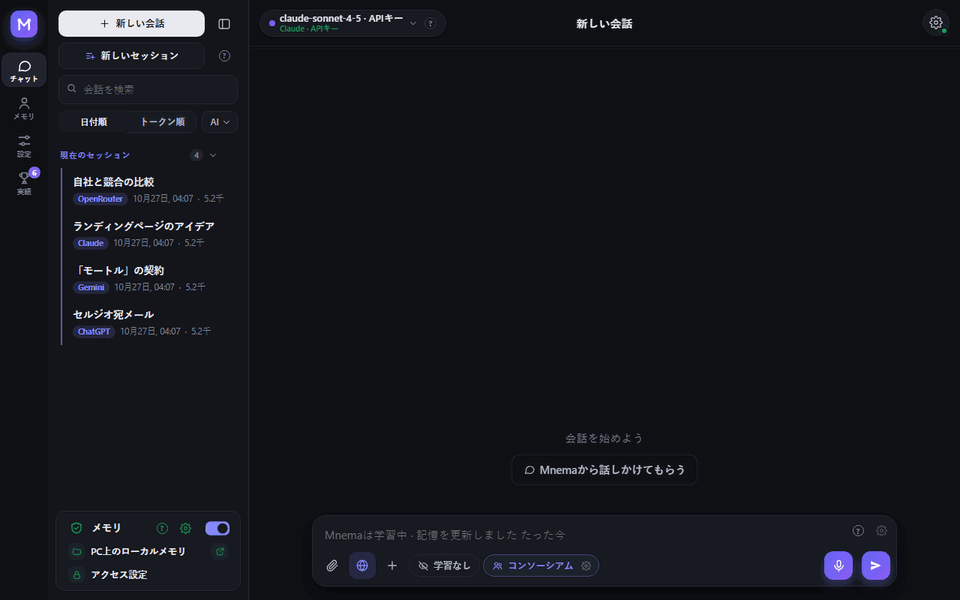
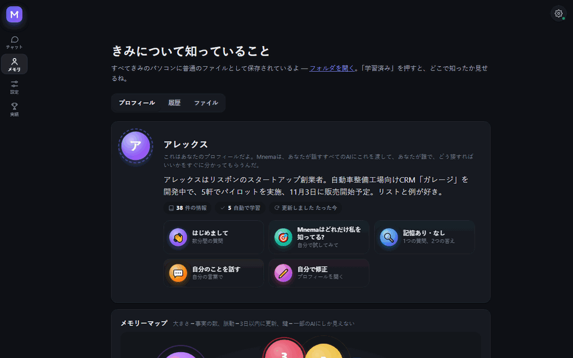
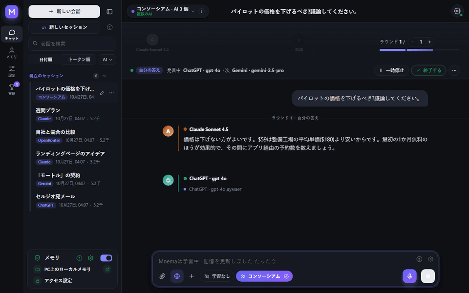
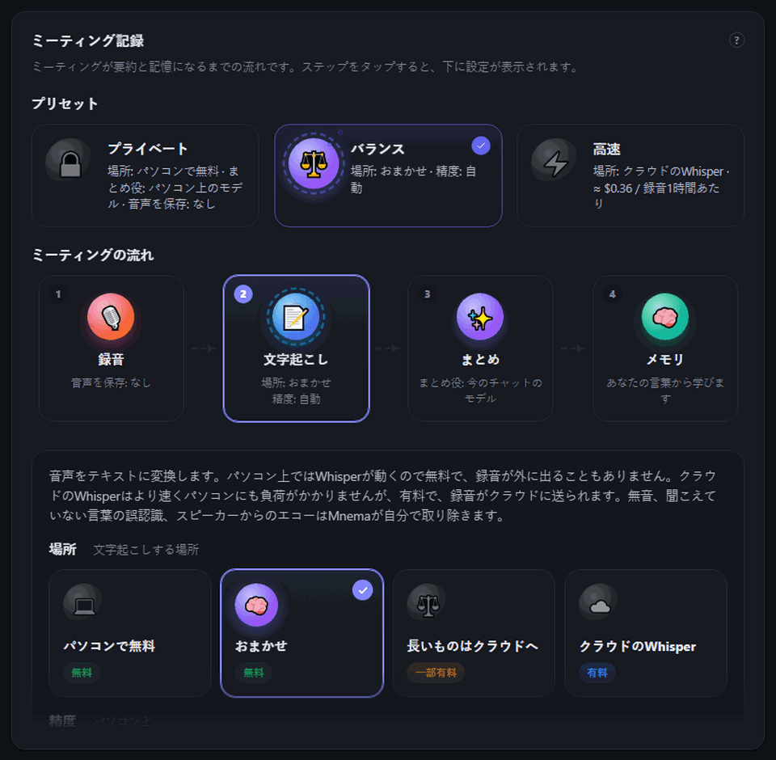
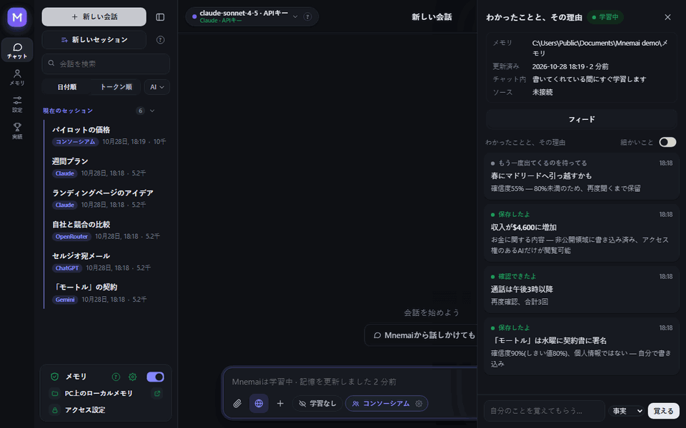
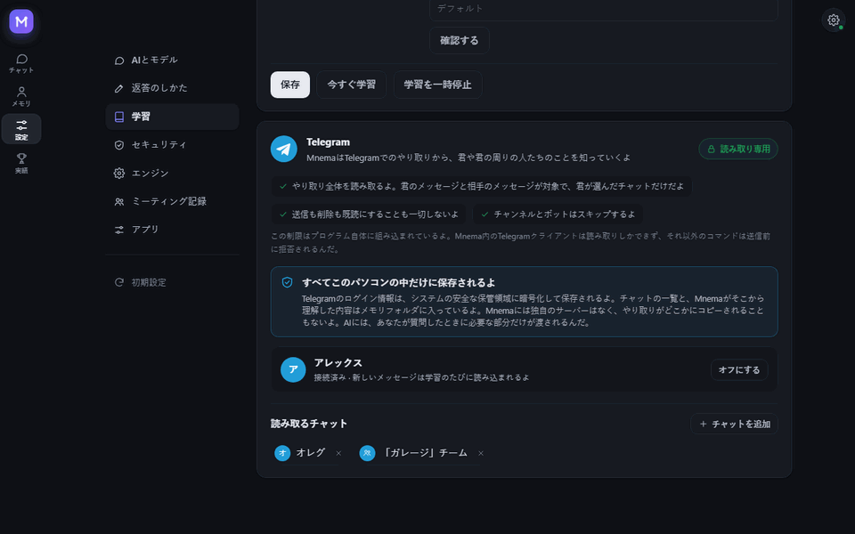
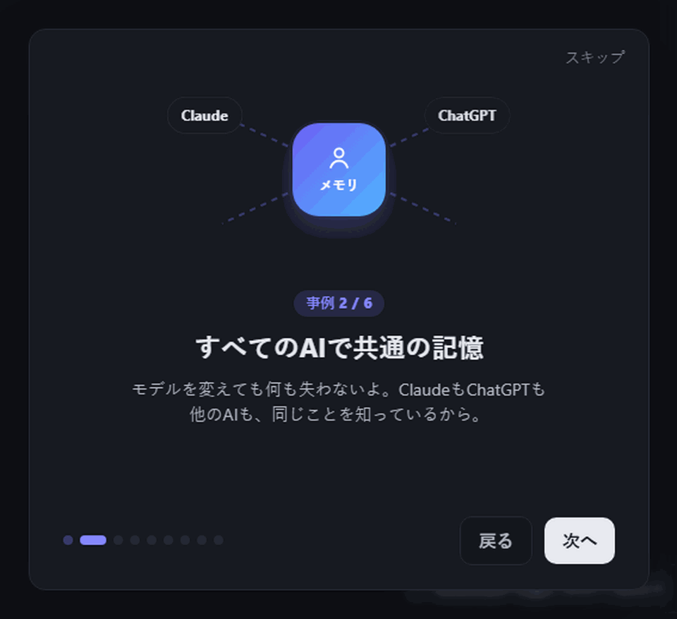
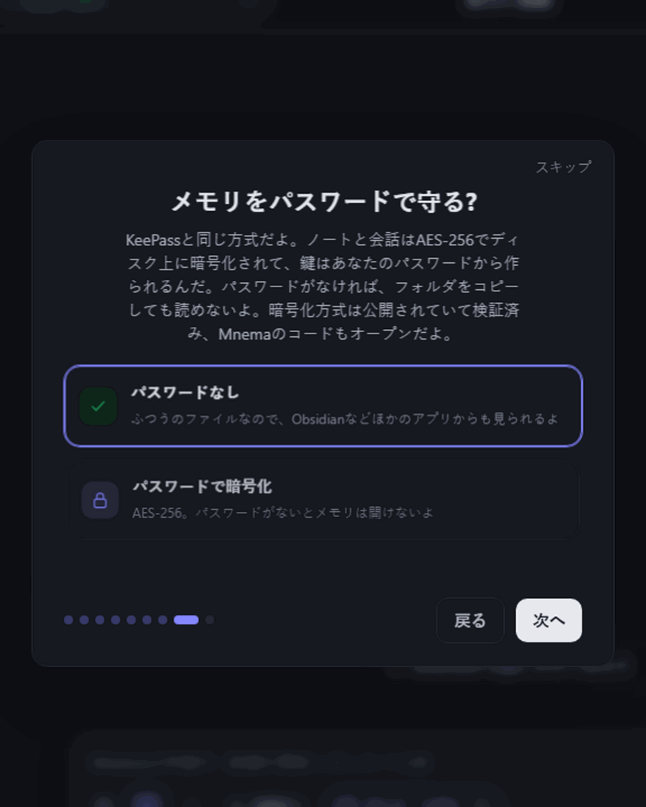
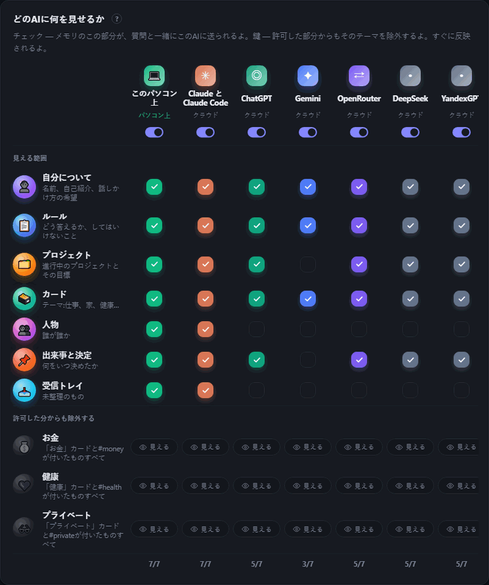

<div align="center">


# Mnema


<a href="https://github.com/Pumpetee/Mnema/releases/latest"></a> <a href="https://github.com/Pumpetee/Mnema/actions/workflows/tests.yml"></a> <a href="LICENSE"></a> <a href="https://github.com/Pumpetee/Mnema/commits/main"></a>

     

<a href="docs/guide/ja.md"></a>

<a href="https://github.com/Pumpetee/Mnema"></a><br><sub>スキャンしてリポジトリを開く · github.com/Pumpetee/Mnema</sub>

</div>

## 言語

Mnemaは9つの言語に対応しています。インターフェース、ヘルプ、AIの回答は、あなたが選んだ言語に合わせます。別の言語で書いても同じです。このREADMEとMnemaガイドは、どの言語でも用意されています。

<table>
<tr><td align="center" width="10%"><br><b>English</b><br><sub><a href="README.md">README</a> · <a href="docs/guide/en.md">Guide</a></sub></td><td align="center" width="10%"><br><b>Русский</b><br><sub><a href="README.ru.md">README</a> · <a href="docs/guide/ru.md">Справочник</a></sub></td><td align="center" width="10%"><br><b>中文</b><br><sub><a href="README.zh.md">README</a> · <a href="docs/guide/zh.md">指南</a></sub></td><td align="center" width="10%"><br><b>Español</b><br><sub><a href="README.es.md">README</a> · <a href="docs/guide/es.md">Guía</a></sub></td><td align="center" width="10%"><br><b>हिन्दी</b><br><sub><a href="README.hi.md">README</a> · <a href="docs/guide/hi.md">गाइड</a></sub></td></tr>
<tr><td align="center" width="10%"><br><b>Português</b><br><sub><a href="README.pt.md">README</a> · <a href="docs/guide/pt.md">Guia</a></sub></td><td align="center" width="10%"><br><b>Français</b><br><sub><a href="README.fr.md">README</a> · <a href="docs/guide/fr.md">Guide</a></sub></td><td align="center" width="10%"><br><b>Deutsch</b><br><sub><a href="README.de.md">README</a> · <a href="docs/guide/de.md">Handbuch</a></sub></td><td align="center" width="10%"><br><b>✓ 日本語</b><br><sub><a href="README.ja.md">README</a> · <a href="docs/guide/ja.md">ガイド</a></sub></td></tr>
</table>

<div align="center">

Mnemaは、あなたが誰で、何に取り組んでいて、何を決めて、どんな答え方が好きかを覚えています。そして話しかけるすべてのAIに、その文脈を渡します。記憶は、あなたのコンピューター上にあるプレーンなMarkdownファイルのフォルダです。クラウドもアカウントも要りません。

<a href="../../releases/latest/download/Mnema-Setup.exe"></a> <a href="../../releases/latest/download/Mnema-macos-arm64.dmg"></a> <a href="../../releases/latest/download/Mnema-x86_64.AppImage"></a>

<sub><a href="../../releases">すべてのファイル</a> · macOS Intel: <a href="../../releases/latest/download/Mnema-macos-x64.dmg">x64.dmg</a></sub>



<sub>「今週大事なことは?」と聞くと、予定が表になって返ってきます。合意済みの価格も、会議についてのあなたのルールも入っています。もう一度打ち直す必要はありません。</sub>

</div>

## ✨ できること

<table>
<tr>
<td width="33%" valign="top"><h3>🧠 あなたを知っている</h3>どのAIも最初に読むプロフィール、生きた記憶マップ、あなたが所有するプレーンなファイル。</td>
<td width="33%" valign="top"><h3>🗣️ コンソーシアム</h3>Claude、ChatGPT、Geminiが議論して、ひとつの答えにまとめます。</td>
<td width="33%" valign="top"><h3>🎙️ ミーティング</h3>通話が、文字起こしと要約、担当者つきのタスクになります。</td>
</tr>
<tr>
<td width="33%" valign="top"><h3>🔐 プライベート</h3>KeePassのように、記憶にパスワードをかけられます。秘密情報はクラウドに届きません。</td>
<td width="33%" valign="top"><h3>💻 オフライン</h3>13個の無料モデルが、キーなしであなたのPCで動きます。</td>
<td width="33%" valign="top"><h3>📉 トークン節約</h3>モデルに送るのは必要な部分だけ。長い契約書ならトークンが4.8×少なくなります。</td>
</tr>
</table>

## 🧠 あなたを知っている

<p align="center"></p>

- **どのAIも最初に読むプロフィール:** あなたが誰で、何を作っていて、どう仕事するのが好きか。Mnemaは学びながら書いていき、手で直すこともできます。
- **記憶マップ:** トピックはそれぞれ泡で、脈打っていれば最近変わったことを、鍵がついていれば一部のAIには見えないことを示します。
- **古い情報を新しいものとして扱わない:** すべての事実に日付がつき、1か月以上前のステータスはMnemaが改めて確認します。
- **フォルダは複数つなげられます:** ObsidianのVaultやチームのフォルダを接続できます。読み取り専用で、書き込みはプログラム自体がブロックします。

## 🗣️ コンソーシアム:複数のAIでひとつの答え

<p align="center"></p>

- **評議会、ディベート、ブレインストーム、レッドチーム、ローストから**形式とラウンド数を選べます。
- **いつでも割り込めます:** 「停止」で今話しているAIを止め、そこまでの発言は残します。
- **答えの下で別のAIと議論できます:** 書いたAIが擁護し、ほかのAIは間違いを探します。

## 🎙️ ミーティング:通話からタスクまで

<p align="center"></p>

- **2つのトラック:** マイクとPCの音声を分けて録るので、文字起こしで誰が話したか分かります。
- **あなたのPC上のWhisperなら無料**、クラウドのWhisperなら(≈ 1時間あたり$0.36)。無音、作り話のようなフレーズ、エコーは取り除かれます。
- **要約:** 決まったこと、タスク、担当者を、ローカルモデルを含め好きなモデルで作れます。
- **プリセット:** プライベート、バランス、高速で、全体のやり方を一度に切り替えられます。

## 🌱 自分で学ぶ

<p align="center"></p>

- **確かなら保存:** 確信度が80%以上の事実はすぐに書き込まれ、自信のないものは、もう一度出てくるまで待機します。
- **個人的なことは別に:** お金、健康、プライベートな話題はタグつきのカードに入り、どのAIからも隠せます。
- **あなたには何も隠しません:** 「理解したことと、その理由」フィードで、すべての判断が理由つきで見られます。

## ✈️ Telegramは読むだけ、書き込みはしない

<p align="center"></p>

- **チャットはあなたが選びます:** Mnemaがあなたや周りの人について学ぶのは、そのチャットからだけです。
- **設計として読み取り専用:** Mnema内のTelegramクライアントは読むことしかできず、それ以外のコマンドは送信前に拒否されます。
- **あなたのPCの中だけ:** ログイン情報はシステムのストアで暗号化され、Mnemaには専用のサーバーがありません。

## 📉 トークンを節約

<p align="center"></p>

- **必要な部分だけ送ります:** 記憶、ドキュメント、Webページはあなたのコンピューター上で読み込まれ、モデルには関連する部分だけが渡されます。
- **実測しました:** 153,000文字の契約書についての質問では、全文だと入力トークンが29,643かかりましたが、Mnemaが送ったのは6,159で、正しく答えられたのもMnemaだけでした。
- **毎回見えます:** 各回答の下に、節約したトークン数が表示されます。

## 🔐 設計から、プライベート

<table><tr><td width="50%" valign="top" align="center"><br><sub>初回起動:KeePassのように、記憶にパスワードを</sub></td><td width="50%" valign="top" align="center"><br><sub>誰に何が見えるか:記憶の部分ごとにチェック、トピックごとに鍵</sub></td></tr></table>

- **記憶にパスワードを:** AES-256で、鍵はあなたのパスワードから作られ、暗号技術はオープンソースです。パスワードがなければ、ディスクからコピーされてもノートは読めません。同期したコピーも暗号化されたままです。
- **秘密情報はあなたの手元に:** カード番号、パスワード、キー、電話番号は、クラウドのモデルに何かが送られる前にラベルに置き換えられます。
- **AIごとに別のアクセス権:** お金、健康、プライベートな話題は、ワンクリックでどのAIからも隠せます。

## 🤖 対応しているもの

<div align="center">
<table><tr><td valign="middle" width="150"><b>クラウドAI</b><br><sub>キーまたはサブスクリプションで</sub></td><td align="center" width="92"><br><sub><b>Claude</b></sub></td><td align="center" width="92"><br><sub><b>ChatGPT</b></sub></td><td align="center" width="92"><br><sub><b>Gemini</b></sub></td><td align="center" width="92"><br><sub><b>DeepSeek</b></sub></td><td align="center" width="92"><br><sub><b>YandexGPT</b></sub></td><td align="center" width="92"><br><sub><b>OpenRouter</b></sub></td></tr><tr><td valign="middle" width="150"><b>あなたのPC上で</b><br><sub>無料、オフライン</sub></td><td align="center" width="92"><br><sub><b>内蔵</b></sub></td><td align="center" width="92"><br><sub><b>Ollama</b></sub></td><td align="center" width="92"><br><sub><b>Strata</b></sub></td><td></td><td></td><td></td></tr><tr><td valign="middle" width="150"><b>あなたのツールで</b><br><sub>MCP経由</sub></td><td align="center" width="92"><br><sub><b>Claude Code</b></sub></td><td align="center" width="92"><br><sub><b>Cursor</b></sub></td><td></td><td></td><td></td><td></td></tr><tr><td valign="middle" width="150"><b>システム</b><br><sub>ひとつのアプリで</sub></td><td align="center" width="92"><br><sub><b>Windows</b></sub></td><td align="center" width="92"><br><sub><b>macOS</b></sub></td><td align="center" width="92"><br><sub><b>Linux</b></sub></td><td></td><td></td><td></td></tr></table>
</div>

## ⚡ ほかにも

- **あなたのファイルを扱えます。** スキャンを読み取り、ノートを書き、PDF、Word、Excelを作成し、PDFの結合と分割もできます。書き込みはすべて、Memory → Historyで元に戻せます。
- **9つの言語。** インターフェースとAIの回答は、あなたが選んだ言語に合わせます。別の言語で書いても同じです。

<details>
<summary><b>インストール</b></summary>

お使いのシステム用のファイルをダウンロードしてください（番号付きの全バージョンは [Releases](../../releases) にあります）:

| システム | ファイル | 方法 |
|---|---|---|
| Windows 10 および 11 | [`Mnema-Setup.exe`](../../releases/latest/download/Mnema-Setup.exe) | 実行してください。管理者権限は不要です。ポータブル版の `.zip` も用意されています。 |
| macOS 11 以降 | Apple Silicon: [`Mnema-macos-arm64.dmg`](../../releases/latest/download/Mnema-macos-arm64.dmg)、Intel: [`Mnema-macos-x64.dmg`](../../releases/latest/download/Mnema-macos-x64.dmg) | 開いて、Mnema を Applications にドラッグしてください。 |
| Linux x86-64（Ubuntu 22.04 以降、Fedora、Debian など） | [`Mnema-x86_64.AppImage`](../../releases/latest/download/Mnema-x86_64.AppImage) | `chmod +x Mnema-*.AppImage` を実行してから起動してください。同じプログラムをフォルダ形式にした `.tar.gz` もあり、中の `Mnema` を実行します。 |

パッケージにはまだコード署名がないため、各システムで初回に一度だけ警告が表示されます:

- **Windows** SmartScreen に「Windows によって PC が保護されました」と表示されます。**詳細情報 → 実行** をクリックしてください。
- **macOS** 開発元を確認できないと表示されます。Applications の Mnema を右クリックして **開く** を選ぶか、システム設定 → プライバシーとセキュリティ → **このまま開く** をクリックしてください。
- **Linux** AppImage には FUSE 2 が必要です: `sudo apt install libfuse2`（Ubuntu 24.04 では `libfuse2t64`）。または `.tar.gz` を使用してください。

ファイルを検証するには、その sha256 を隣にある `.sha256` ファイルと比較してください: Windows では `certutil -hashfile <file> SHA256`、macOS では `shasum -a 256 <file>`、Linux では `sha256sum <file>`。

</details>

<details>
<summary><b>ソースからビルド</b></summary>

Windows:

```powershell
python -m venv .venv
.venv\Scripts\pip install -r requirements-dev.txt
.venv\Scripts\python tools\fetch_vendor.py      # llama.cpp, Xray, WebView2 を公式リリースから取得し、検証します
.venv\Scripts\python -m mnema.desktop           # プログラムを実行
.venv\Scripts\python tools\package.py           # dist\Mnema-Setup-<version>.exe とポータブル版 zip
```

macOS と Linux:

```bash
python3 -m venv .venv
.venv/bin/pip install -r requirements-dev.txt
.venv/bin/python tools/fetch_vendor.py           # お使いのシステム向けの llama.cpp と Xray を取得し、sha256 で検証します
.venv/bin/python -m mnema.desktop                # プログラムを実行
.venv/bin/python tools/package.py                # macOS: dist/Mnema-<version>-macos-arm64.dmg
                                                 # Linux: dist/Mnema-<version>-x86_64.AppImage と .tar.gz
```

プッシュのたびに Windows、macOS、Linux でテストが実行されます。3 つのパッケージがビルドされ、ウィンドウ付きで一度起動され、その実行結果のファイルとして保存されます (`.github/workflows`)。

コアに必要なのは Python 標準ライブラリだけです。vault、アクセスルール、ジャーナル、MCP サーバー、コマンドラインをカバーしています。

```bash
python -m mnema init ~/mnema --default
python -m mnema serve                    # http://127.0.0.1:7461
python -m mnema install claude-code      # 計画を表示します。--apply を付けると適用されます

</details>

<details>
<summary><b>仕組み</b></summary>

[docs/ARCHITECTURE.md](docs/ARCHITECTURE.md) をご覧ください。概要は次のとおりです。

| 部分 | 場所 |
|---|---|
| Vault：フォルダ、事実、非表示タグ付きのセクション | `mnema/vault.py`, `mnema/memory.py` |
| AIごとのアクセスルール | `mnema/clients.py` |
| ジャーナルと元に戻す機能 | `mnema/journal.py` |
| MCPサーバー、コマンドライン | `mnema/mcp_server.py`, `mnema/cli.py` |
| ローカルAPIとウィンドウ | `mnema/api*.py`, `mnema/desktop.py` |
| インターフェース | `mnema/ui/index.html`, `mnema/ui/css/app.css`, `mnema/ui/js/NN-*.js`（順番に読み込まれます） |
| あらゆるモデルとのチャット、コンソーシアム、ファイルを使った操作 | `mnema/chat/` |
| 学習：ソース、ブレイン、意思決定 | `mnema/learn/` |
| コンピューターの外に出るもの | `mnema/outgoing.py` |
| Windows、macOS、Linuxの違い | `mnema/osapi.py` |
| パスワードによるメモリの暗号化 | `mnema/crypt.py` |
| スキャンや画像からのテキスト抽出 | `mnema/ocr.py` |
| アシスタントが回答の根拠にするナレッジベース | `mnema/knowledge/mnema.md` |

</details>

<details>
<summary><b>セキュリティ</b></summary>

ローカル API は 127.0.0.1 のみで待ち受け、Host ヘッダーを検証し、トークンを必須としています。リンクによるページ共有や VPN サブスクリプションは、インターネット側からのみ開かれ、このコンピューターやローカルネットワークからは開かれません。キーやパスワードはシステムのシークレットストア(Windows では DPAPI、macOS では Keychain、Linux では Secret Service がある場合)に保存され、メモリフォルダーには保存されません。メモリ自体はパスワードで暗号化できます(AES-256-GCM、鍵は scrypt で保護)。暗号化されたメモリの同期では、暗号化されたファイルのみが送信されます。クラウドモデルへのすべてのリクエストは、何を送信し何を隠したかとともに記録されます。脆弱性は作者宛てに非公開で報告してください。

</details>

## ライセンス

AGPL-3.0。個人利用およびオープンソースプロジェクトでは無料でご利用いただけます。商用ライセンスとチーム版は作者から提供されています。

© 2026 Anton Sannikov

<div align="center">


<sub>Mnemaがあなたの役に立つことを覚えていたら、⭐を付けてもらえると、ほかの人が見つけやすくなります。</sub>
</div>
