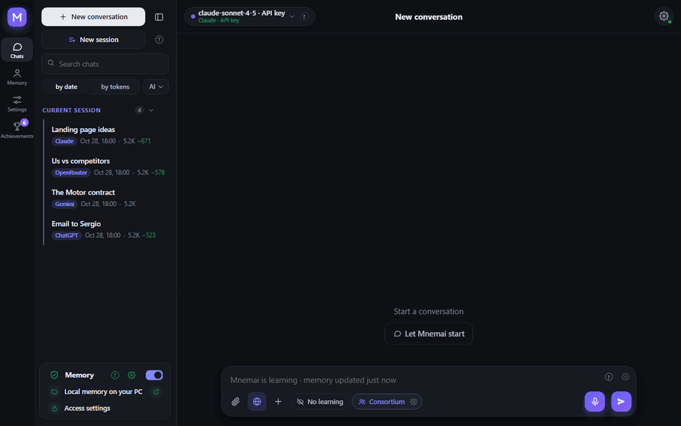
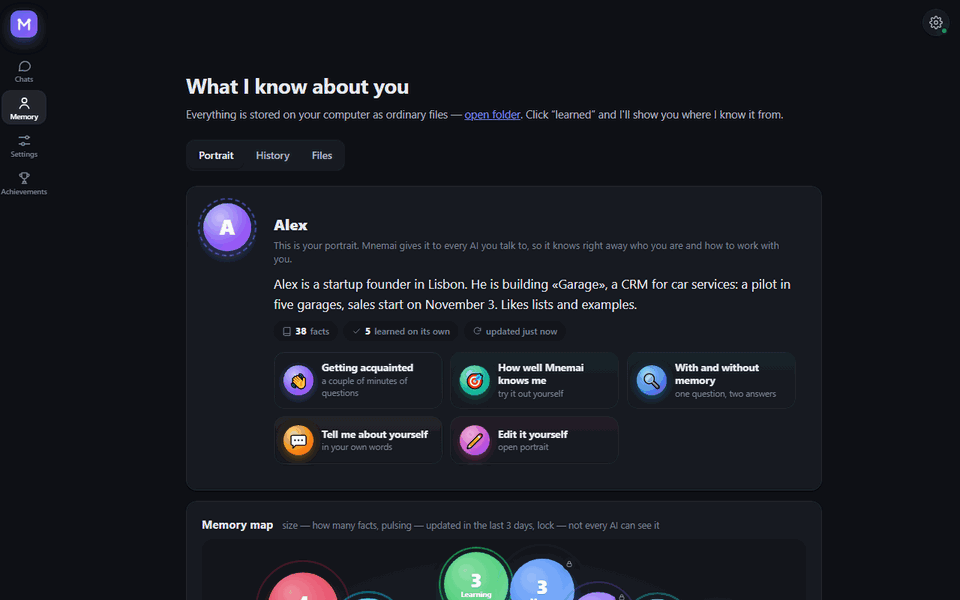
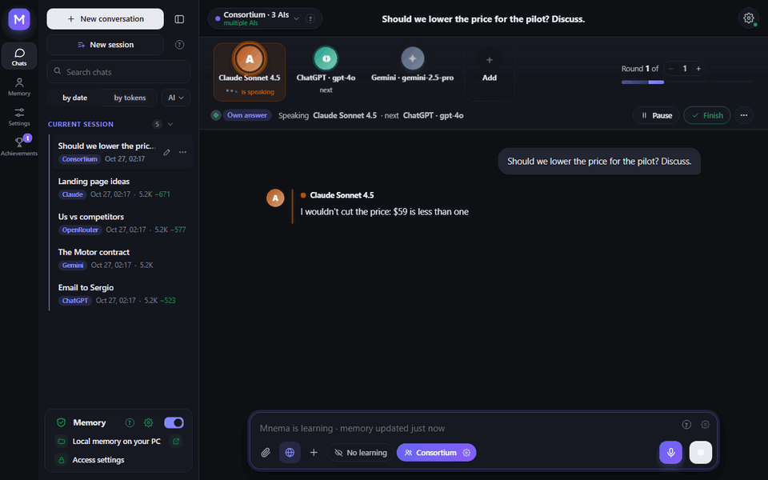
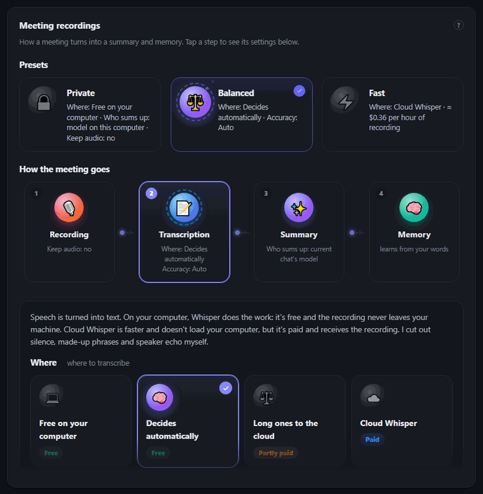
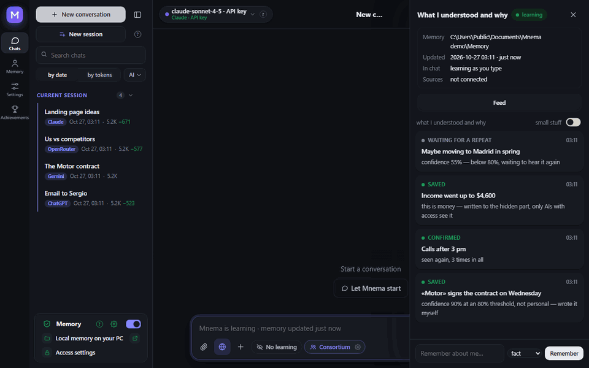
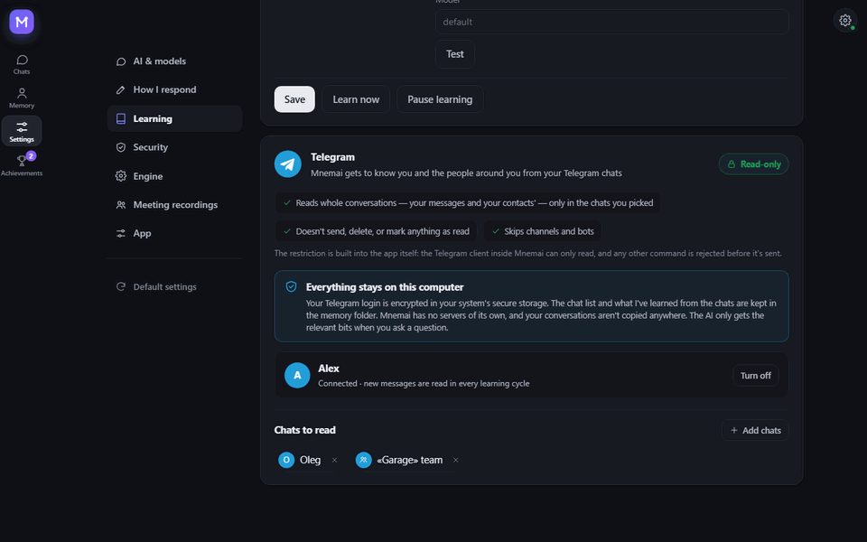
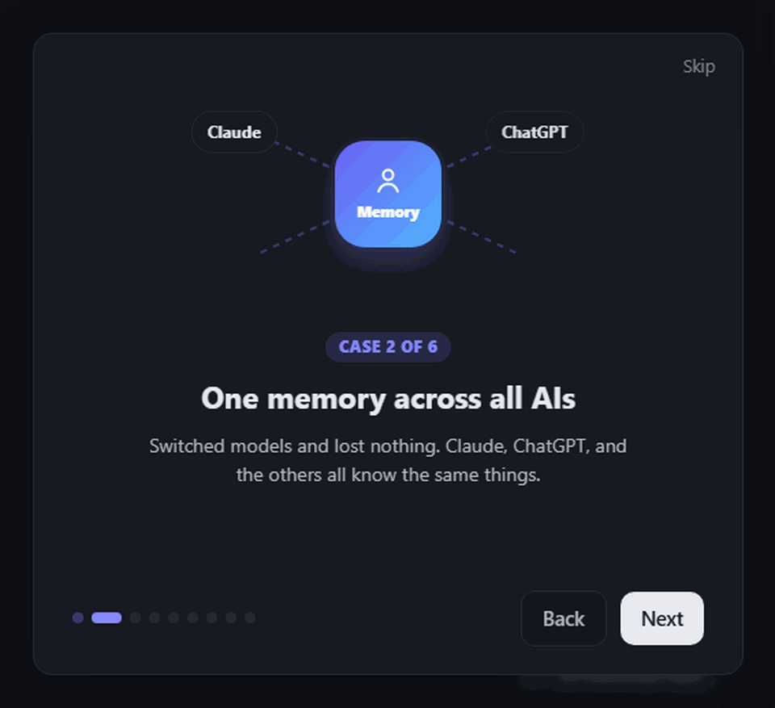
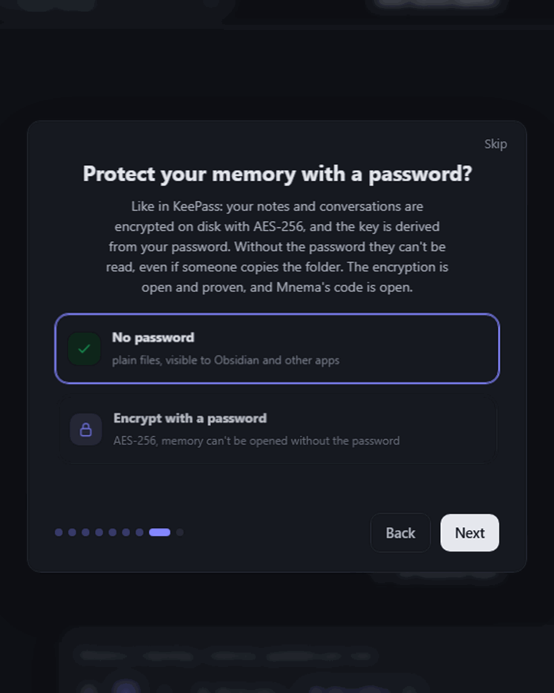
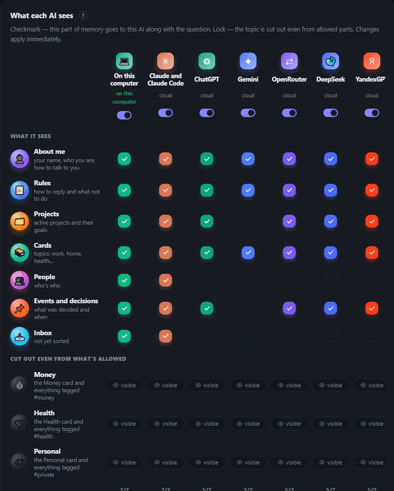

<div align="center">


# Mnema


<a href="https://github.com/Pumpetee/Mnema/releases/latest"></a> <a href="https://github.com/Pumpetee/Mnema/actions/workflows/tests.yml"></a> <a href="LICENSE"></a> <a href="https://github.com/Pumpetee/Mnema/commits/main"></a>

     

<a href="docs/guide/en.md"></a>

</div>

## Languages

Mnema speaks nine languages. The interface, the help and the AI's answers follow the one you pick, even when you write in another. This README and the Mnema guide exist in each of them.

<table>
<tr><td align="center" width="10%"><br><b>✓ English</b><br><sub><a href="README.md">README</a> · <a href="docs/guide/en.md">Guide</a></sub></td><td align="center" width="10%"><br><b>Русский</b><br><sub><a href="README.ru.md">README</a> · <a href="docs/guide/ru.md">Справочник</a></sub></td><td align="center" width="10%"><br><b>中文</b><br><sub><a href="README.zh.md">README</a> · <a href="docs/guide/zh.md">指南</a></sub></td><td align="center" width="10%"><br><b>Español</b><br><sub><a href="README.es.md">README</a> · <a href="docs/guide/es.md">Guía</a></sub></td><td align="center" width="10%"><br><b>हिन्दी</b><br><sub><a href="README.hi.md">README</a> · <a href="docs/guide/hi.md">गाइड</a></sub></td></tr>
<tr><td align="center" width="10%"><br><b>Português</b><br><sub><a href="README.pt.md">README</a> · <a href="docs/guide/pt.md">Guia</a></sub></td><td align="center" width="10%"><br><b>Français</b><br><sub><a href="README.fr.md">README</a> · <a href="docs/guide/fr.md">Guide</a></sub></td><td align="center" width="10%"><br><b>Deutsch</b><br><sub><a href="README.de.md">README</a> · <a href="docs/guide/de.md">Handbuch</a></sub></td><td align="center" width="10%"><br><b>日本語</b><br><sub><a href="README.ja.md">README</a> · <a href="docs/guide/ja.md">ガイド</a></sub></td></tr>
</table>

<div align="center">

Mnema remembers who you are, what you are working on, what you decided and how you like answers — and every AI you talk to gets that context. The memory is a folder of plain Markdown files on your computer. No cloud, no account.

<a href="../../releases/latest/download/Mnema-Setup.exe"></a> <a href="../../releases/latest/download/Mnema-macos-arm64.dmg"></a> <a href="../../releases/latest/download/Mnema-x86_64.AppImage"></a>

<sub><a href="../../releases">all files</a> · macOS Intel: <a href="../../releases/latest/download/Mnema-macos-x64.dmg">x64.dmg</a></sub>



<sub>You ask «what matters this week?» — the plan comes as a table, with the agreed price and your rule about meetings. You never retyped them.</sub>

</div>

## ✨ What it does

<table>
<tr>
<td width="33%" valign="top"><h3>🧠 Knows you</h3>A portrait every AI reads first, a living memory map, plain files you own.</td>
<td width="33%" valign="top"><h3>🗣️ Consortium</h3>Claude, ChatGPT and Gemini argue and agree on one answer.</td>
<td width="33%" valign="top"><h3>🎙️ Meetings</h3>A call becomes a transcript, a summary and tasks with owners.</td>
</tr>
<tr>
<td width="33%" valign="top"><h3>🔐 Private</h3>A password on the memory like KeePass. Secrets never reach the cloud.</td>
<td width="33%" valign="top"><h3>💻 Offline</h3>13 free models run on your computer, with no keys.</td>
<td width="33%" valign="top"><h3>📉 Fewer tokens</h3>Only what matters goes to the model: 4.8× fewer tokens on a long contract.</td>
</tr>
</table>

## 🧠 It knows you

<p align="center"></p>

- **A portrait every AI reads first:** who you are, what you are building, how you like to work. Mnema writes it as it learns, you can fix it by hand.
- **A memory map:** each topic is a bubble, a pulse means it changed recently, a lock means some AIs don't see it.
- **Old facts don't pass for new ones:** every fact carries its date, and Mnema asks again about a status older than a month.
- **More than one folder:** connect an Obsidian vault or a team folder — read only, the program itself blocks writing there.

## 🗣️ Consortium: several AIs, one answer

<p align="center"></p>

- **Council, debate, brainstorm, red team, roast** — pick the format and the number of rounds.
- **Step in at any time:** «Stop» cuts the current AI and keeps what it said.
- **Argue with different AIs** under any answer: its author defends it, the rest look for where it is wrong.

## 🎙️ Meetings: from a call to tasks

<p align="center"></p>

- **Two tracks:** your microphone and the computer's sound, so the transcript knows who spoke.
- **Whisper on your computer for free**, or the cloud Whisper (≈ $0.36 an hour) — silence, made-up phrases and echo are cut out.
- **The summary:** what was decided, the tasks and who owns them, by any model you pick, a local one included.
- **Presets:** Private, Balanced, Fast set the whole way at once.

## 🌱 It learns by itself

<p align="center"></p>

- **Sure means saved:** a fact it is sure of (80% or more) is written at once, a doubtful one waits to be heard again.
- **Personal goes apart:** money, health and private matters land in tagged cards you can hide from any AI.
- **Nothing is hidden from you:** the «What I understood and why» feed shows every decision with its reason.

## ✈️ Reads Telegram, never writes there

<p align="center"></p>

- **You pick the chats:** Mnema learns about you and the people around you only from those.
- **Read only, by design:** the Telegram client inside Mnema can only read; any other command is refused before it is sent.
- **Stays on your computer:** the login is encrypted in the system's store, and Mnema has no servers of its own.

## 📉 Saves tokens

<p align="center"></p>

- **Only what matters goes out:** memory, documents and web pages are read on your computer, and the model gets the relevant parts.
- **Measured:** on a question about a 153,000-character contract the whole text took 29,643 input tokens; Mnema sent 6,159, and only the Mnema answer was right.
- **Visible every time:** under each answer you see how many tokens were saved.

## 🔐 Private by design

<table><tr><td width="50%" valign="top" align="center"><br><sub>First start: a password on the memory, like KeePass</sub></td><td width="50%" valign="top" align="center"><br><sub>Who sees what: a tick per part of memory, a lock per topic</sub></td></tr></table>

- **A password on the memory:** AES-256, the key comes from your password, open-source cryptography. Without it the notes can't be read, even copied off the disk. A synced copy stays encrypted too.
- **Secrets stay with you:** card numbers, passwords, keys and phones become labels before anything goes to a cloud model.
- **Every AI has its own access:** money, health and private topics are hidden from any of them in one click.

## 🤖 Works with

<div align="center">
<table><tr><td valign="middle" width="150"><b>Cloud AI</b><br><sub>by key or subscription</sub></td><td align="center" width="92"><br><sub><b>Claude</b></sub></td><td align="center" width="92"><br><sub><b>ChatGPT</b></sub></td><td align="center" width="92"><br><sub><b>Gemini</b></sub></td><td align="center" width="92"><br><sub><b>DeepSeek</b></sub></td><td align="center" width="92"><br><sub><b>YandexGPT</b></sub></td><td align="center" width="92"><br><sub><b>OpenRouter</b></sub></td></tr><tr><td valign="middle" width="150"><b>On your computer</b><br><sub>free, offline</sub></td><td align="center" width="92"><br><sub><b>Built-in</b></sub></td><td align="center" width="92"><br><sub><b>Ollama</b></sub></td><td align="center" width="92"><br><sub><b>Strata</b></sub></td><td></td><td></td><td></td></tr><tr><td valign="middle" width="150"><b>In your tools</b><br><sub>over MCP</sub></td><td align="center" width="92"><br><sub><b>Claude Code</b></sub></td><td align="center" width="92"><br><sub><b>Cursor</b></sub></td><td></td><td></td><td></td><td></td></tr><tr><td valign="middle" width="150"><b>Systems</b><br><sub>one app</sub></td><td align="center" width="92"><br><sub><b>Windows</b></sub></td><td align="center" width="92"><br><sub><b>macOS</b></sub></td><td align="center" width="92"><br><sub><b>Linux</b></sub></td><td></td><td></td><td></td></tr></table>
</div>

## ⚡ And more

- **Works with your files.** Reads scans, writes notes, makes PDF, Word and Excel, merges and splits PDF. Every write can be undone in Memory → History.
- **Nine languages.** The interface and the AI's answers follow the one you pick, even when you write in another.

<details>
<summary><b>Install</b></summary>

Download the file for your system (every version with its number is in [Releases](../../releases)):

| System | File | How |
|---|---|---|
| Windows 10 and 11 | [`Mnema-Setup.exe`](../../releases/latest/download/Mnema-Setup.exe) | Run it. No administrator rights needed. A portable `.zip` is there as well. |
| macOS 11 and newer | Apple Silicon: [`Mnema-macos-arm64.dmg`](../../releases/latest/download/Mnema-macos-arm64.dmg), Intel: [`Mnema-macos-x64.dmg`](../../releases/latest/download/Mnema-macos-x64.dmg) | Open it and drag Mnema to Applications. |
| Linux x86-64 (Ubuntu 22.04 and newer, Fedora, Debian…) | [`Mnema-x86_64.AppImage`](../../releases/latest/download/Mnema-x86_64.AppImage) | `chmod +x Mnema-*.AppImage` and run it. The same program as a folder: `.tar.gz`, run `Mnema` inside. |

The packages are not code-signed yet, so each system warns once:

- **Windows** SmartScreen says «Windows protected your PC». Click **More info → Run anyway**.
- **macOS** says it can't check the developer. Right-click Mnema in Applications → **Open**, or open System Settings → Privacy & Security → **Open Anyway**.
- **Linux** AppImage needs FUSE 2: `sudo apt install libfuse2` (on Ubuntu 24.04: `libfuse2t64`). Or use the `.tar.gz`.

To check a file, compare its sha256 with the `.sha256` file beside it: `certutil -hashfile <file> SHA256` on Windows, `shasum -a 256 <file>` on macOS, `sha256sum <file>` on Linux.

</details>

<details>
<summary><b>Build from source</b></summary>

Windows:

```powershell
python -m venv .venv
.venv\Scripts\pip install -r requirements-dev.txt
.venv\Scripts\python tools\fetch_vendor.py      # llama.cpp, Xray, WebView2 from their official releases, verified
.venv\Scripts\python -m mnema.desktop           # run the program
.venv\Scripts\python tools\package.py           # dist\Mnema-Setup-<version>.exe and the portable zip
```

macOS and Linux:

```bash
python3 -m venv .venv
.venv/bin/pip install -r requirements-dev.txt
.venv/bin/python tools/fetch_vendor.py           # llama.cpp and Xray for this system, verified by sha256
.venv/bin/python -m mnema.desktop                # run the program
.venv/bin/python tools/package.py                # macOS: dist/Mnema-<version>-macos-arm64.dmg
                                                 # Linux: dist/Mnema-<version>-x86_64.AppImage and .tar.gz
```

Every push is tested on Windows, macOS and Linux; the three packages are built, started once with their window and kept as files of the run (`.github/workflows`).

The core needs only the Python standard library. It covers the vault, access rules, journal, MCP server and command line:

```bash
python -m mnema init ~/mnema --default
python -m mnema serve                    # http://127.0.0.1:7461
python -m mnema install claude-code      # shows the plan; add --apply
```

</details>

<details>
<summary><b>How it is built</b></summary>

See [docs/ARCHITECTURE.md](docs/ARCHITECTURE.md). In short:

| Part | Where |
|---|---|
| Vault: folders, facts, sections with hidden tags | `mnema/vault.py`, `mnema/memory.py` |
| Access rules per AI | `mnema/clients.py` |
| Journal and undo | `mnema/journal.py` |
| MCP server, command line | `mnema/mcp_server.py`, `mnema/cli.py` |
| Local API and the window | `mnema/api*.py`, `mnema/desktop.py` |
| Interface | `mnema/ui/index.html`, `mnema/ui/css/app.css`, `mnema/ui/js/NN-*.js` (loaded in order) |
| Chat with any model, consortium, actions with files | `mnema/chat/` |
| Learning: sources, brains, decisions | `mnema/learn/` |
| What leaves the computer | `mnema/outgoing.py` |
| What differs between Windows, macOS and Linux | `mnema/osapi.py` |
| Encryption of the memory by password | `mnema/crypt.py` |
| Text from scans and pictures | `mnema/ocr.py` |
| Knowledge base the assistant answers from | `mnema/knowledge/mnema.md` |

</details>

<details>
<summary><b>Security</b></summary>

The local API listens on 127.0.0.1 only, checks the Host header and requires a token. Pages by link and VPN subscriptions are opened only from the internet, never from this computer or the local network. Keys and passwords live in the system's secret store (DPAPI on Windows, the Keychain on macOS, the Secret Service on Linux when there is one), never in the memory folder. The memory itself can be encrypted with a password (AES-256-GCM, the key protected by scrypt); sync of an encrypted memory sends only encrypted files. Every request to a cloud model is logged with what was sent and what was hidden. Report vulnerabilities privately to the author.

</details>

## License

AGPL-3.0. Free for personal use and for open-source projects. A commercial license and the team edition are available from the author.

© 2026 Anton Sannikov

<div align="center">


<sub>If Mnema remembers something useful for you, a ⭐ helps others find it.</sub>
</div>
