# Stop explaining yourself to every new chat.

**One memory for Claude, ChatGPT and Gemini — free and on your computer.**

[](https://github.com/Pumpetee/Mnema/releases/latest) [](https://github.com/Pumpetee/Mnema/actions/workflows/tests.yml) [](https://github.com/Pumpetee/Mnema/actions/workflows/build.yml) [](https://github.com/Pumpetee/Mnema/actions/workflows/github-code-scanning/codeql) [](LICENSE) [](https://github.com/Pumpetee/Mnema/commits/main)

            

Mnema remembers who you are, what you are working on, what you decided and how you like answers. Every AI you talk to gets that context: Claude, ChatGPT, Gemini, DeepSeek or a free model running on your own computer. The memory is a folder of plain Markdown files. There is no cloud and no account.

**Download:** [Windows](../../releases/latest/download/Mnema-Setup.exe) · [macOS (Apple Silicon)](../../releases/latest/download/Mnema-macos-arm64.dmg) · [macOS (Intel)](../../releases/latest/download/Mnema-macos-x64.dmg) · [Linux (AppImage)](../../releases/latest/download/Mnema-x86_64.AppImage) · [all files](../../releases)

[Русская версия](README.ru.md)

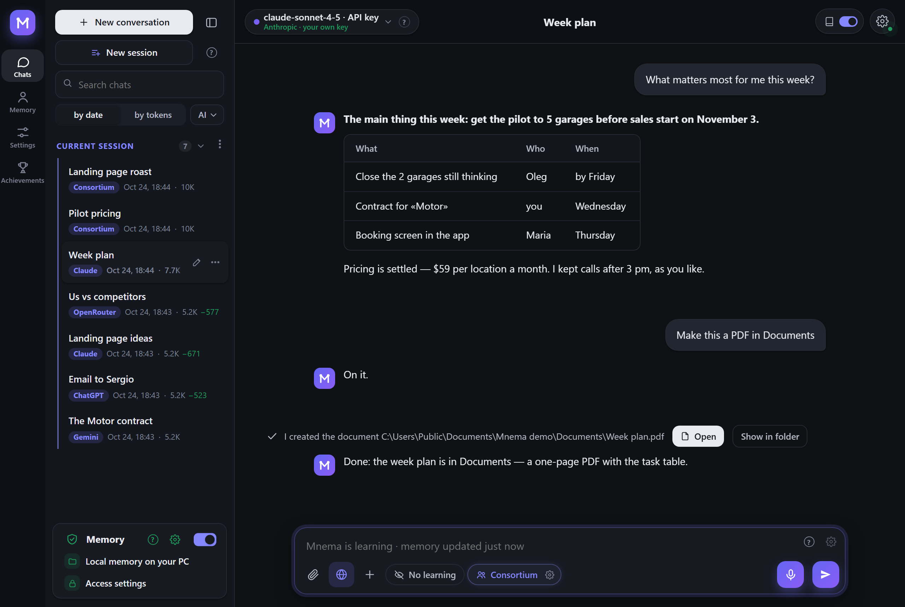

You ask «what matters this week?» and get the plan as a table. It includes the agreed price and your rule about meetings, because Mnema already knows both. You never retyped them.

## Try it in a minute

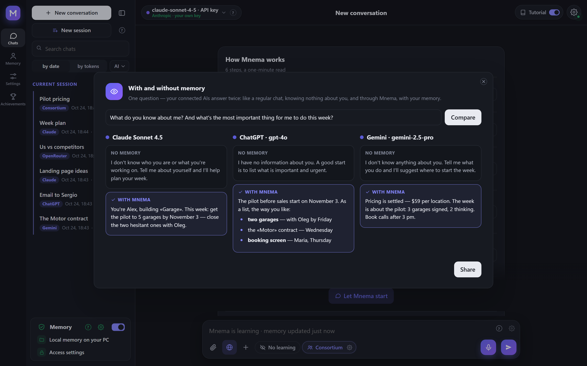

- **With and without memory.** One question to your connected AIs, and each answers twice: as a plain chat that knows nothing about you, and through Mnema. The difference shows at once.
- **Getting acquainted.** Seven short questions on day one: who you are, what matters now, what you work on, who is around you and how to talk to you. The answers go into memory as ordinary facts and overwrite nothing.
- **How well Mnema knows you.** A quiz on your own memory: «correct», «not anymore» or «wrong». Every answer fixes the memory: outdated facts are rewritten, wrong ones go to the archive.
- **Roast.** Hand an idea, a resume, a text or a landing page to several AIs: they find the weak spots, harsh but to the point, and finish with a score out of 10 and three fixes.

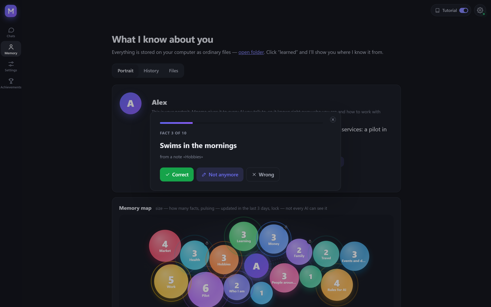

Any result can become a card: a picture with the score or the answer and nothing personal beyond what you see on it. Copy it, save it, or take it with a ready post text. All of this is in the «+» menu under the input and on the Memory page.

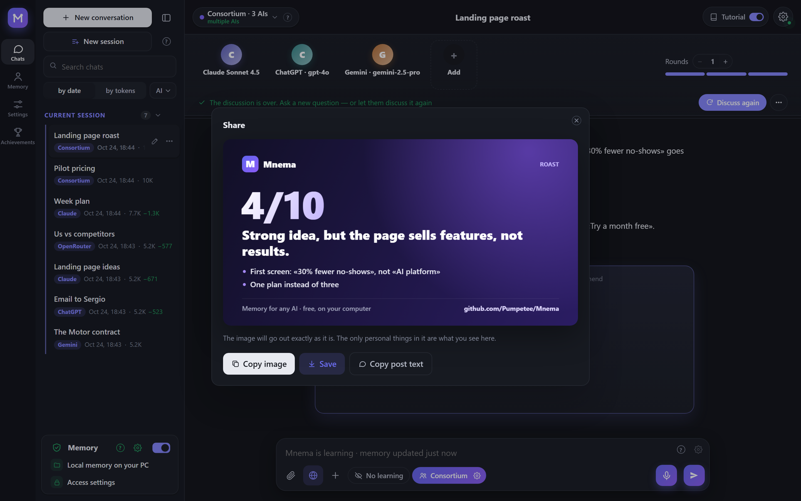

## Memory: it knows you

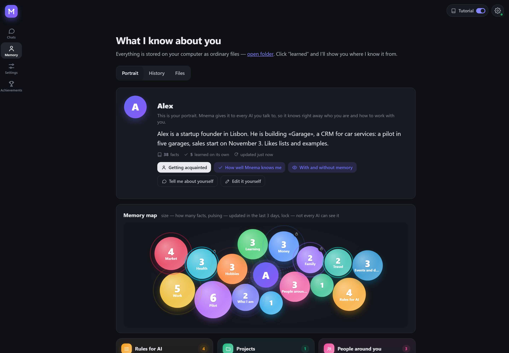

- **A portrait every AI reads first.** It says who you are, what you are building and how you like to work. Mnema writes it from what it learns, and you can fix it by hand.
- **A memory map.** Each topic is a bubble. Size shows how much Mnema knows, a pulse means it changed recently, and a lock means the topic is hidden from some AIs.
- **Plain files you own.** Cards, rules, people, decisions and events are ordinary Markdown in your folder. Open them in any editor, sync them however you like, and delete them whenever you want.
- **Old facts don't pass for new ones.** Every fact carries the date it was said. Mnema asks again about any status older than a month.
- **Off with one switch.** A new memory starts switched off: Mnema is then a plain chat that remembers nothing, and the dot by the gear turns yellow. One switch in the memory panel turns it on, and every AI gets to know you.
- **More than one folder.** Add your notes, an Obsidian vault or a team folder as extra memory: only the passages a question needs go to the AI. «Connect Obsidian» finds the vaults on your computer by itself. Mnema only reads connected folders: writing to them is blocked in the program itself. Several memories on one computer switch in the settings, and each can be renamed or deleted (deleting asks twice and waits ten seconds).

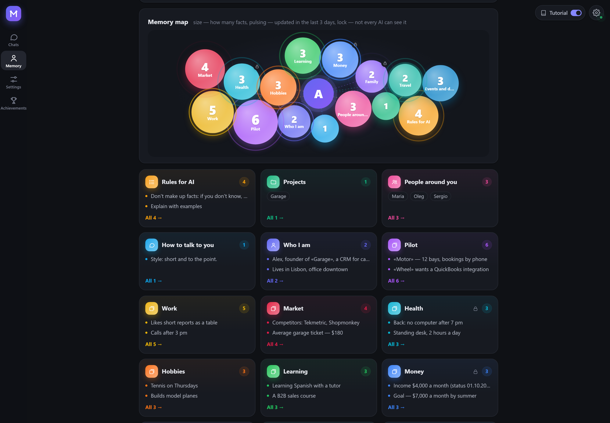

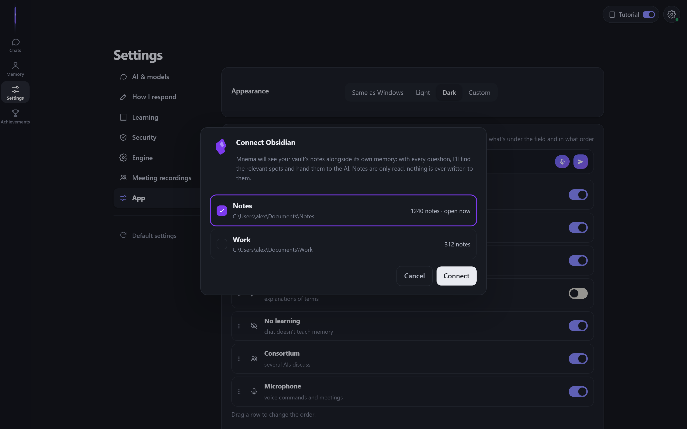

## Consortium: several AIs, one answer

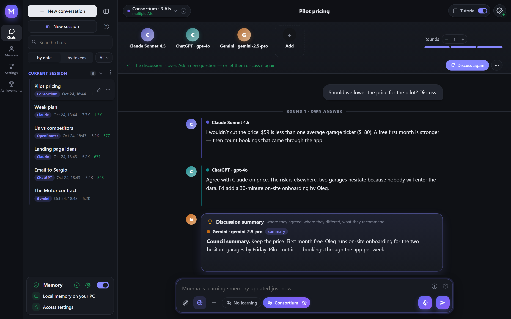

Ask Claude, ChatGPT and Gemini at once. They answer, read each other and argue, and one of them writes the summary: where they agreed, where they differed and what they recommend. All of them see the same memory of you.

| Format | What happens |
|---|---|
| Council | each answers, they check each other, one joint answer at the end |
| Debate | some argue for, others against, a verdict at the end |
| Brainstorm | ideas without criticism, then the three best |
| Red team | they hunt for holes in your plan and how to close them |
| Roast | they take an idea, a resume or a text apart, harsh but to the point, with a score out of 10 |

You can set the number of rounds and step in between them: «Stop» cuts the current AI at once and keeps what it said. Every participant gets the whole conversation with your files, not just the last question. Under any answer, **Argue with different AIs** puts it on trial: you pick the opponents, its author defends it, the rest look for where it is wrong, and a verdict ends it. With a single AI connected, its own models argue, for example Sonnet against Opus.

## Any AI

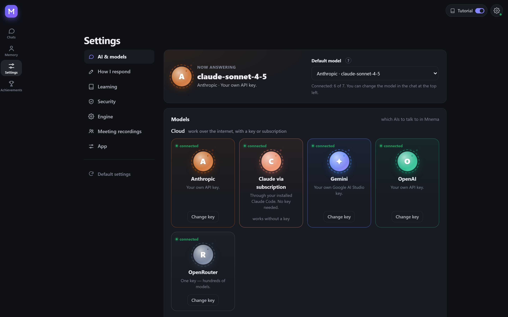

- **In Mnema's own chat:** every model is equal. Cloud: Anthropic, OpenAI, Gemini, OpenRouter (hundreds of models with one key) by key, or Claude Code by subscription. On your computer: the built-in model or Ollama. You can switch models in the middle of a conversation.
- **In the programs you already use:** Claude Code, Claude Desktop and Cursor connect over MCP. ChatGPT and Gemini work in Mnema's chat with your key: whatever the AIs can't do themselves, Mnema does on your computer, with no browser extensions.
- **You decide who sees what.** Every AI has its own access: which parts of memory it sees and which topics are cut out. Money, health and private topics can be hidden from any of them with one click.

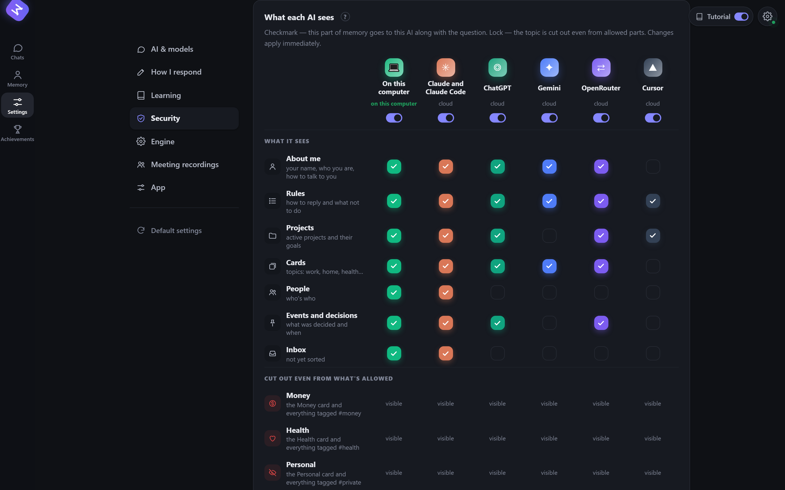

## Local models: free and offline

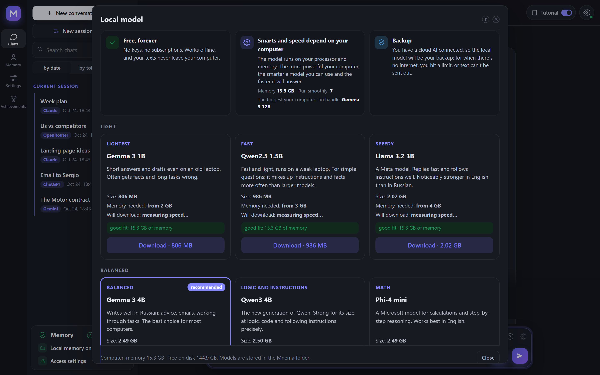

You can choose from 13 models: Gemma 3, Qwen 3, Llama 3, Phi-4 mini, Mistral Small, YandexGPT and others. Mnema measures your computer and shows which models will run smoothly and how long each takes to download. No keys and no subscription are needed, and your text never leaves the machine. If you also use a cloud AI, the local model is the backup for when there's no internet, you hit a limit, or the text must not go out. When the network drops in the middle of a conversation, Mnema switches to it by itself.

## Smart Mnema

**It learns by itself.** While you talk, Mnema understands what is worth keeping:

- A fact it is confident about (80% or more) is written down at once.
- A fact it is unsure about waits until you say it again.
- Money, health and private matters get their own tagged cards, which you can hide from any AI.

The «What I understood and why» feed shows each decision with its reason. If you allow it, Mnema also learns from other programs on your computer.

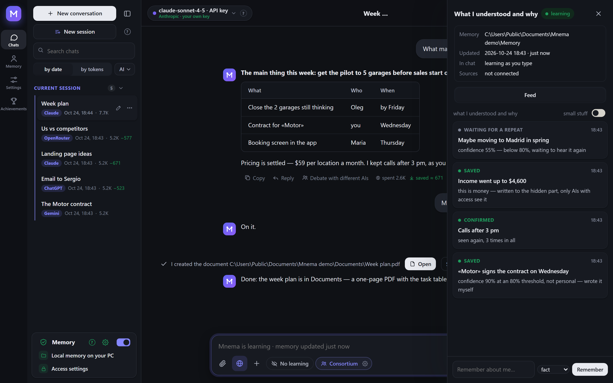

**It reads Telegram and never writes there.** You pick the chats, and Mnema learns about you and the people around you from the conversations. The ban on writing is built into the program: the Telegram client inside Mnema can only read, and any other command is refused before it is sent. The login is stored encrypted on your computer, and Mnema has no servers of its own.

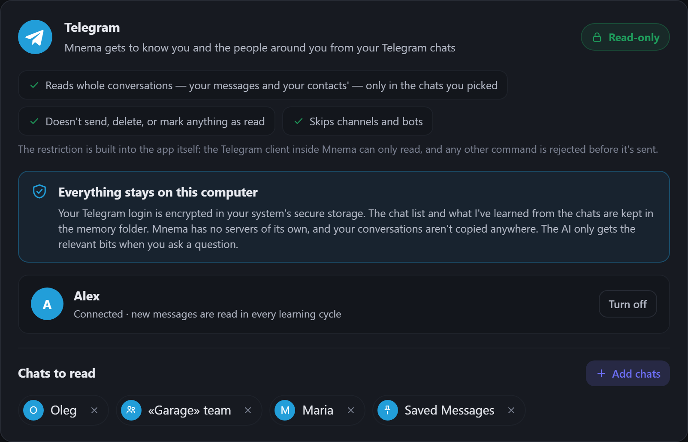

**It works with your files.** In the chat, any model can:

- read, find and edit files, including scans and pictures: their text is recognised on your computer;
- write notes;
- make PDF, Word and Excel documents and edit existing Word and Excel files, keeping their formatting;
- merge, cut, rotate and split PDF.

All of this works in the memory folder and in the work folders you open for it.

There are no questions in the way. Every write goes to the journal and can be undone in Memory → History. If you prefer, one switch makes Mnema ask before each action. It never runs programs.

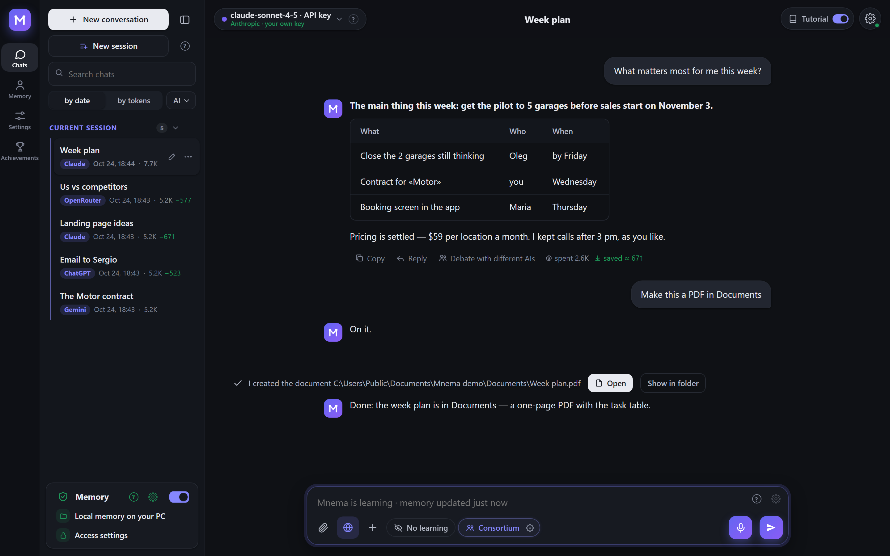

**It saves tokens.** Memory, documents and web pages are read on your computer, and only the parts that matter go to the model. We measured it on a question about a 153,000-character contract. The whole text took 29,643 input tokens. Mnema sent 6,159, almost five times fewer, and only the Mnema version gave the right answer. Under each answer you see how many tokens were saved.

**It is private by default.** Card numbers, passwords, keys and phone numbers are replaced with labels before anything goes to a cloud model. A journal records what was read, what was written and what went out. On any system Mnema can encrypt the memory with your password.

## Languages

Mnema speaks ten languages. The interface, the help and the AI's answers follow the one you pick, even when you write in another. Arabic reads right to left. This README is in English and [Russian](README.ru.md).

| <br><b>English</b><br><sub>English</sub> | <br><b>Русский</b><br><sub>Russian</sub> | <br><b>中文</b><br><sub>Chinese</sub> | <br><b>Español</b><br><sub>Spanish</sub> | <br><b>हिन्दी</b><br><sub>Hindi</sub> |
|:---:|:---:|:---:|:---:|:---:|
| <br><b>العربية</b><br><sub>Arabic</sub> | <br><b>Português</b><br><sub>Portuguese</sub> | <br><b>Français</b><br><sub>French</sub> | <br><b>Deutsch</b><br><sub>German</sub> | <br><b>日本語</b><br><sub>Japanese</sub> |

## Install

Download the file for your system (every version with its number is in [Releases](../../releases)):

| System | File | How |
|---|---|---|
| Windows 10 and 11 | [`Mnema-Setup.exe`](../../releases/latest/download/Mnema-Setup.exe) | Run it. No administrator rights needed. A portable `.zip` is there as well. |
| macOS 11 and newer | Apple Silicon: [`Mnema-macos-arm64.dmg`](../../releases/latest/download/Mnema-macos-arm64.dmg), Intel: [`Mnema-macos-x64.dmg`](../../releases/latest/download/Mnema-macos-x64.dmg) | Open it and drag Mnema to Applications. |
| Linux x86-64 (Ubuntu 22.04 and newer, Fedora, Debian…) | [`Mnema-x86_64.AppImage`](../../releases/latest/download/Mnema-x86_64.AppImage) | `chmod +x Mnema-*.AppImage` and run it. The same program as a folder: `.tar.gz`, run `Mnema` inside. |

The packages are not code-signed yet, so each system warns once:

- **Windows** SmartScreen says «Windows protected your PC». Click **More info → Run anyway**.
- **macOS** says it can't check the developer. Right-click Mnema in Applications → **Open**, or open System Settings → Privacy & Security → **Open Anyway**.
- **Linux** AppImage needs FUSE 2: `sudo apt install libfuse2` (on Ubuntu 24.04: `libfuse2t64`). Or use the `.tar.gz`.

To check a file, compare its sha256 with the `.sha256` file beside it: `certutil -hashfile <file> SHA256` on Windows, `shasum -a 256 <file>` on macOS, `sha256sum <file>` on Linux.

## Build from source

Windows:

```powershell
python -m venv .venv
.venv\Scripts\pip install -r requirements-dev.txt
.venv\Scripts\python tools\fetch_vendor.py      # llama.cpp, Xray, WebView2 from their official releases, verified
.venv\Scripts\python -m mnema.desktop           # run the program
.venv\Scripts\python tools\package.py           # dist\Mnema-Setup-<version>.exe and the portable zip
```

macOS and Linux:

```bash
python3 -m venv .venv
.venv/bin/pip install -r requirements-dev.txt
.venv/bin/python tools/fetch_vendor.py           # llama.cpp and Xray for this system, verified by sha256
.venv/bin/python -m mnema.desktop                # run the program
.venv/bin/python tools/package.py                # macOS: dist/Mnema-<version>-macos-arm64.dmg
                                                 # Linux: dist/Mnema-<version>-x86_64.AppImage and .tar.gz
```

Every push is tested on Windows, macOS and Linux; the three packages are built, started once with their window and kept as files of the run (`.github/workflows`).

The core needs only the Python standard library. It covers the vault, access rules, journal, MCP server and command line:

```bash
python -m mnema init ~/mnema --default
python -m mnema serve                    # http://127.0.0.1:7461
python -m mnema install claude-code      # shows the plan; add --apply
```

## How it is built

See [docs/ARCHITECTURE.md](docs/ARCHITECTURE.md). In short:

| Part | Where |
|---|---|
| Vault: folders, facts, sections with hidden tags | `mnema/vault.py`, `mnema/memory.py` |
| Access rules per AI | `mnema/clients.py` |
| Journal and undo | `mnema/journal.py` |
| MCP server, command line | `mnema/mcp_server.py`, `mnema/cli.py` |
| Local API and the window | `mnema/api*.py`, `mnema/desktop.py` |
| Interface | `mnema/ui/index.html`, `mnema/ui/css/app.css`, `mnema/ui/js/NN-*.js` (loaded in order) |
| Chat with any model, consortium, actions with files | `mnema/chat/` |
| Learning: sources, brains, decisions | `mnema/learn/` |
| What leaves the computer | `mnema/outgoing.py` |
| What differs between Windows, macOS and Linux | `mnema/osapi.py` |
| Encryption of the memory by password | `mnema/crypt.py` |
| Text from scans and pictures | `mnema/ocr.py` |
| Knowledge base the assistant answers from | `mnema/knowledge/mnema.md` |

## Security

The local API listens on 127.0.0.1 only, checks the Host header and requires a token. Pages by link and VPN subscriptions are opened only from the internet, never from this computer or the local network. Keys and passwords live in the system's secret store (DPAPI on Windows, the Keychain on macOS, the Secret Service on Linux when there is one), never in the memory folder. The memory itself can be encrypted with a password (AES-256-GCM, the key protected by scrypt). Every request to a cloud model is logged with what was sent and what was hidden. Report vulnerabilities privately to the author.

## License

AGPL-3.0. Free for personal use and for open-source projects. A commercial license and the team edition are available from the author.

© 2026 Anton Sannikov
