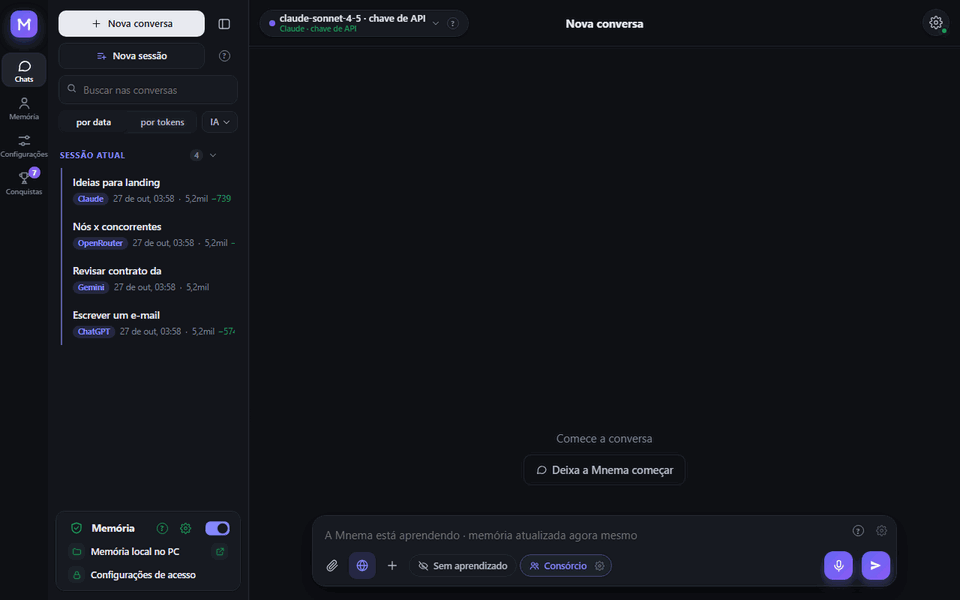
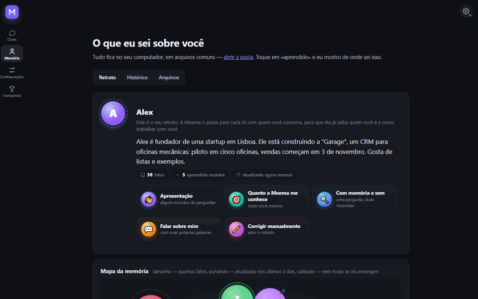
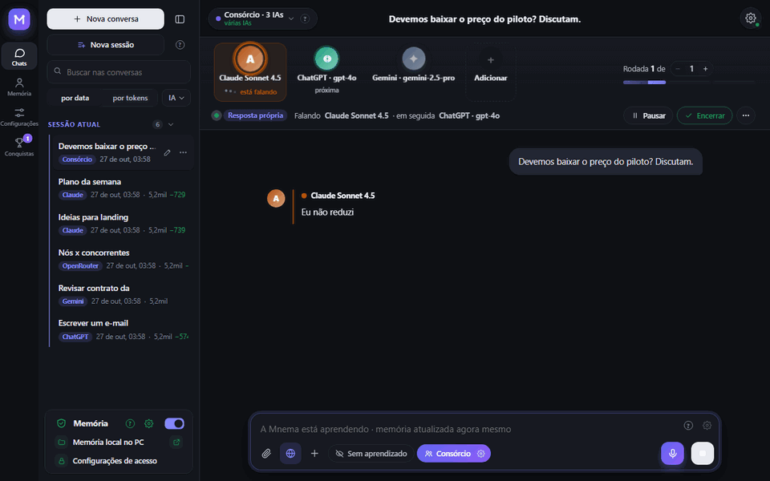
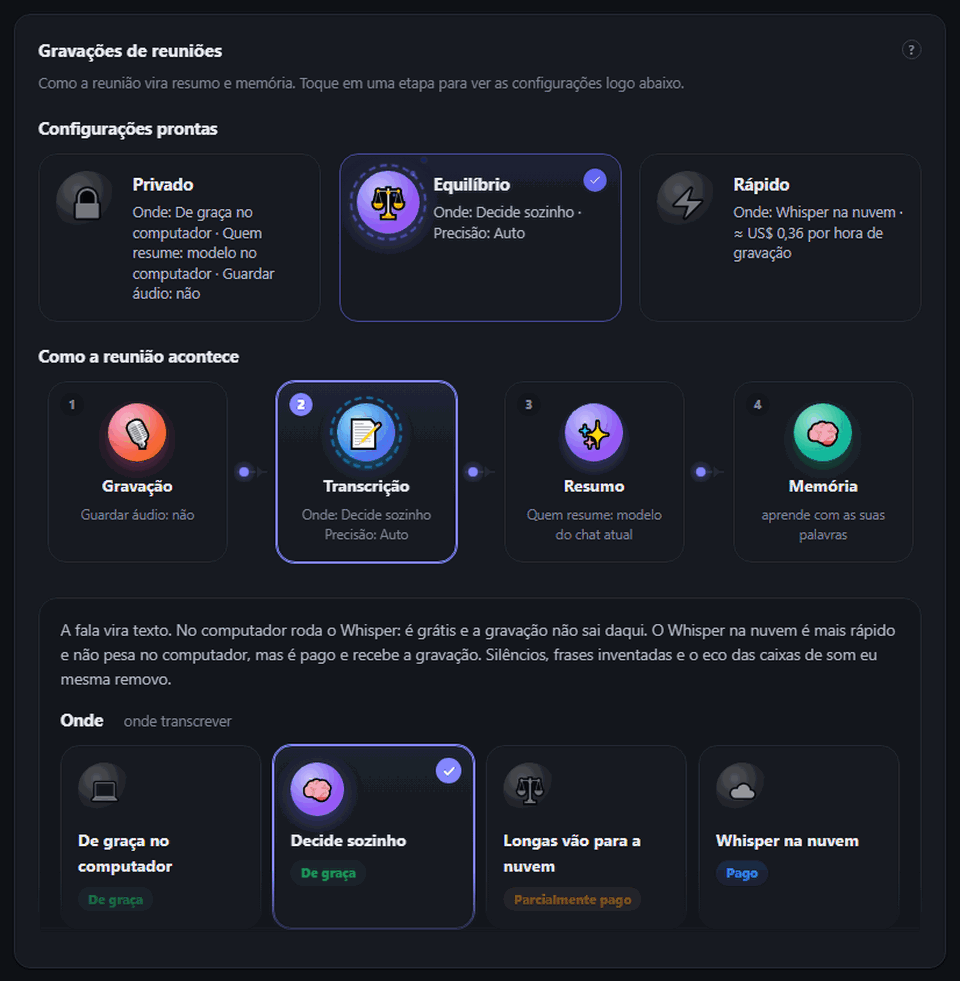
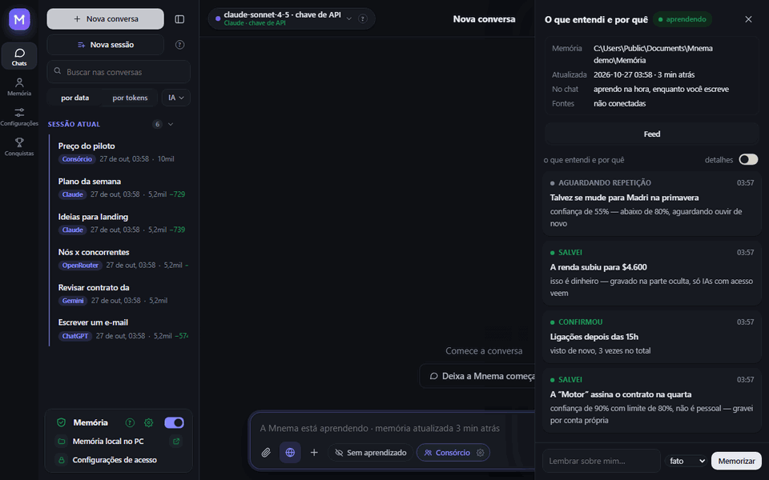
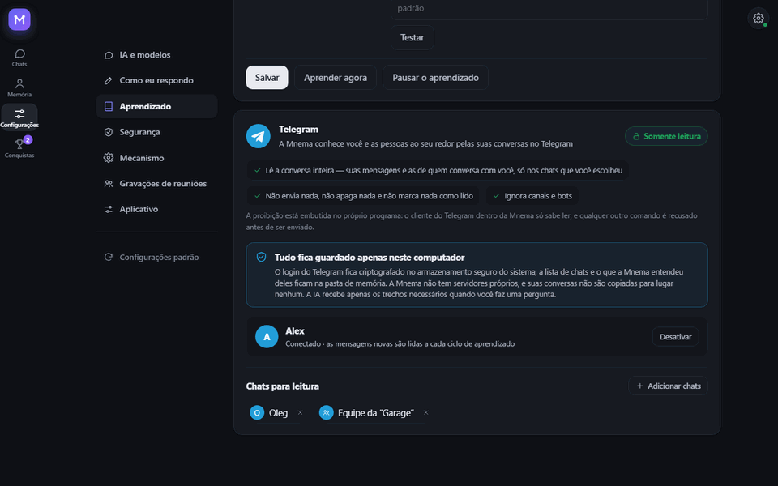
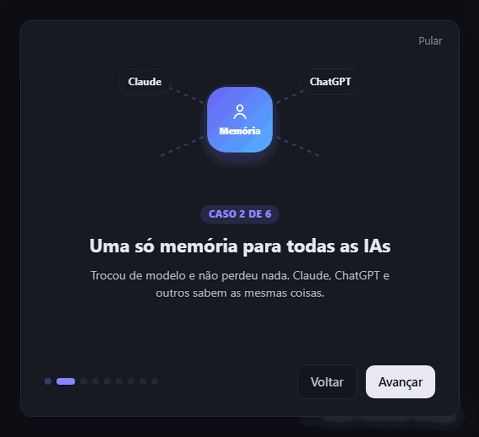
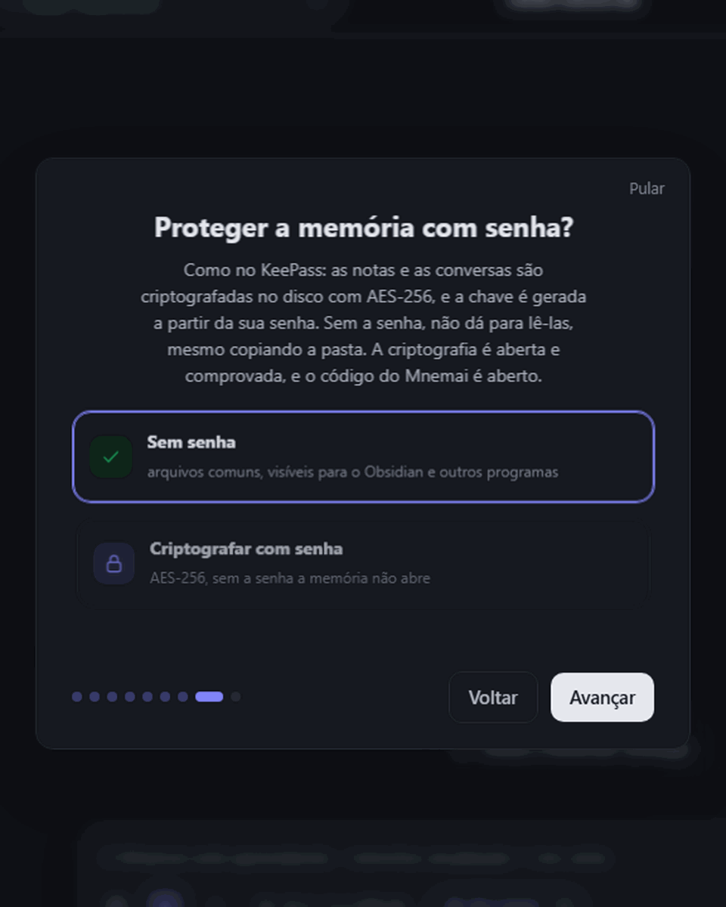
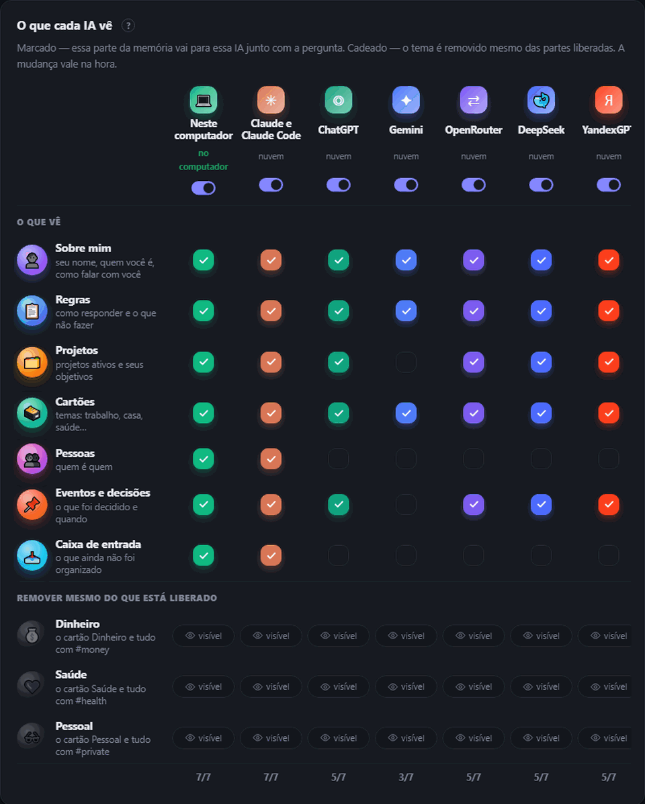

<div align="center">


# Mnema


<a href="https://github.com/Pumpetee/Mnema/releases/latest"></a> <a href="https://github.com/Pumpetee/Mnema/actions/workflows/tests.yml"></a> <a href="LICENSE"></a> <a href="https://github.com/Pumpetee/Mnema/commits/main"></a>

     

<a href="docs/guide/pt.md"></a>

<a href="https://github.com/Pumpetee/Mnema"></a><br><sub>Escaneie para abrir o repositório · github.com/Pumpetee/Mnema</sub>

</div>

## Idiomas

O Mnema fala nove idiomas. A interface, a ajuda e as respostas da IA seguem o idioma que você escolher, mesmo quando você escreve em outro. Este README e o guia do Mnema existem em cada um deles.

<table>
<tr><td align="center" width="10%"><br><b>English</b><br><sub><a href="README.md">README</a> · <a href="docs/guide/en.md">Guide</a></sub></td><td align="center" width="10%"><br><b>Русский</b><br><sub><a href="README.ru.md">README</a> · <a href="docs/guide/ru.md">Справочник</a></sub></td><td align="center" width="10%"><br><b>中文</b><br><sub><a href="README.zh.md">README</a> · <a href="docs/guide/zh.md">指南</a></sub></td><td align="center" width="10%"><br><b>Español</b><br><sub><a href="README.es.md">README</a> · <a href="docs/guide/es.md">Guía</a></sub></td><td align="center" width="10%"><br><b>हिन्दी</b><br><sub><a href="README.hi.md">README</a> · <a href="docs/guide/hi.md">गाइड</a></sub></td></tr>
<tr><td align="center" width="10%"><br><b>✓ Português</b><br><sub><a href="README.pt.md">README</a> · <a href="docs/guide/pt.md">Guia</a></sub></td><td align="center" width="10%"><br><b>Français</b><br><sub><a href="README.fr.md">README</a> · <a href="docs/guide/fr.md">Guide</a></sub></td><td align="center" width="10%"><br><b>Deutsch</b><br><sub><a href="README.de.md">README</a> · <a href="docs/guide/de.md">Handbuch</a></sub></td><td align="center" width="10%"><br><b>日本語</b><br><sub><a href="README.ja.md">README</a> · <a href="docs/guide/ja.md">ガイド</a></sub></td></tr>
</table>

<div align="center">

O Mnema lembra quem você é, no que está trabalhando, o que decidiu e como você gosta das respostas — e toda IA com quem você conversa recebe esse contexto. A memória é uma pasta de arquivos Markdown simples no seu computador. Sem nuvem, sem conta.

<a href="../../releases/latest/download/Mnema-Setup.exe"></a> <a href="../../releases/latest/download/Mnema-macos-arm64.dmg"></a> <a href="../../releases/latest/download/Mnema-x86_64.AppImage"></a>

<sub><a href="../../releases">todos os arquivos</a> · macOS Intel: <a href="../../releases/latest/download/Mnema-macos-x64.dmg">x64.dmg</a></sub>



<sub>Você pergunta “o que é importante esta semana?” — o plano vem em uma tabela, com o preço combinado e a sua regra sobre reuniões. Você não precisou digitar nada disso de novo.</sub>

</div>

## ✨ O que ele faz

<table>
<tr>
<td width="33%" valign="top"><h3>🧠 Conhece você</h3>Um retrato que toda IA lê primeiro, um mapa vivo da memória, arquivos simples que são seus.</td>
<td width="33%" valign="top"><h3>🗣️ Consórcio</h3>Claude, ChatGPT e Gemini debatem e chegam a uma única resposta.</td>
<td width="33%" valign="top"><h3>🎙️ Reuniões</h3>Uma chamada vira transcrição, resumo e tarefas com responsáveis.</td>
</tr>
<tr>
<td width="33%" valign="top"><h3>🔐 Privado</h3>Uma senha na memória, como no KeePass. Segredos nunca chegam à nuvem.</td>
<td width="33%" valign="top"><h3>💻 Offline</h3>13 modelos gratuitos rodam no seu computador, sem chaves.</td>
<td width="33%" valign="top"><h3>📉 Menos tokens</h3>Só o que importa vai para o modelo: 4,8× menos tokens em um contrato longo.</td>
</tr>
</table>

## 🧠 Ele conhece você

<p align="center"></p>

- **Um retrato que toda IA lê primeiro:** quem você é, o que está construindo, como gosta de trabalhar. O Mnema escreve o retrato conforme aprende, e você pode corrigi-lo à mão.
- **Um mapa da memória:** cada tópico é uma bolha, uma pulsação indica que mudou recentemente, um cadeado indica que algumas IAs não o enxergam.
- **Fatos antigos não se passam por novos:** cada fato leva a sua data, e o Mnema pergunta de novo sobre qualquer status com mais de um mês.
- **Mais de uma pasta:** conecte um cofre do Obsidian ou uma pasta de equipe — somente leitura, o próprio programa bloqueia a escrita ali.

## 🗣️ Consórcio: várias IAs, uma resposta

<p align="center"></p>

- **Conselho, debate, brainstorm, red team, roast** — escolha o formato e o número de rodadas.
- **Intervenha quando quiser:** “Parar” interrompe a IA atual e mantém o que ela disse.
- **Discuta com IAs diferentes** sob qualquer resposta: o autor a defende, e as demais procuram onde ela erra.

## 🎙️ Reuniões: de uma chamada a tarefas

<p align="center"></p>

- **Duas faixas:** seu microfone e o som do computador, para a transcrição saber quem falou.
- **Whisper no seu computador de graça**, ou o Whisper na nuvem (≈ US$ 0,36 por hora) — silêncio, frases inventadas e eco são removidos.
- **O resumo:** o que foi decidido, as tarefas e quem é o responsável, feito por qualquer modelo que você escolher, inclusive um local.
- **Predefinições:** Privado, Equilibrado e Rápido ajustam todo o processo de uma vez.

## 🌱 Ele aprende sozinho

<p align="center"></p>

- **Certeza significa salvar:** um fato de que ele tem certeza (80% ou mais) é gravado na hora, e um duvidoso espera ser ouvido de novo.
- **O pessoal fica à parte:** dinheiro, saúde e assuntos privados vão para cartões com etiqueta que você pode esconder de qualquer IA.
- **Nada fica escondido de você:** o feed “O que entendi e por quê” mostra cada decisão com o seu motivo.

## ✈️ Lê o Telegram, nunca escreve nele

<p align="center"></p>

- **Você escolhe os chats:** o Mnema aprende sobre você e as pessoas ao seu redor apenas com eles.
- **Somente leitura, por design:** o cliente do Telegram dentro do Mnema só consegue ler; qualquer outro comando é recusado antes de ser enviado.
- **Fica no seu computador:** o login é criptografado no armazenamento do sistema, e o Mnema não tem servidores próprios.

## 📉 Economiza tokens

<p align="center"></p>

- **Só o que importa sai daqui:** memória, documentos e páginas da web são lidos no seu computador, e o modelo recebe apenas as partes relevantes.
- **Medido:** em uma pergunta sobre um contrato de 153.000 caracteres, o texto inteiro custou 29.643 tokens de entrada; o Mnema enviou 6.159, e só a resposta do Mnema estava certa.
- **Visível sempre:** embaixo de cada resposta você vê quantos tokens foram economizados.

## 🔐 Privado por design

<table><tr><td width="50%" valign="top" align="center"><br><sub>Primeiro início: uma senha na memória, como no KeePass</sub></td><td width="50%" valign="top" align="center"><br><sub>Quem vê o quê: um visto por parte da memória, um cadeado por tópico</sub></td></tr></table>

- **Uma senha na memória:** AES-256, a chave vem da sua senha, criptografia de código aberto. Sem ela, as notas não podem ser lidas, mesmo copiadas do disco. Uma cópia sincronizada também continua criptografada.
- **Segredos ficam com você:** números de cartão, senhas, chaves e telefones viram marcadores antes que qualquer coisa vá para um modelo na nuvem.
- **Cada IA tem o seu próprio acesso:** dinheiro, saúde e tópicos privados ficam ocultos de qualquer uma delas com um clique.

## 🤖 Funciona com

<div align="center">
<table><tr><td valign="middle" width="150"><b>IA na nuvem</b><br><sub>por chave ou assinatura</sub></td><td align="center" width="92"><br><sub><b>Claude</b></sub></td><td align="center" width="92"><br><sub><b>ChatGPT</b></sub></td><td align="center" width="92"><br><sub><b>Gemini</b></sub></td><td align="center" width="92"><br><sub><b>DeepSeek</b></sub></td><td align="center" width="92"><br><sub><b>YandexGPT</b></sub></td><td align="center" width="92"><br><sub><b>OpenRouter</b></sub></td></tr><tr><td valign="middle" width="150"><b>No seu computador</b><br><sub>grátis, offline</sub></td><td align="center" width="92"><br><sub><b>Integrado</b></sub></td><td align="center" width="92"><br><sub><b>Ollama</b></sub></td><td align="center" width="92"><br><sub><b>Strata</b></sub></td><td></td><td></td><td></td></tr><tr><td valign="middle" width="150"><b>Nas suas ferramentas</b><br><sub>via MCP</sub></td><td align="center" width="92"><br><sub><b>Claude Code</b></sub></td><td align="center" width="92"><br><sub><b>Cursor</b></sub></td><td></td><td></td><td></td><td></td></tr><tr><td valign="middle" width="150"><b>Sistemas</b><br><sub>um só app</sub></td><td align="center" width="92"><br><sub><b>Windows</b></sub></td><td align="center" width="92"><br><sub><b>macOS</b></sub></td><td align="center" width="92"><br><sub><b>Linux</b></sub></td><td></td><td></td><td></td></tr></table>
</div>

## ⚡ E mais

- **Trabalha com os seus arquivos.** Lê digitalizações, escreve notas, cria PDF, Word e Excel, junta e divide PDF. Toda escrita pode ser desfeita em Memória → Histórico.
- **Nove idiomas.** A interface e as respostas da IA seguem o idioma que você escolher, mesmo quando você escreve em outro.

<details>
<summary><b>Instalar</b></summary>

Baixe o arquivo para o seu sistema (todas as versões, com seus números, estão em [Releases](../../releases)):

| Sistema | Arquivo | Como |
|---|---|---|
| Windows 10 e 11 | [`Mnema-Setup.exe`](../../releases/latest/download/Mnema-Setup.exe) | Execute-o. Não é necessário ter direitos de administrador. Um `.zip` portátil também está disponível. |
| macOS 11 e mais recente | Apple Silicon: [`Mnema-macos-arm64.dmg`](../../releases/latest/download/Mnema-macos-arm64.dmg), Intel: [`Mnema-macos-x64.dmg`](../../releases/latest/download/Mnema-macos-x64.dmg) | Abra-o e arraste o Mnema para Aplicativos. |
| Linux x86-64 (Ubuntu 22.04 e mais recente, Fedora, Debian…) | [`Mnema-x86_64.AppImage`](../../releases/latest/download/Mnema-x86_64.AppImage) | `chmod +x Mnema-*.AppImage` e execute-o. O mesmo programa em formato de pasta: `.tar.gz`, execute `Mnema` dentro dela. |

Os pacotes ainda não são assinados digitalmente, então cada sistema exibe um aviso uma vez:

- **Windows**: o SmartScreen diz «O Windows protegeu seu PC». Clique em **Mais informações → Executar assim mesmo**.
- **macOS**: informa que não é possível verificar o desenvolvedor. Clique com o botão direito no Mnema em Aplicativos → **Abrir**, ou abra Ajustes do Sistema → Privacidade e Segurança → **Abrir Mesmo Assim**.
- **Linux**: o AppImage precisa do FUSE 2: `sudo apt install libfuse2` (no Ubuntu 24.04: `libfuse2t64`). Ou use o `.tar.gz`.

Para verificar um arquivo, compare o sha256 dele com o arquivo `.sha256` que está ao lado: `certutil -hashfile <arquivo> SHA256` no Windows, `shasum -a 256 <arquivo>` no macOS, `sha256sum <arquivo>` no Linux.

</details>

<details>
<summary><b>Compilar a partir do código-fonte</b></summary>

Windows:

```powershell
python -m venv .venv
.venv\Scripts\pip install -r requirements-dev.txt
.venv\Scripts\python tools\fetch_vendor.py      # llama.cpp, Xray, WebView2 dos seus lançamentos oficiais, verificados
.venv\Scripts\python -m mnema.desktop           # executa o programa
.venv\Scripts\python tools\package.py           # dist\Mnema-Setup-<version>.exe e o zip portátil
```

macOS e Linux:

```bash
python3 -m venv .venv
.venv/bin/pip install -r requirements-dev.txt
.venv/bin/python tools/fetch_vendor.py           # llama.cpp e Xray para este sistema, verificados por sha256
.venv/bin/python -m mnema.desktop                # executa o programa
.venv/bin/python tools/package.py                # macOS: dist/Mnema-<version>-macos-arm64.dmg
                                                 # Linux: dist/Mnema-<version>-x86_64.AppImage e .tar.gz
```

Cada push é testado no Windows, macOS e Linux; os três pacotes são compilados, iniciados uma vez com sua janela e mantidos como arquivos da execução (`.github/workflows`).

O núcleo precisa apenas da biblioteca padrão do Python. Ele cobre o cofre, as regras de acesso, o diário, o servidor MCP e a linha de comando:

```bash
python -m mnema init ~/mnema --default
python -m mnema serve                    # http://127.0.0.1:7461
python -m mnema install claude-code      # mostra o plano; adicione --apply

</details>

<details>
<summary><b>Como é construído</b></summary>

Veja [docs/ARCHITECTURE.md](docs/ARCHITECTURE.md). Em resumo:

| Parte | Onde |
|---|---|
| Cofre: pastas, fatos, seções com tags ocultas | `mnema/vault.py`, `mnema/memory.py` |
| Regras de acesso por IA | `mnema/clients.py` |
| Diário e desfazer | `mnema/journal.py` |
| Servidor MCP, linha de comando | `mnema/mcp_server.py`, `mnema/cli.py` |
| API local e a janela | `mnema/api*.py`, `mnema/desktop.py` |
| Interface | `mnema/ui/index.html`, `mnema/ui/css/app.css`, `mnema/ui/js/NN-*.js` (carregados em ordem) |
| Chat com qualquer modelo, consórcio, ações com arquivos | `mnema/chat/` |
| Aprendizado: fontes, cérebros, decisões | `mnema/learn/` |
| O que sai do computador | `mnema/outgoing.py` |
| O que muda entre Windows, macOS e Linux | `mnema/osapi.py` |
| Criptografia da memória por senha | `mnema/crypt.py` |
| Texto de digitalizações e imagens | `mnema/ocr.py` |
| Base de conhecimento a partir da qual o assistente responde | `mnema/knowledge/mnema.md` |

</details>

<details>
<summary><b>Segurança</b></summary>

A API local escuta apenas em 127.0.0.1, verifica o cabeçalho Host e exige um token. Páginas por link e assinaturas de VPN são abertas somente a partir da internet, nunca deste computador ou da rede local. Chaves e senhas ficam no repositório de segredos do sistema (DPAPI no Windows, o Keychain no macOS, o Secret Service no Linux quando houver), nunca na pasta de memória. A própria memória pode ser criptografada com uma senha (AES-256-GCM, com a chave protegida por scrypt); a sincronização de uma memória criptografada envia apenas arquivos criptografados. Toda requisição a um modelo na nuvem é registrada, com o que foi enviado e o que foi ocultado. Relate vulnerabilidades de forma privada ao autor.

</details>

## Licença

AGPL-3.0. Gratuito para uso pessoal e para projetos de código aberto. Uma licença comercial e a edição para equipes estão disponíveis com o autor.

© 2026 Anton Sannikov

<div align="center">


<sub>Se o Mnema lembra de algo útil para você, uma ⭐ ajuda outras pessoas a encontrá-lo.</sub>
</div>
