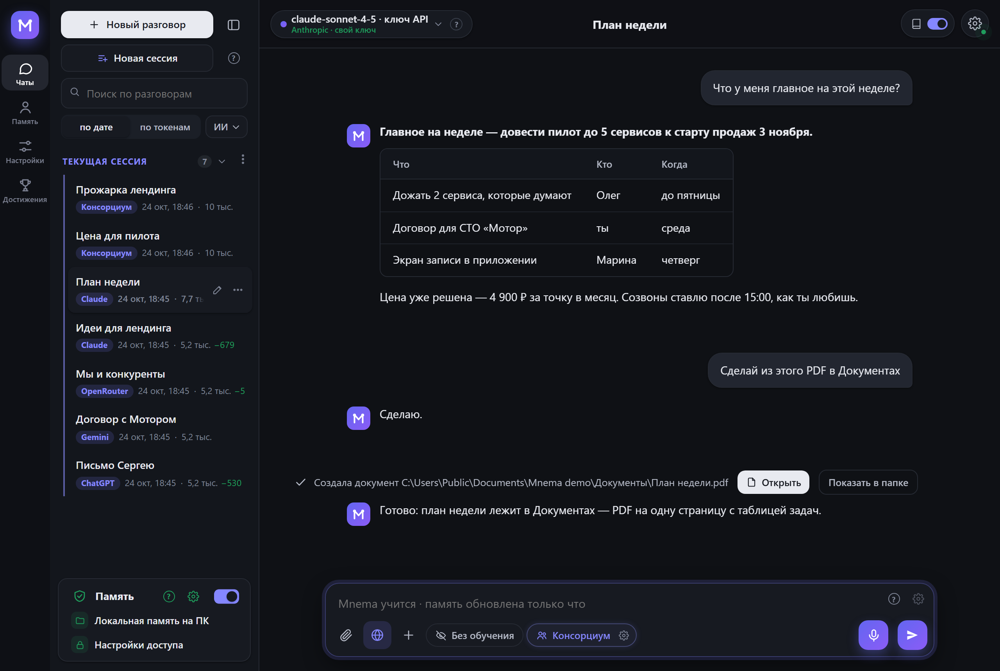
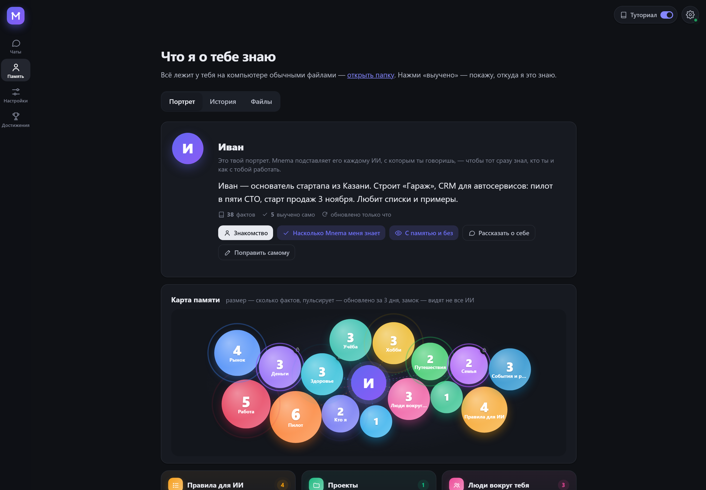
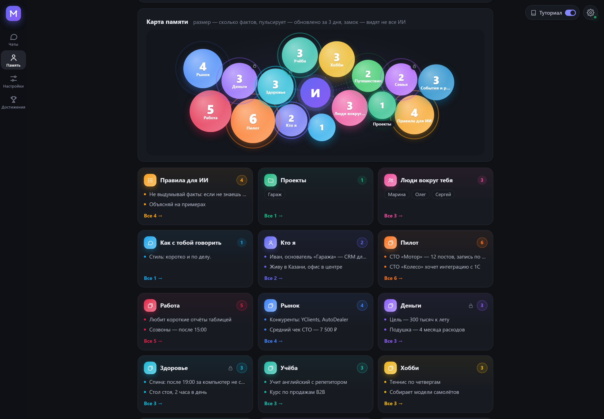
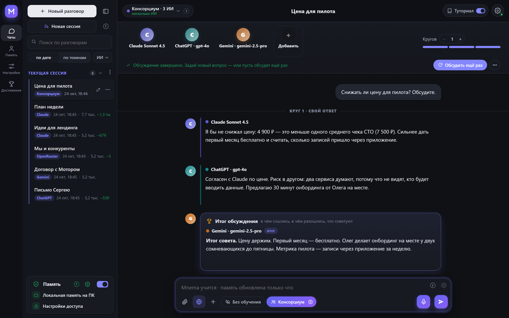
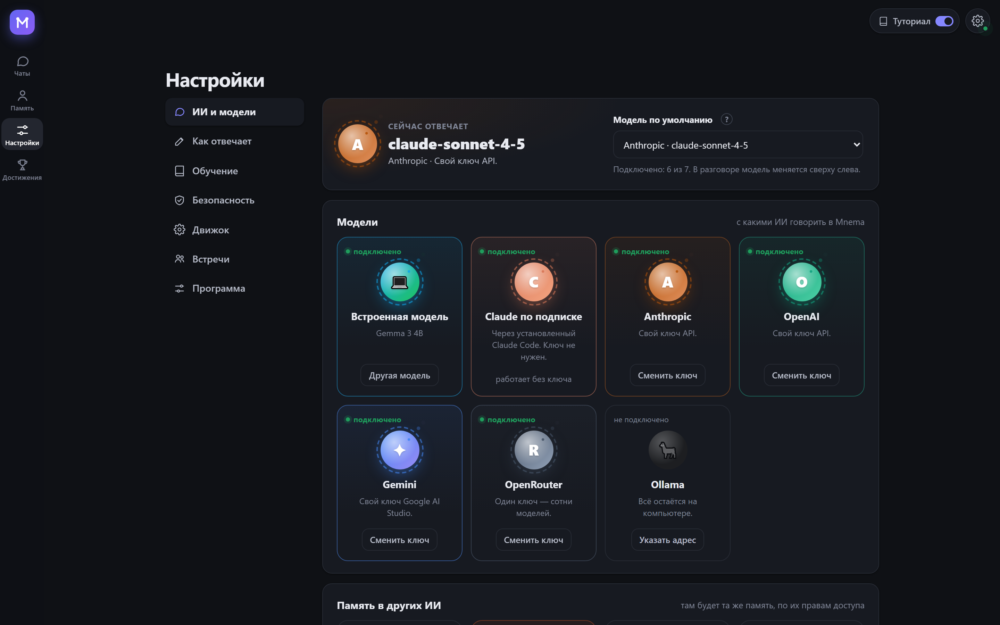
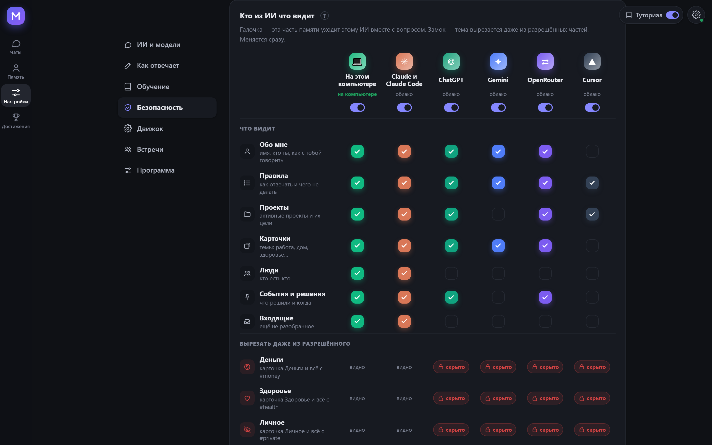
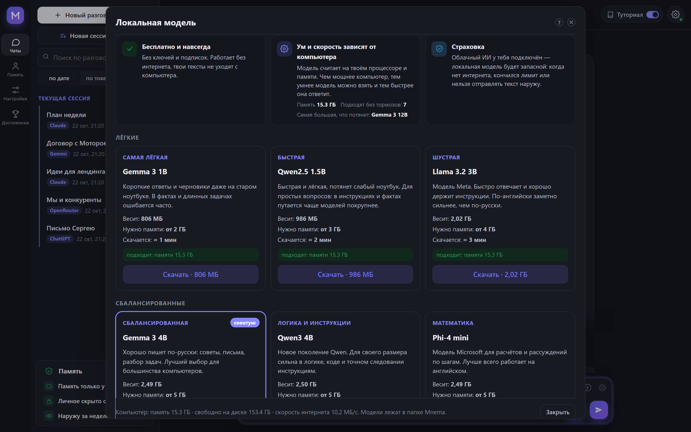
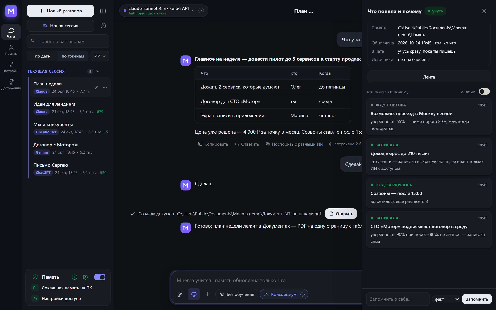
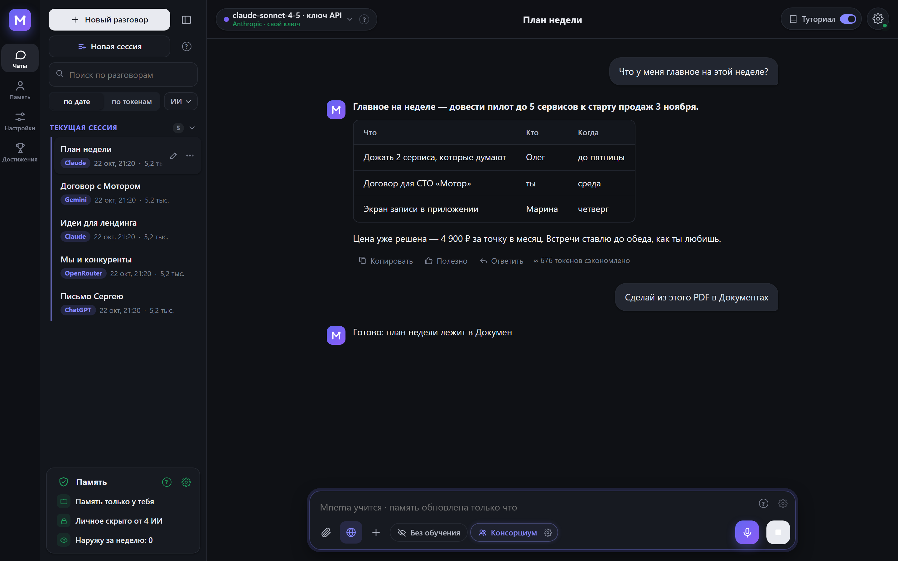

# Бесплатный интерфейс для ИИ с памятью, локальными агентами и мультизадачами.

[](https://github.com/Pumpetee/Mnema/actions/workflows/tests.yml) [](https://github.com/Pumpetee/Mnema/actions/workflows/build.yml)  [](LICENSE)    

**Mnema** — одна память для любого ИИ, и живёт она на твоём компьютере.

Больше не нужно объяснять в каждом новом чате, кто ты такой. Mnema помнит, кто ты, над чем работаешь, что решил и как тебе отвечать. Она подставляет это в любой ИИ: Claude, ChatGPT, Gemini, DeepSeek или бесплатную модель на твоём же компьютере. Память — это папка обычных Markdown-файлов. Облака и аккаунта нет.

**Скачать:** [Windows](../../releases/latest/download/Mnema-Setup.exe) · [macOS (Apple Silicon)](../../releases/latest/download/Mnema-macos-arm64.dmg) · [macOS (Intel)](../../releases/latest/download/Mnema-macos-x64.dmg) · [Linux (AppImage)](../../releases/latest/download/Mnema-linux-x86_64.AppImage) · [все файлы](../../releases)

[English version](README.md)



Ты спрашиваешь «что главное на неделе?» и получаешь план таблицей. В нём уже есть решённая цена и твоё правило про встречи, потому что Mnema их помнит. Повторять их не пришлось.

## Память: она тебя знает



- **Портрет, который каждый ИИ читает первым.** Кто ты, что строишь и как с тобой работать. Mnema пишет его сама по тому, что узнала, а поправить его можно руками.
- **Карта памяти.** Каждая тема — пузырь. Размер показывает, сколько Mnema знает, пульс — что тема недавно менялась, замок — что её видят не все ИИ.
- **Обычные файлы, которые принадлежат тебе.** Карточки, правила, люди, решения и события лежат в твоей папке обычным Markdown. Их можно открыть в любом редакторе, синхронизировать как угодно и удалить когда захочешь.
- **Старое не выдаётся за новое.** У каждого факта есть дата, когда он был сказан. Статусы старше месяца Mnema переспрашивает.



## Консорциум: несколько ИИ, один ответ



Задай вопрос сразу Claude, ChatGPT и Gemini. Они отвечают, читают друг друга и спорят, а потом один из них подводит итог: в чём сошлись, в чём разошлись и что советуют. Все видят одну и ту же память о тебе.

| Формат | Что происходит |
|---|---|
| Совет | каждый отвечает, они проверяют друг друга, в конце общий ответ |
| Дебаты | одни за, другие против, в конце вердикт |
| Мозговой штурм | идеи без критики, потом три лучшие |
| Красная команда | ищут дыры в твоём плане и как их закрыть |

Число кругов задаёшь ты сам, а между кругами можно вмешаться. Под любым ответом есть **«Поспорить с другими»**: автор ответа его защищает, другие ИИ ищут, где он неверен, в конце вердикт.

## Любой ИИ



- **В чате самой Mnema:** все модели равны. Облачные: Anthropic, OpenAI, Gemini, OpenRouter (сотни моделей по одному ключу) по ключу или Claude Code по подписке. На компьютере: встроенная модель или Ollama. Модель можно сменить посреди разговора.
- **В программах, где ты уже работаешь:** Claude Code, Claude Desktop и Cursor подключаются по MCP, а ChatGPT и Gemini в браузере — через расширение Chrome.
- **Ты решаешь, кто что видит.** У каждого ИИ свои права: какие части памяти он видит и какие темы из них вырезаются. По умолчанию деньги, здоровье и личное скрыты от ChatGPT, Gemini, OpenRouter и Cursor.



## Локальные модели: бесплатно и без интернета



На выбор 13 моделей: Gemma 3, Qwen 3, Llama 3, Phi-4 mini, Mistral Small, YandexGPT и другие. Mnema замеряет компьютер и показывает, какие модели пойдут без тормозов и сколько каждую качать. Ключи и подписки не нужны, текст не уходит с компьютера. Если у тебя подключён облачный ИИ, локальная модель становится запасной: на случай, когда нет интернета, кончился лимит или текст нельзя отправлять наружу. Если сеть пропала посреди разговора, Mnema сама переходит на неё.

## Умная Mnema

**Учится сама.** Пока ты разговариваешь, Mnema понимает, что стоит запомнить:

- в чём уверена на 80% и больше — записывает сразу;
- в чём не уверена — ждёт, пока ты скажешь это ещё раз;
- деньги, здоровье и личное — кладёт в скрытую часть.

В ленте «Что поняла и почему» видно каждое решение и его причину. Если разрешишь, Mnema учится и из других программ на компьютере.



**Работает с твоими файлами.** В чате любая модель может:

- читать, искать и править файлы, в том числе сканы и картинки: текст на них распознаётся на компьютере;
- писать заметки;
- делать документы PDF, Word и Excel и править готовые Word и Excel с сохранением оформления;
- склеивать, резать, поворачивать и разрезать PDF.

Всё это — в папке памяти и в рабочих папках, которые ты ей открыл.

Лишних вопросов нет. Каждая запись попадает в журнал и откатывается в «Память» → «История». Если хочешь, одним переключателем можно включить вопрос перед каждым действием. Программы Mnema не запускает.



**Экономит токены.** Память, документы и страницы из сети читаются на компьютере, а модели уходят только нужные куски. Замер: вопрос по договору в 153 000 знаков. Весь текст — это 29 643 входных токена. Mnema отправила 6 159, почти в пять раз меньше, и правильный ответ дал только вариант с Mnema. Под каждым ответом видно, сколько токенов сэкономлено.

**Приватна по умолчанию.** Номера карт, пароли, ключи и телефоны заменяются метками до отправки в облачную модель. В журнале видно, что прочитано, что записано и что ушло наружу. На любой системе Mnema может зашифровать память твоим паролем. Интерфейс на 10 языках.

## Установка

Скачай файл для своей системы (все версии с номерами — в [Releases](../../releases)):

| Система | Файл | Как поставить |
|---|---|---|
| Windows 10 и 11 | [`Mnema-Setup.exe`](../../releases/latest/download/Mnema-Setup.exe) | Запусти. Права администратора не нужны. Там же переносной `.zip`. |
| macOS 11 и новее | Apple Silicon: [`Mnema-macos-arm64.dmg`](../../releases/latest/download/Mnema-macos-arm64.dmg), Intel: [`Mnema-macos-x64.dmg`](../../releases/latest/download/Mnema-macos-x64.dmg) | Открой и перетащи Mnema в «Программы». |
| Linux x86-64 (Ubuntu 22.04 и новее, Fedora, Debian…) | [`Mnema-linux-x86_64.AppImage`](../../releases/latest/download/Mnema-linux-x86_64.AppImage) | `chmod +x Mnema-*.AppImage` и запусти. Та же программа папкой: `.tar.gz`, внутри запусти `Mnema`. |

Пакеты пока без цифровой подписи, поэтому каждая система один раз предупредит:

- **Windows** покажет «Windows защитила ваш компьютер». Нажми **Подробнее → Выполнить в любом случае**.
- **macOS** скажет, что не может проверить разработчика. Нажми на Mnema в «Программах» правой кнопкой → **Открыть** или открой Системные настройки → Конфиденциальность и безопасность → **Всё равно открыть**.
- **Linux**: для AppImage нужен FUSE 2 — `sudo apt install libfuse2` (на Ubuntu 24.04 — `libfuse2t64`). Или возьми `.tar.gz`.

Чтобы проверить файл, сравни его sha256 с файлом `.sha256` рядом: `certutil -hashfile <файл> SHA256` на Windows, `shasum -a 256 <файл>` на macOS, `sha256sum <файл>` на Linux.

## Сборка из исходников

Windows:

```powershell
python -m venv .venv
.venv\Scripts\pip install -r requirements-dev.txt
.venv\Scripts\python tools\fetch_vendor.py      # llama.cpp, Xray, WebView2 с официальных релизов, с проверкой
.venv\Scripts\python -m mnema.desktop           # запустить программу
.venv\Scripts\python tools\package.py           # dist\Mnema-Setup-<версия>.exe и переносной архив
```

macOS и Linux:

```bash
python3 -m venv .venv
.venv/bin/pip install -r requirements-dev.txt
.venv/bin/python tools/fetch_vendor.py           # llama.cpp и Xray для этой системы, с проверкой sha256
.venv/bin/python -m mnema.desktop                # запустить программу
.venv/bin/python tools/package.py                # macOS: dist/Mnema-<версия>-macos-arm64.dmg
                                                 # Linux: dist/Mnema-<версия>-linux-x86_64.AppImage и .tar.gz
```

Каждый push проверяется на Windows, macOS и Linux: собираются три пакета, каждый один раз запускается с окном и остаётся файлами прогона (`.github/workflows`).

Ядру нужна только стандартная библиотека Python. Ядро — это папка памяти, права ИИ, журнал, MCP-сервер и командная строка:

```bash
python -m mnema init ~/mnema --default
python -m mnema serve                    # http://127.0.0.1:7461
python -m mnema install claude-code      # покажет план; добавь --apply
```

## Как устроено

Подробно — [docs/ARCHITECTURE.ru.md](docs/ARCHITECTURE.ru.md), все механики для пользователя — [база знаний](mnema/knowledge/mnema.md). Коротко:

| Часть | Где |
|---|---|
| Папка памяти: разделы, факты, скрытые теги | `mnema/vault.py`, `mnema/memory.py` |
| Права каждого ИИ | `mnema/clients.py` |
| Журнал и откат | `mnema/journal.py` |
| MCP-сервер, командная строка | `mnema/mcp_server.py`, `mnema/cli.py` |
| Локальный API и окно | `mnema/api*.py`, `mnema/desktop.py` |
| Интерфейс | `mnema/ui/index.html`, `mnema/ui/css/app.css`, `mnema/ui/js/NN-*.js` (грузятся по порядку) |
| Чат с любой моделью, консорциум, действия с файлами | `mnema/chat/` |
| Обучение: источники, разбор текста, решения | `mnema/learn/` |
| Что уходит с компьютера | `mnema/outgoing.py` |
| Чем отличаются Windows, macOS и Linux | `mnema/osapi.py` |
| Шифрование памяти паролем | `mnema/crypt.py` |
| Текст со сканов и картинок | `mnema/ocr.py` |
| Расширение для браузера | `extension/` |
| База знаний, по которой ассистент отвечает о себе | `mnema/knowledge/mnema.md` |

## Безопасность

Локальный API слушает только 127.0.0.1, проверяет заголовок Host и требует токен. У расширения свой узкий токен. Ключи и пароли хранятся в защищённом хранилище системы (DPAPI на Windows, Связка ключей на macOS, Secret Service на Linux, если он есть), а не в папке памяти. Саму память можно зашифровать паролем (AES-256-GCM, ключ защищён scrypt). Каждый запрос к облачной модели записывается в журнал: что ушло и что скрыто. Об уязвимостях пиши лично автору.

## Лицензия

AGPL-3.0. Бесплатно для личного использования и для открытых проектов. Коммерческая лицензия и версия для команды — у автора.

© 2026 Антон Санников
