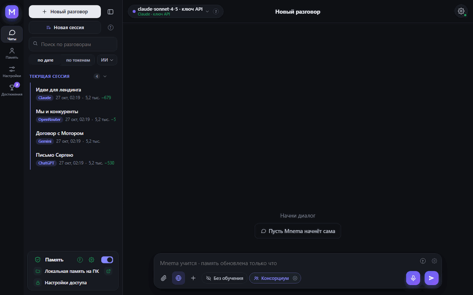
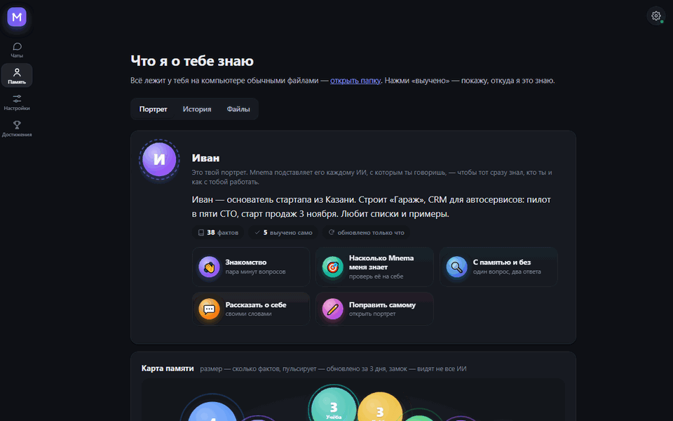
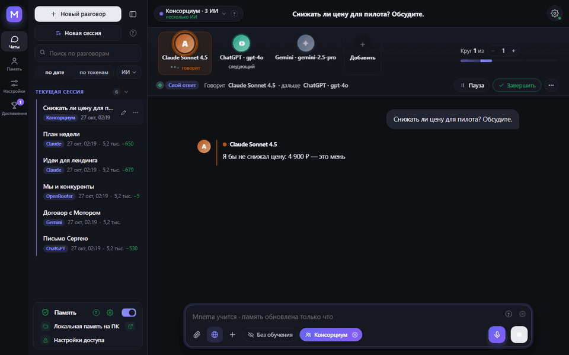
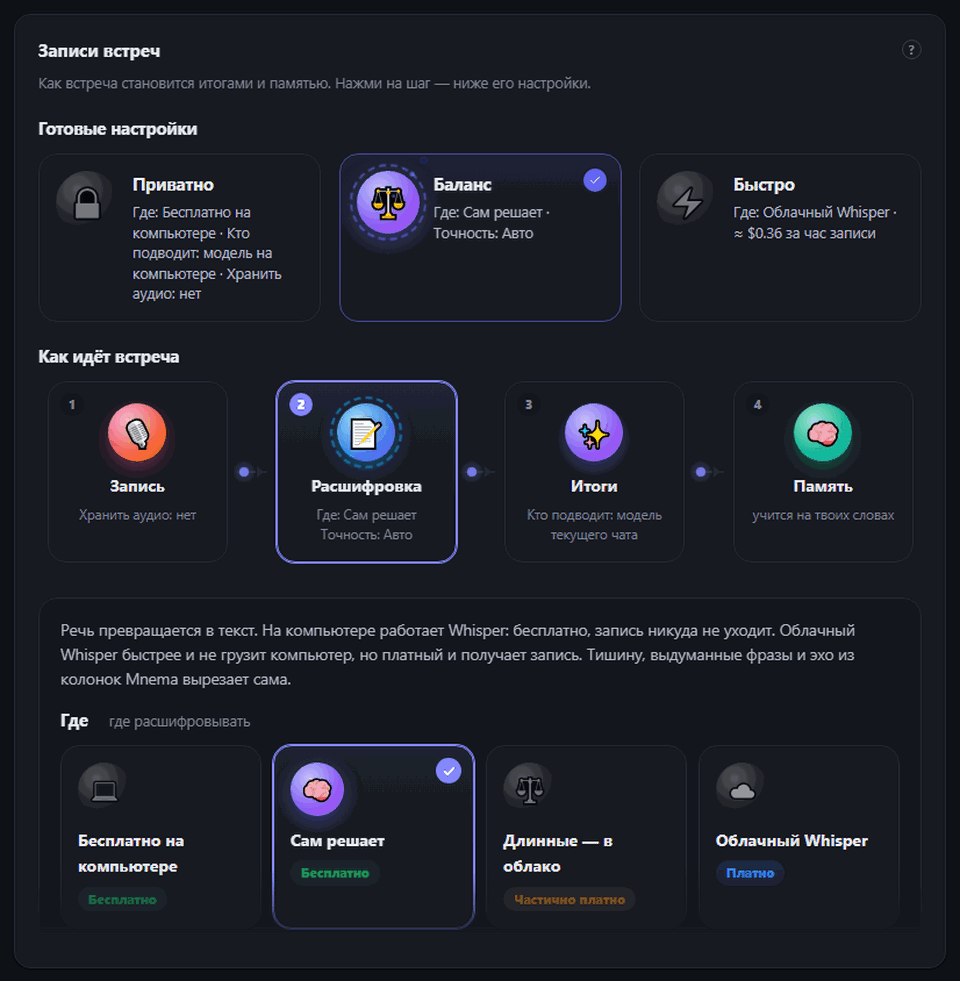
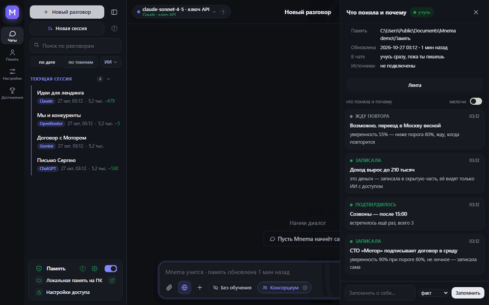
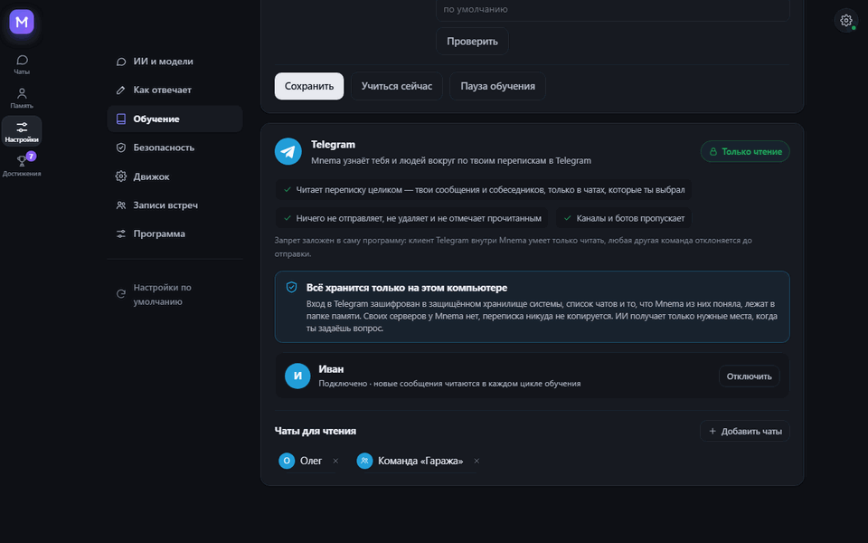
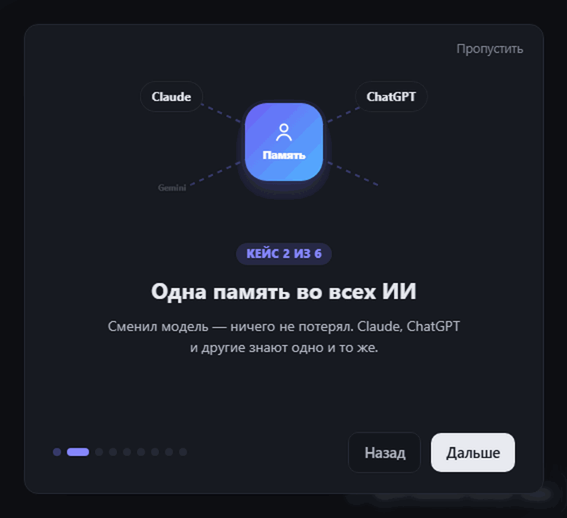
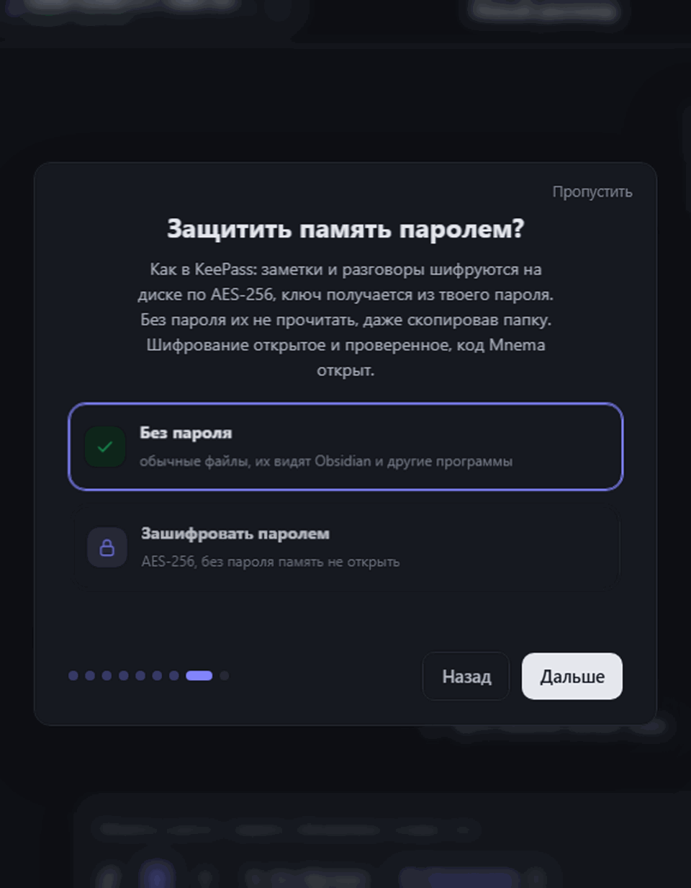
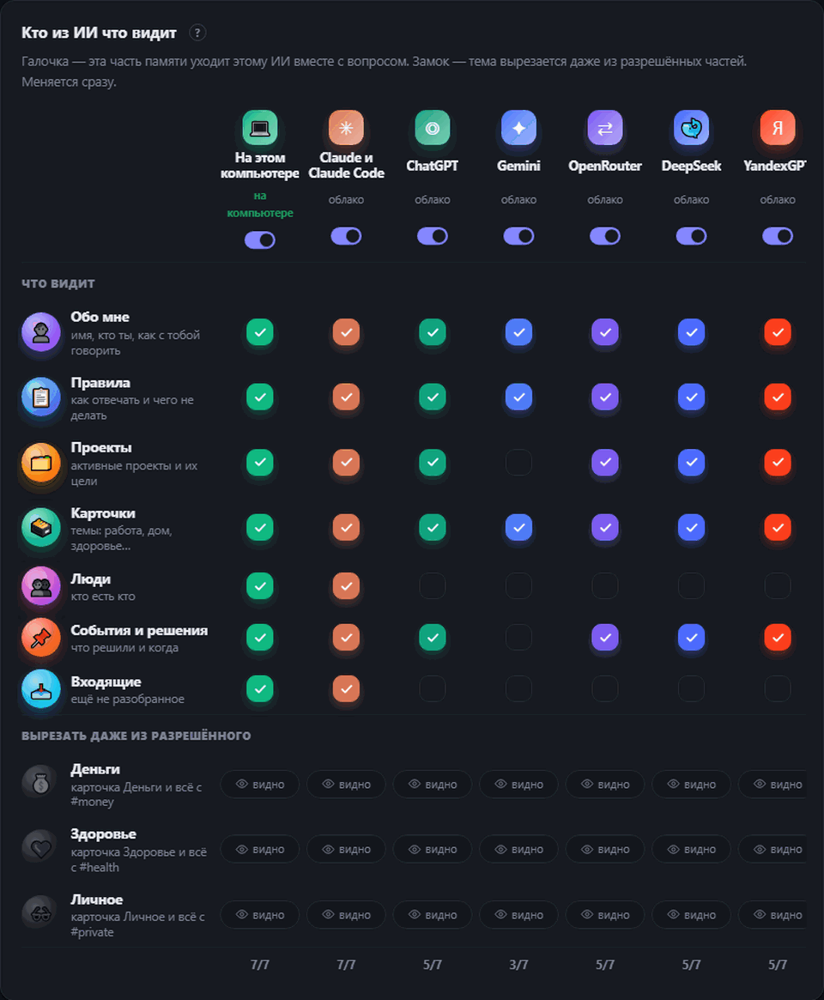

<div align="center">


# Mnemai


<a href="https://github.com/Pumpetee/Mnemai/releases/latest"></a> <a href="https://github.com/Pumpetee/Mnemai/actions/workflows/tests.yml"></a> <a href="LICENSE"></a> <a href="https://github.com/Pumpetee/Mnemai/commits/main"></a>

     

<a href="docs/guide/ru.md"></a>

<a href="https://github.com/Pumpetee/Mnemai"></a><br><sub>Наведи камеру, чтобы открыть репозиторий · github.com/Pumpetee/Mnemai</sub>

</div>

## Языки

Mnemai говорит на девяти языках. Интерфейс, подсказки и ответы ИИ идут на выбранном, даже если пишешь на другом. Этот README и справочник Mnemai есть на каждом из них.

<table>
<tr><td align="center" width="10%"><br><b>English</b><br><sub><a href="README.md">README</a> · <a href="docs/guide/en.md">Guide</a></sub></td><td align="center" width="10%"><br><b>✓ Русский</b><br><sub><a href="README.ru.md">README</a> · <a href="docs/guide/ru.md">Справочник</a></sub></td><td align="center" width="10%"><br><b>中文</b><br><sub><a href="README.zh.md">README</a> · <a href="docs/guide/zh.md">指南</a></sub></td><td align="center" width="10%"><br><b>Español</b><br><sub><a href="README.es.md">README</a> · <a href="docs/guide/es.md">Guía</a></sub></td><td align="center" width="10%"><br><b>हिन्दी</b><br><sub><a href="README.hi.md">README</a> · <a href="docs/guide/hi.md">गाइड</a></sub></td></tr>
<tr><td align="center" width="10%"><br><b>Português</b><br><sub><a href="README.pt.md">README</a> · <a href="docs/guide/pt.md">Guia</a></sub></td><td align="center" width="10%"><br><b>Français</b><br><sub><a href="README.fr.md">README</a> · <a href="docs/guide/fr.md">Guide</a></sub></td><td align="center" width="10%"><br><b>Deutsch</b><br><sub><a href="README.de.md">README</a> · <a href="docs/guide/de.md">Handbuch</a></sub></td><td align="center" width="10%"><br><b>日本語</b><br><sub><a href="README.ja.md">README</a> · <a href="docs/guide/ja.md">ガイド</a></sub></td></tr>
</table>

<div align="center">

Mnemai помнит, кто ты, над чем работаешь, что решил и как тебе отвечать, — и подставляет это в любой ИИ. Память — папка обычных Markdown-файлов на твоём компьютере. Без облака и без аккаунта.

<a href="../../releases/latest/download/Mnemai-Setup.exe"></a> <a href="../../releases/latest/download/Mnemai-macos-arm64.dmg"></a> <a href="../../releases/latest/download/Mnemai-x86_64.AppImage"></a>

<sub><a href="../../releases">все файлы</a> · macOS Intel: <a href="../../releases/latest/download/Mnemai-macos-x64.dmg">x64.dmg</a></sub>



<sub>Спрашиваешь «что главное на неделе?» — план приходит таблицей, с решённой ценой и твоим правилом про встречи. Повторять их не пришлось.</sub>

</div>

## ✨ Что умеет

<table>
<tr>
<td width="33%" valign="top"><h3>🧠 Знает тебя</h3>Портрет, который ИИ читает первым, живая карта памяти, твои обычные файлы.</td>
<td width="33%" valign="top"><h3>🗣️ Консорциум</h3>Claude, ChatGPT и Gemini спорят и сходятся на одном ответе.</td>
<td width="33%" valign="top"><h3>🎙️ Встречи</h3>Созвон превращается в расшифровку, итоги и задачи с ответственными.</td>
</tr>
<tr>
<td width="33%" valign="top"><h3>🔐 Приватно</h3>Пароль на память, как в KeePass. Секреты не уходят в облако.</td>
<td width="33%" valign="top"><h3>💻 Без интернета</h3>13 бесплатных моделей прямо на компьютере, без ключей.</td>
<td width="33%" valign="top"><h3>📉 Меньше токенов</h3>Модели уходит только нужное: на длинном договоре в 4,8 раза меньше токенов.</td>
</tr>
</table>

## 🧠 Она тебя знает

<p align="center"></p>

- **Портрет, который каждый ИИ читает первым:** кто ты, что строишь, как с тобой работать. Mnemai пишет его сама, поправить можно руками.
- **Карта памяти:** каждая тема — пузырь, пульсирует — недавно менялась, замок — её видят не все ИИ.
- **Старое не выдаётся за новое:** у каждого факта дата, статус старше месяца Mnemai переспросит.
- **Не одна папка:** подключи хранилище Obsidian или папку команды — только чтение, запись туда запрещена в самой программе.

## 🗣️ Консорциум: несколько ИИ, один ответ

<p align="center"></p>

- **Совет, дебаты, мозговой штурм, красная команда, прожарка** — выбираешь формат и число кругов.
- **Вмешаться можно в любой момент:** «Остановить» прерывает текущий ИИ и сохраняет сказанное.
- **Поспорить с разными ИИ** под любым ответом: автор защищает, остальные ищут, где он неправ.

## 🎙️ Встречи: от созвона к задачам

<p align="center"></p>

- **Две дорожки:** твой микрофон и звук компьютера, поэтому в расшифровке видно, кто говорит.
- **Whisper на компьютере бесплатно** или облачный Whisper (≈ $0.36 за час) — тишину, выдуманные фразы и эхо Mnemai вырезает.
- **Итоги:** что решили, какие задачи и за кем — любой моделью на выбор, в том числе на компьютере.
- **Готовые настройки:** Приватно, Баланс, Быстро задают весь путь сразу.

## 🌱 Учится сама

<p align="center"></p>

- **Уверена — записывает:** факт с уверенностью от 80% записывается сразу, сомнительный ждёт повтора.
- **Личное — отдельно:** деньги, здоровье и личное попадают в помеченные карточки, их можно скрыть от любого ИИ.
- **Ничего не прячет:** в ленте «Что я поняла и почему» видно каждое решение с причиной.

## ✈️ Читает Telegram, но ничего туда не пишет

<p align="center"></p>

- **Чаты выбираешь ты:** Mnemai узнаёт тебя и людей вокруг только по ним.
- **Только чтение, в самой программе:** клиент Telegram внутри Mnemai умеет только читать, любая другая команда отклоняется до отправки.
- **Всё на твоём компьютере:** вход зашифрован в хранилище системы, своих серверов у Mnemai нет.

## 📉 Экономит токены

<p align="center"></p>

- **Уходит только нужное:** память, документы и страницы читаются на компьютере, модели достаются нужные куски.
- **Замер:** вопрос по договору в 153 000 знаков — весь текст занял 29 643 входных токена, Mnemai отправила 6 159, и правильный ответ дал только вариант с Mnemai.
- **Видно каждый раз:** под каждым ответом написано, сколько токенов сэкономлено.

## 🔐 Приватно по устройству

<table><tr><td width="50%" valign="top" align="center"><br><sub>Первый запуск: пароль на память, как в KeePass</sub></td><td width="50%" valign="top" align="center"><br><sub>Кто что видит: галочка на часть памяти, замок на тему</sub></td></tr></table>

- **Пароль на память:** AES-256, ключ получается из твоего пароля, шифрование открытое. Без него заметки не прочитать, даже скопировав их с диска. Копия при синхронизации тоже зашифрована.
- **Секреты остаются у тебя:** номера карт, пароли, ключи и телефоны заменяются метками до отправки в облачную модель.
- **У каждого ИИ свой доступ:** деньги, здоровье и личное скрываются от любого из них одним щелчком.

## 🤖 С чем работает

<div align="center">
<table><tr><td valign="middle" width="150"><b>Облачные ИИ</b><br><sub>по ключу или подписке</sub></td><td align="center" width="92"><br><sub><b>Claude</b></sub></td><td align="center" width="92"><br><sub><b>ChatGPT</b></sub></td><td align="center" width="92"><br><sub><b>Gemini</b></sub></td><td align="center" width="92"><br><sub><b>DeepSeek</b></sub></td><td align="center" width="92"><br><sub><b>YandexGPT</b></sub></td><td align="center" width="92"><br><sub><b>OpenRouter</b></sub></td></tr><tr><td valign="middle" width="150"><b>На компьютере</b><br><sub>бесплатно, без интернета</sub></td><td align="center" width="92"><br><sub><b>Встроенная</b></sub></td><td align="center" width="92"><br><sub><b>Ollama</b></sub></td><td align="center" width="92"><br><sub><b>Strata</b></sub></td><td></td><td></td><td></td></tr><tr><td valign="middle" width="150"><b>В твоих программах</b><br><sub>через MCP</sub></td><td align="center" width="92"><br><sub><b>Claude Code</b></sub></td><td align="center" width="92"><br><sub><b>Cursor</b></sub></td><td></td><td></td><td></td><td></td></tr><tr><td valign="middle" width="150"><b>Системы</b><br><sub>одна программа</sub></td><td align="center" width="92"><br><sub><b>Windows</b></sub></td><td align="center" width="92"><br><sub><b>macOS</b></sub></td><td align="center" width="92"><br><sub><b>Linux</b></sub></td><td></td><td></td><td></td></tr></table>
</div>

## ⚡ И ещё

- **Работает с файлами.** Читает сканы, пишет заметки, делает PDF, Word и Excel, склеивает и режет PDF. Любую запись можно откатить: Память → История.
- **Девять языков.** Интерфейс и ответы ИИ идут на выбранном, даже если пишешь на другом.

<details>
<summary><b>Установка</b></summary>

Скачай файл для своей системы (все версии с номерами — в [Releases](../../releases)):

| Система | Файл | Как поставить |
|---|---|---|
| Windows 10 и 11 | [`Mnemai-Setup.exe`](../../releases/latest/download/Mnemai-Setup.exe) | Запусти. Права администратора не нужны. Там же переносной `.zip`. |
| macOS 11 и новее | Apple Silicon: [`Mnemai-macos-arm64.dmg`](../../releases/latest/download/Mnemai-macos-arm64.dmg), Intel: [`Mnemai-macos-x64.dmg`](../../releases/latest/download/Mnemai-macos-x64.dmg) | Открой и перетащи Mnemai в «Программы». |
| Linux x86-64 (Ubuntu 22.04 и новее, Fedora, Debian…) | [`Mnemai-x86_64.AppImage`](../../releases/latest/download/Mnemai-x86_64.AppImage) | `chmod +x Mnemai-*.AppImage` и запусти. Та же программа папкой: `.tar.gz`, внутри запусти `Mnemai`. |

Пакеты пока без цифровой подписи, поэтому каждая система один раз предупредит:

- **Windows** покажет «Windows защитила ваш компьютер». Нажми **Подробнее → Выполнить в любом случае**.
- **macOS** скажет, что не может проверить разработчика. Нажми на Mnemai в «Программах» правой кнопкой → **Открыть** или открой Системные настройки → Конфиденциальность и безопасность → **Всё равно открыть**.
- **Linux**: для AppImage нужен FUSE 2 — `sudo apt install libfuse2` (на Ubuntu 24.04 — `libfuse2t64`). Или возьми `.tar.gz`.

Чтобы проверить файл, сравни его sha256 с файлом `.sha256` рядом: `certutil -hashfile <файл> SHA256` на Windows, `shasum -a 256 <файл>` на macOS, `sha256sum <файл>` на Linux.

</details>

<details>
<summary><b>Сборка из исходников</b></summary>

Windows:

```powershell
python -m venv .venv
.venv\Scripts\pip install -r requirements-dev.txt
.venv\Scripts\python tools\fetch_vendor.py      # llama.cpp, Xray, WebView2 с официальных релизов, с проверкой
.venv\Scripts\python -m mnema.desktop           # запустить программу
.venv\Scripts\python tools\package.py           # dist\Mnemai-Setup-<версия>.exe и переносной архив
```

macOS и Linux:

```bash
python3 -m venv .venv
.venv/bin/pip install -r requirements-dev.txt
.venv/bin/python tools/fetch_vendor.py           # llama.cpp и Xray для этой системы, с проверкой sha256
.venv/bin/python -m mnema.desktop                # запустить программу
.venv/bin/python tools/package.py                # macOS: dist/Mnemai-<версия>-macos-arm64.dmg
                                                 # Linux: dist/Mnemai-<версия>-x86_64.AppImage и .tar.gz
```

Каждый push проверяется на Windows, macOS и Linux: собираются три пакета, каждый один раз запускается с окном и остаётся файлами прогона (`.github/workflows`).

Ядру нужна только стандартная библиотека Python. Ядро — это папка памяти, права ИИ, журнал, MCP-сервер и командная строка:

```bash
python -m mnema init ~/mnema --default
python -m mnema serve                    # http://127.0.0.1:7461
python -m mnema install claude-code      # покажет план; добавь --apply
```

</details>

<details>
<summary><b>Как устроено</b></summary>

Подробно — [docs/ARCHITECTURE.ru.md](docs/ARCHITECTURE.ru.md), все механики для пользователя — [база знаний](mnema/knowledge/mnema.md). Коротко:

| Часть | Где |
|---|---|
| Папка памяти: разделы, факты, скрытые теги | `mnema/vault.py`, `mnema/memory.py` |
| Права каждого ИИ | `mnema/clients.py` |
| Журнал и откат | `mnema/journal.py` |
| MCP-сервер, командная строка | `mnema/mcp_server.py`, `mnema/cli.py` |
| Локальный API и окно | `mnema/api*.py`, `mnema/desktop.py` |
| Интерфейс | `mnema/ui/index.html`, `mnema/ui/css/app.css`, `mnema/ui/js/NN-*.js` (грузятся по порядку) |
| Чат с любой моделью, консорциум, действия с файлами | `mnema/chat/` |
| Обучение: источники, разбор текста, решения | `mnema/learn/` |
| Что уходит с компьютера | `mnema/outgoing.py` |
| Чем отличаются Windows, macOS и Linux | `mnema/osapi.py` |
| Шифрование памяти паролем | `mnema/crypt.py` |
| Текст со сканов и картинок | `mnema/ocr.py` |
| База знаний, по которой ассистент отвечает о себе | `mnema/knowledge/mnema.md` |

</details>

<details>
<summary><b>Безопасность</b></summary>

Локальный API слушает только 127.0.0.1, проверяет заголовок Host и требует токен. Страницы по ссылке и подписки VPN открываются только из интернета, никогда — с этого компьютера или из локальной сети. Ключи и пароли хранятся в защищённом хранилище системы (DPAPI на Windows, Связка ключей на macOS, Secret Service на Linux, если он есть), а не в папке памяти. Саму память можно зашифровать паролем (AES-256-GCM, ключ защищён scrypt), и тогда синхронизация отправляет только зашифрованные файлы. Каждый запрос к облачной модели записывается в журнал: что ушло и что скрыто. Об уязвимостях пиши лично автору.

</details>

## Лицензия

AGPL-3.0. Бесплатно для личного использования и для открытых проектов. Коммерческая лицензия и версия для команды — у автора.

© 2026 Антон Санников

<div align="center">


<sub>Если Mnemai помнит для тебя что-то полезное, ⭐ поможет её найти другим.</sub>
</div>
