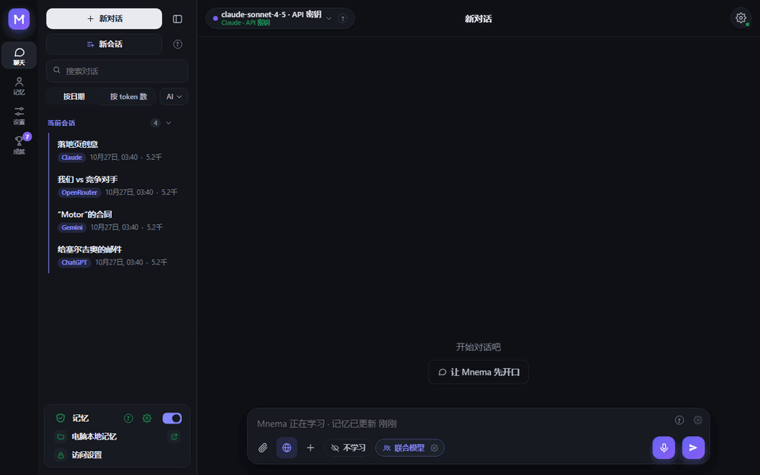
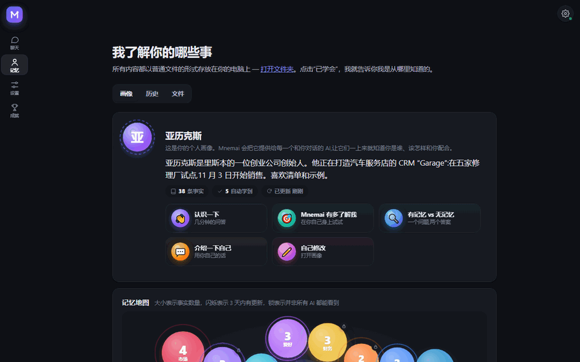
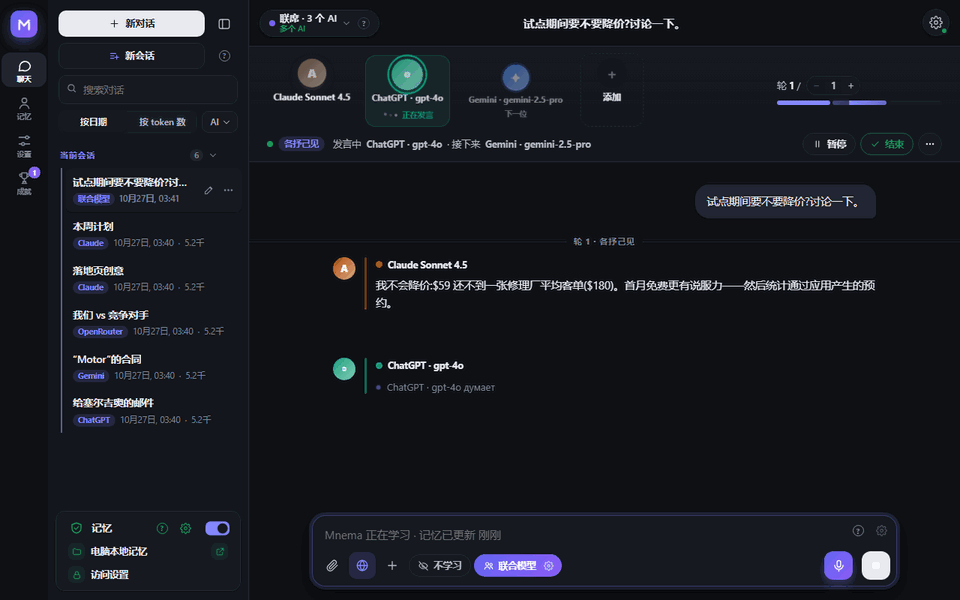
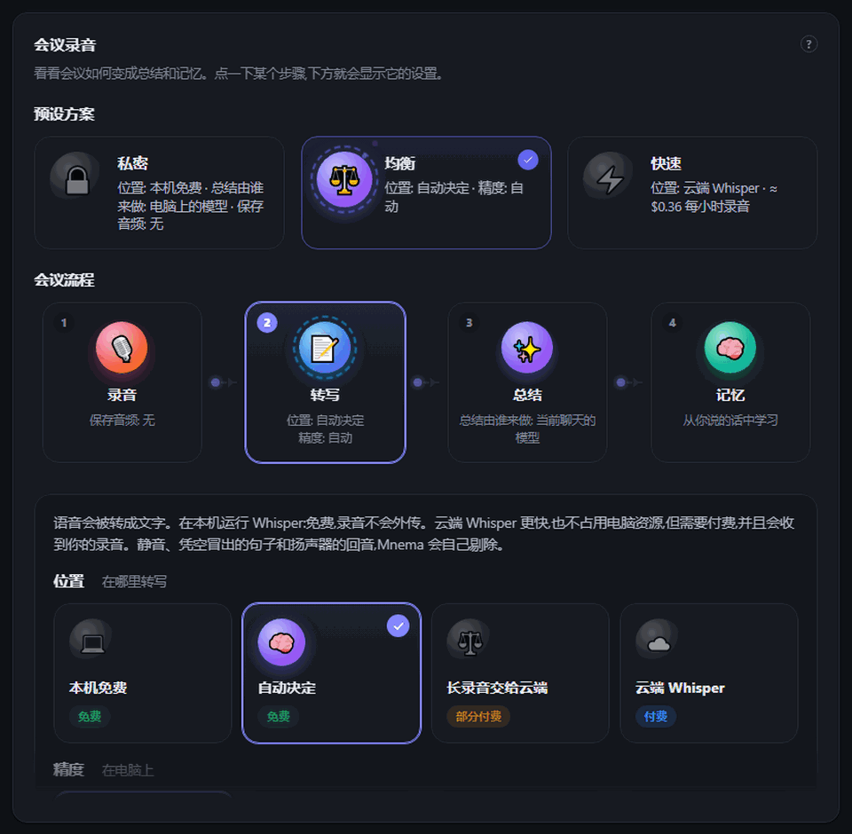
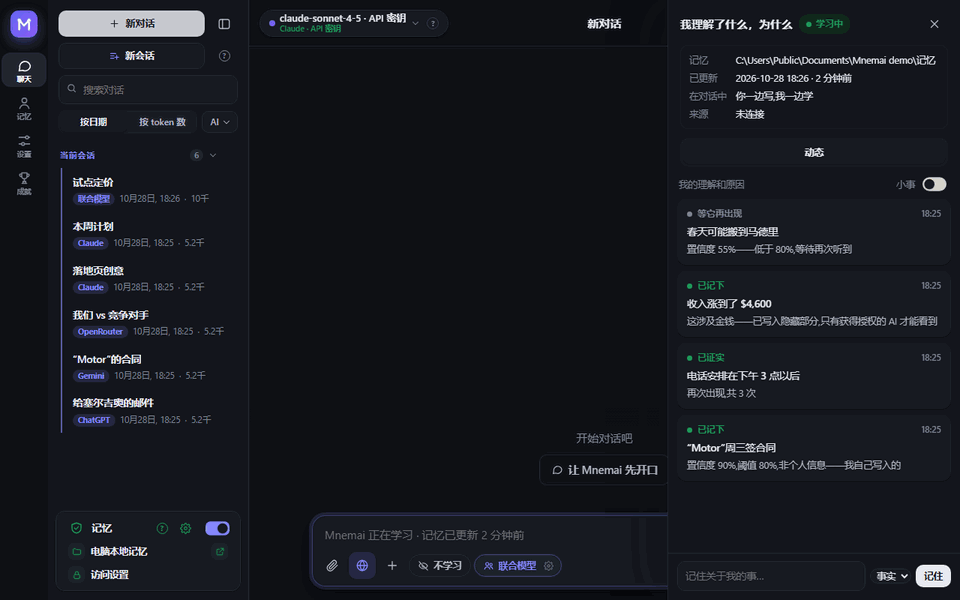
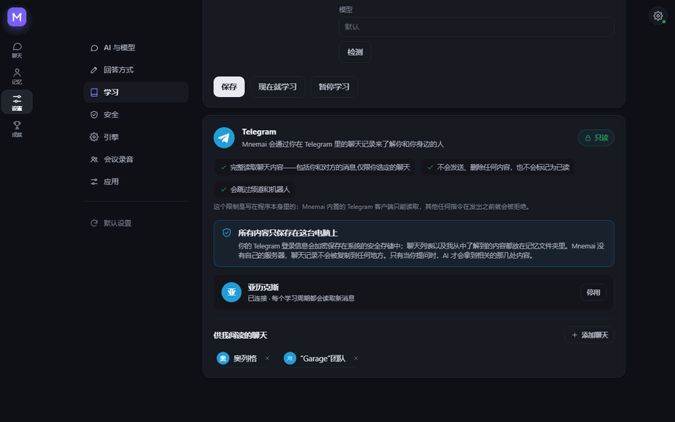
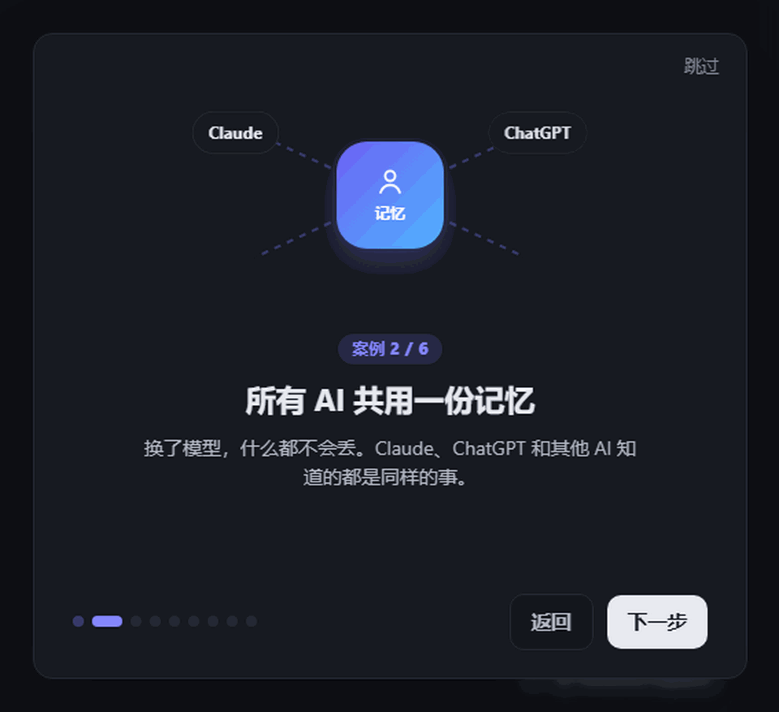
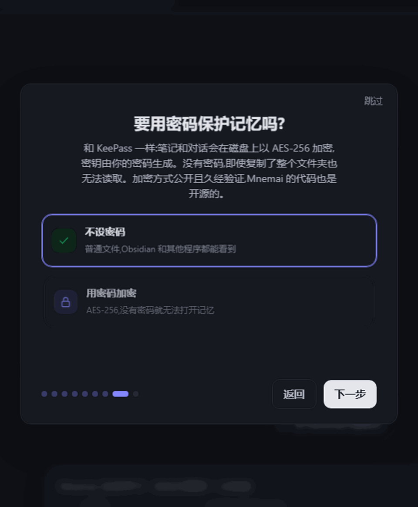
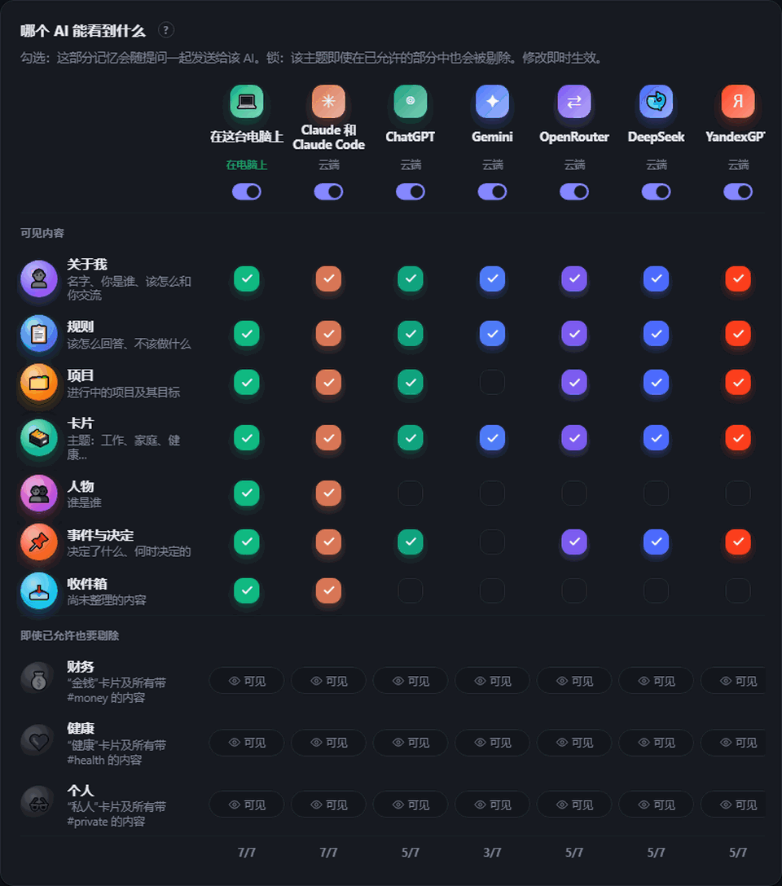

<div align="center">


# Mnema


<a href="https://github.com/Pumpetee/Mnema/releases/latest"></a> <a href="https://github.com/Pumpetee/Mnema/actions/workflows/tests.yml"></a> <a href="LICENSE"></a> <a href="https://github.com/Pumpetee/Mnema/commits/main"></a>

     

<a href="docs/guide/zh.md"></a>

<a href="https://github.com/Pumpetee/Mnema"></a><br><sub>扫码打开仓库 · github.com/Pumpetee/Mnema</sub>

</div>

## 语言

Mnema 支持九种语言。界面、帮助和 AI 的回答都会跟随你选的语言，即使你用另一种语言书写也一样。本 README 和 Mnema 指南都有对应的语言版本。

<table>
<tr><td align="center" width="10%"><br><b>English</b><br><sub><a href="README.md">README</a> · <a href="docs/guide/en.md">Guide</a></sub></td><td align="center" width="10%"><br><b>Русский</b><br><sub><a href="README.ru.md">README</a> · <a href="docs/guide/ru.md">Справочник</a></sub></td><td align="center" width="10%"><br><b>✓ 中文</b><br><sub><a href="README.zh.md">README</a> · <a href="docs/guide/zh.md">指南</a></sub></td><td align="center" width="10%"><br><b>Español</b><br><sub><a href="README.es.md">README</a> · <a href="docs/guide/es.md">Guía</a></sub></td><td align="center" width="10%"><br><b>हिन्दी</b><br><sub><a href="README.hi.md">README</a> · <a href="docs/guide/hi.md">गाइड</a></sub></td></tr>
<tr><td align="center" width="10%"><br><b>Português</b><br><sub><a href="README.pt.md">README</a> · <a href="docs/guide/pt.md">Guia</a></sub></td><td align="center" width="10%"><br><b>Français</b><br><sub><a href="README.fr.md">README</a> · <a href="docs/guide/fr.md">Guide</a></sub></td><td align="center" width="10%"><br><b>Deutsch</b><br><sub><a href="README.de.md">README</a> · <a href="docs/guide/de.md">Handbuch</a></sub></td><td align="center" width="10%"><br><b>日本語</b><br><sub><a href="README.ja.md">README</a> · <a href="docs/guide/ja.md">ガイド</a></sub></td></tr>
</table>

<div align="center">

Mnema 记得你是谁、在做什么、做过哪些决定，以及你喜欢什么样的回答——并且让你对话的每个 AI 都获得这些上下文。记忆就是你电脑上的一个纯 Markdown 文件夹。没有云端，无需账号。

<a href="../../releases/latest/download/Mnema-Setup.exe"></a> <a href="../../releases/latest/download/Mnema-macos-arm64.dmg"></a> <a href="../../releases/latest/download/Mnema-x86_64.AppImage"></a>

<sub><a href="../../releases">所有文件</a> · macOS Intel: <a href="../../releases/latest/download/Mnema-macos-x64.dmg">x64.dmg</a></sub>



<sub>你问“这周什么最重要？”——计划会以表格形式给出，带着已商定的价格和你关于会议的规则。你从没重新输入过它们。</sub>

</div>

## ✨ 它能做什么

<table>
<tr>
<td width="33%" valign="top"><h3>🧠 懂你</h3>每个 AI 都会先读的个人画像、活的记忆地图，以及归你所有的纯文件。</td>
<td width="33%" valign="top"><h3>🗣️ AI 议会</h3>Claude、ChatGPT 和 Gemini 互相讨论，最终达成一个答案。</td>
<td width="33%" valign="top"><h3>🎙️ 会议</h3>一通电话变成文字记录、摘要和有负责人的任务。</td>
</tr>
<tr>
<td width="33%" valign="top"><h3>🔐 私密</h3>像 KeePass 一样给记忆设密码。机密信息绝不会进入云端。</td>
<td width="33%" valign="top"><h3>💻 离线</h3>13 个免费模型在你的电脑上运行，无需密钥。</td>
<td width="33%" valign="top"><h3>📉 更少 token</h3>只有重要的内容才会发给模型：长合同场景下 token 减少 4.8 倍。</td>
</tr>
</table>

## 🧠 它懂你

<p align="center"></p>

- **每个 AI 都会先读的个人画像：**你是谁、在做什么、喜欢怎样的工作方式。Mnema 会在了解你的过程中撰写它，你也可以手动修改。
- **记忆地图：**每个话题是一个气泡，脉动表示最近有变化，锁表示部分 AI 看不到它。
- **旧事实不会冒充新事实：**每条事实都带有日期，超过一个月的状态，Mnema 会再次向你确认。
- **不止一个文件夹：**可以连接 Obsidian 库或团队文件夹——只读，程序本身会阻止写入。

## 🗣️ AI 议会：多个 AI，一个答案

<p align="center"></p>

- **议会、辩论、头脑风暴、红队、吐槽**——选好形式和轮数。
- **随时插话：**点“停止”会打断当前的 AI，并保留它已说的内容。
- **在任何回答下与不同的 AI 争论：**回答的作者负责辩护，其余的去找它哪里错了。

## 🎙️ 会议：从通话到任务

<p align="center"></p>

- **双音轨：**你的麦克风和电脑的声音，这样文字记录就知道是谁在说话。
- **免费在你电脑上运行 Whisper**，或使用云端 Whisper（约每小时 $0.36）——静音、凭空捏造的句子和回声都会被剔除。
- **摘要：**决定了什么、有哪些任务、由谁负责，可用你选的任何模型，包括本地模型。
- **预设：**私密、均衡、快速，一次设定整个流程。

## 🌱 它自己会学习

<p align="center"></p>

- **确定就保存：**有把握的事实（80% 及以上）会立即写入，存疑的则等待再次听到。
- **个人信息单独存放：**金钱、健康和私人事务会进入带标签的卡片，你可以对任何 AI 隐藏它们。
- **对你毫无隐瞒：**“我理解了什么，为什么”信息流会展示每个决定及其理由。

## ✈️ 读取 Telegram，从不在那里写入

<p align="center"></p>

- **由你选择聊天：**Mnema 只从这些聊天中了解你和你身边的人。
- **设计上就是只读：**Mnema 内的 Telegram 客户端只能读取；任何其他命令在发送前就会被拒绝。
- **留在你的电脑上：**登录信息加密存放在系统的存储中，Mnema 没有自己的服务器。

## 📉 节省 token

<p align="center"></p>

- **只发送重要的内容：**记忆、文档和网页都在你的电脑上读取，模型只会收到相关的部分。
- **实测数据：**针对一份 153,000 字符合同的提问，整篇文本占用 29,643 个输入 token；Mnema 只发送了 6,159 个，而且只有 Mnema 的回答是对的。
- **每次都看得见：**每个回答下方都会显示节省了多少 token。

## 🔐 天生私密

<table><tr><td width="50%" valign="top" align="center"><br><sub>首次启动：像 KeePass 一样给记忆设置密码</sub></td><td width="50%" valign="top" align="center"><br><sub>谁能看到什么：每部分记忆一个勾选，每个话题一把锁</sub></td></tr></table>

- **给记忆设密码：**AES-256，密钥由你的密码生成，采用开源密码学。没有密码，笔记无法读取，即使从磁盘上复制走也不行。同步的副本同样保持加密。
- **机密由你掌管：**银行卡号、密码、密钥和电话号码，在发送给云端模型之前都会变成标签。
- **每个 AI 都有各自的权限：**金钱、健康和私人话题，一键即可对任何 AI 隐藏。

## 🤖 兼容

<div align="center">
<table><tr><td valign="middle" width="150"><b>云端 AI</b><br><sub>通过密钥或订阅</sub></td><td align="center" width="92"><br><sub><b>Claude</b></sub></td><td align="center" width="92"><br><sub><b>ChatGPT</b></sub></td><td align="center" width="92"><br><sub><b>Gemini</b></sub></td><td align="center" width="92"><br><sub><b>DeepSeek</b></sub></td><td align="center" width="92"><br><sub><b>YandexGPT</b></sub></td><td align="center" width="92"><br><sub><b>OpenRouter</b></sub></td></tr><tr><td valign="middle" width="150"><b>在你的电脑上</b><br><sub>免费，离线</sub></td><td align="center" width="92"><br><sub><b>内置</b></sub></td><td align="center" width="92"><br><sub><b>Ollama</b></sub></td><td align="center" width="92"><br><sub><b>Strata</b></sub></td><td></td><td></td><td></td></tr><tr><td valign="middle" width="150"><b>在你的工具中</b><br><sub>通过 MCP</sub></td><td align="center" width="92"><br><sub><b>Claude Code</b></sub></td><td align="center" width="92"><br><sub><b>Cursor</b></sub></td><td></td><td></td><td></td><td></td></tr><tr><td valign="middle" width="150"><b>系统</b><br><sub>一个应用</sub></td><td align="center" width="92"><br><sub><b>Windows</b></sub></td><td align="center" width="92"><br><sub><b>macOS</b></sub></td><td align="center" width="92"><br><sub><b>Linux</b></sub></td><td></td><td></td><td></td></tr></table>
</div>

## ⚡ 还有更多

- **处理你的文件。**读取扫描件、撰写笔记、生成 PDF、Word 和 Excel，合并与拆分 PDF。每次写入都可以在“记忆 → 历史”中撤销。
- **九种语言。**界面和 AI 的回答都会跟随你选的语言，即使你用另一种语言书写也一样。

<details>
<summary><b>安装</b></summary>

下载适用于你系统的文件(所有带版本号的版本都在 [Releases](../../releases) 中):

| 系统 | 文件 | 方法 |
|---|---|---|
| Windows 10 和 11 | [`Mnema-Setup.exe`](../../releases/latest/download/Mnema-Setup.exe) | 直接运行即可,无需管理员权限。同时也提供便携版 `.zip`。 |
| macOS 11 及更高版本 | Apple Silicon:[`Mnema-macos-arm64.dmg`](../../releases/latest/download/Mnema-macos-arm64.dmg),Intel:[`Mnema-macos-x64.dmg`](../../releases/latest/download/Mnema-macos-x64.dmg) | 打开后将 Mnema 拖入“应用程序”文件夹。 |
| Linux x86-64(Ubuntu 22.04 及更高版本、Fedora、Debian……) | [`Mnema-x86_64.AppImage`](../../releases/latest/download/Mnema-x86_64.AppImage) | 执行 `chmod +x Mnema-*.AppImage` 后运行。同一程序的文件夹版本:`.tar.gz`,运行其中的 `Mnema` 即可。 |

这些安装包尚未进行代码签名,因此每个系统都会提示一次警告:

- **Windows** 的 SmartScreen 会显示“Windows 已保护你的电脑”。点击 **更多信息 → 仍要运行**。
- **macOS** 会提示无法验证开发者。在“应用程序”中右键点击 Mnema → **打开**,或打开“系统设置” → “隐私与安全性” → **仍要打开**。
- **Linux** 的 AppImage 需要 FUSE 2:`sudo apt install libfuse2`(Ubuntu 24.04 上为 `libfuse2t64`)。或者使用 `.tar.gz`。

要校验文件,请将其 sha256 与旁边的 `.sha256` 文件进行比对:Windows 上使用 `certutil -hashfile <file> SHA256`,macOS 上使用 `shasum -a 256 <file>`,Linux 上使用 `sha256sum <file>`。

</details>

<details>
<summary><b>从源码构建</b></summary>

Windows：

```powershell
python -m venv .venv
.venv\Scripts\pip install -r requirements-dev.txt
.venv\Scripts\python tools\fetch_vendor.py      # llama.cpp、Xray、WebView2，均来自官方发布并经过校验
.venv\Scripts\python -m mnema.desktop           # 运行程序
.venv\Scripts\python tools\package.py           # dist\Mnema-Setup-<version>.exe 以及便携版 zip
```

macOS 和 Linux：

```bash
python3 -m venv .venv
.venv/bin/pip install -r requirements-dev.txt
.venv/bin/python tools/fetch_vendor.py           # 适用于当前系统的 llama.cpp 和 Xray，经 sha256 校验
.venv/bin/python -m mnema.desktop                # 运行程序
.venv/bin/python tools/package.py                # macOS: dist/Mnema-<version>-macos-arm64.dmg
                                                 # Linux: dist/Mnema-<version>-x86_64.AppImage 以及 .tar.gz
```

每次推送都会在 Windows、macOS 和 Linux 上进行测试；三个安装包都会被构建，并带窗口启动一次，且作为本次运行的文件保留下来（`.github/workflows`）。

核心部分只需要 Python 标准库。它涵盖保险库（vault）、访问规则、日志、MCP 服务器和命令行：

```bash
python -m mnema init ~/mnema --default
python -m mnema serve                    # http://127.0.0.1:7461
python -m mnema install claude-code      # shows the plan; add --apply

</details>

<details>
<summary><b>它是如何构建的</b></summary>

参见 [docs/ARCHITECTURE.md](docs/ARCHITECTURE.md)。简而言之:

| 部分 | 位置 |
|---|---|
| 记忆库(Vault):文件夹、事实、带隐藏标签的章节 | `mnema/vault.py`, `mnema/memory.py` |
| 每个 AI 的访问规则 | `mnema/clients.py` |
| 日志与撤销 | `mnema/journal.py` |
| MCP 服务器、命令行 | `mnema/mcp_server.py`, `mnema/cli.py` |
| 本地 API 与窗口 | `mnema/api*.py`, `mnema/desktop.py` |
| 界面 | `mnema/ui/index.html`, `mnema/ui/css/app.css`, `mnema/ui/js/NN-*.js`(按顺序加载) |
| 与任意模型聊天、联合会诊(consortium)、对文件的操作 | `mnema/chat/` |
| 学习:来源、大脑、决策 | `mnema/learn/` |
| 离开本机的内容 | `mnema/outgoing.py` |
| Windows、macOS 与 Linux 之间的差异 | `mnema/osapi.py` |
| 通过密码对记忆进行加密 | `mnema/crypt.py` |
| 扫描件与图片中的文字 | `mnema/ocr.py` |
| 助手用于回答问题的知识库 | `mnema/knowledge/mnema.md` |

</details>

<details>
<summary><b>安全</b></summary>

本地 API 仅监听 127.0.0.1,会检查 Host 头,并要求提供令牌。通过链接打开的页面和 VPN 订阅只能从互联网访问,绝不会从本机或本地网络访问。密钥和密码保存在系统的密钥存储中(Windows 上为 DPAPI,macOS 上为 Keychain,Linux 上在可用时为 Secret Service),绝不会存放在记忆文件夹中。记忆本身可以用密码加密(AES-256-GCM,密钥由 scrypt 保护);加密记忆的同步只会发送加密后的文件。每一次发往云端模型的请求都会被记录,包括发送了什么内容以及隐藏了什么内容。请私下向作者报告漏洞。

</details>

## 许可证

AGPL-3.0。个人使用及开源项目可免费使用。商业许可证和团队版可向作者获取。

© 2026 Anton Sannikov

<div align="center">


<sub>如果 Mnema 为你记住了有用的东西，点个 ⭐ 可以帮助更多人发现它。</sub>
</div>
